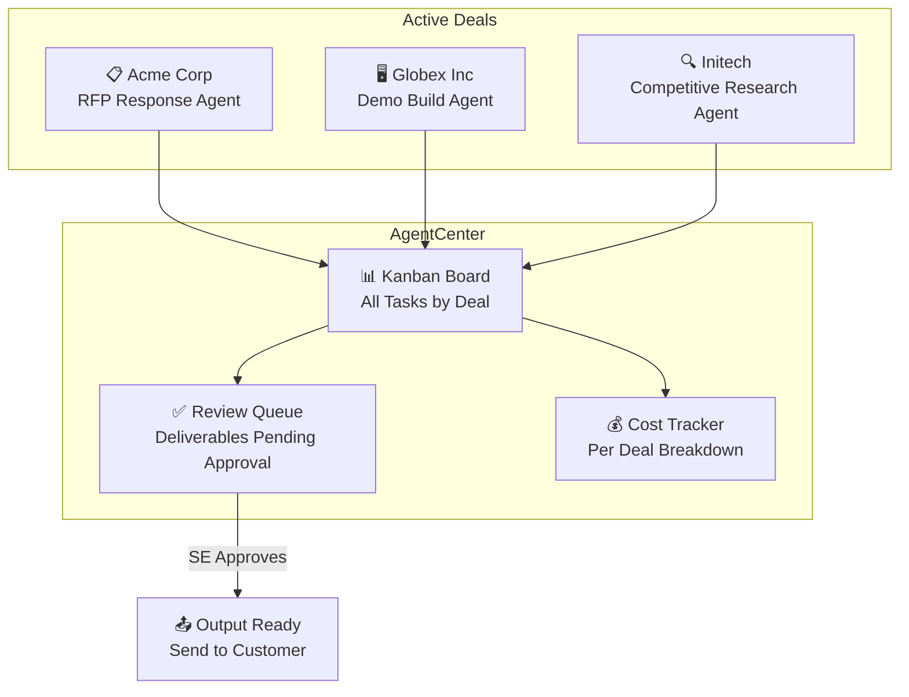

Solutions engineers run on parallel tracks. At any given point in a quarter, a busy SE might be prepping a custom demo for one account, answering a 200-question RFP for another, and waiting on competitive research for a third. AI agents for solutions engineering teams make this workload manageable. But they also create a new coordination problem nobody warns you about.

When you have six agents running across four different deals and you have a call in 45 minutes, you need to know: what finished, what needs review, and what broke. A folder of output files doesn't tell you that.

## What Breaks Without a Control Plane

**RFP agents finish and nobody knows**

An RFP response agent can work through 200 questions in under an hour. The problem isn't the output — it's that the agent completes, drops a file somewhere, and the SE finds out three hours later when they happen to check. If the response had factual errors or needed sign-off before going to the customer, those things don't happen automatically.

**Demo environment agents finish while you're mid-call**

You kick off an agent to build a custom demo environment: populate it with sample data matching the prospect's industry, configure integrations, prep the UI. The agent finishes. You're talking to a different customer. You go into the next call not knowing whether the demo is ready.

**Competitive research goes stale and you don't catch it**

A research agent ran Tuesday. It's Friday afternoon, and a competitor just announced something new. Your notes are from Tuesday. You find out mid-call when the prospect mentions it.

These aren't agent failures. They're coordination failures — the kind that a control plane is built to prevent.

## How Solutions Engineering Teams Use AgentCenter

**Kanban board — visibility across your whole pipeline**

Solutions engineers don't work on one thing. The [task management board](/features/task-orchestration) in AgentCenter gives you a single view of every agent task across every active deal. Cards are labeled by account. Status is live. Before you jump on a call, you check the board, not your terminal.

**Deliverable review — nothing goes out unreviewed**

The biggest risk in solutions engineering is sending a customer something wrong. An agent-generated RFP response that contains a hallucinated feature, or a proposal with the wrong architecture, can kill a deal. AgentCenter's deliverable review workflow means the agent's output lands in your queue before it goes anywhere. You review, you approve, then it leaves.

For RFP work specifically: set up a review step that flags responses containing technical claims that need verification. The agent handles the 200 answers. You focus on the 14 that need your judgment.

**Real-time status — know before you get on the call**

[Agent monitoring](/features/agent-monitoring) shows you every agent's current state: working, idle, blocked. Two minutes before a demo call, you check. Your demo environment agent is idle. It finished. You're clear to go.

That's a small thing that removes a large amount of anxiety from SE work.

**Cost tracking — which deals are expensive to pursue**

Solutions engineering has real costs that rarely get tracked. A complex technical evaluation with multiple demo cycles, custom integrations, and security review agents can consume 3x the agent budget of a simpler deal. AgentCenter tracks cost per task. Over a quarter, you'll start to see which deal types are worth the investment.

**@Mentions for handoffs to AEs and CSMs**

When a deal closes, the technical context needs to move to the post-sale team. Mentioning the CSM on relevant task threads means they get the agent outputs, the review notes, and the decisions that were made — without a separate handoff document.

## The Numbers

A solo SE typically runs 5-15 agents across their active pipeline in any given month. A team of three SEs with a busy book of business might coordinate 40-60 agent tasks during a peak quarter. Short-lived tasks — spin up, run, review, close — are the norm.

The Starter plan (5 agents, $14/month) covers an SE with a focused pipeline. The Pro plan (15 agents, $29/month) handles a higher-volume SE or a small SE team. See [pricing](/pricing) for the full breakdown.

What it replaces: a Slack channel full of links to output files, a shared Notion doc tracking what's running, and a lot of anxious tab-switching before calls.

## Before vs After

| | Without AgentCenter | With AgentCenter |
|---|---|---|
| Visibility | Output files scattered across folders | Kanban board with all tasks by deal and live status |
| Task handoffs | Share a Notion link, hope the AE reads it | Mention teammates inside the task thread |
| Error detection | Review manually before every send | Deliverables land in a review queue automatically |
| Cost tracking | No per-deal breakdown | Task-level cost visible per account |
| Debugging time | Check logs or re-run to see what happened | Activity feed per task with full history |

## Where to Start

Set up the deliverable review workflow before you run your first production agent. Solutions engineers are accountable for accuracy — one wrong claim in a proposal is a trust problem, not just a typo. Building the review step in from the start is faster than adding it later.

After that, build your task naming convention: `[Account Name] - [Task Type]` keeps the kanban board readable as your pipeline grows.

---

*Solutions engineering teams that add a control plane early spend less time firefighting later. [Start your 7-day free trial](/pricing).*
