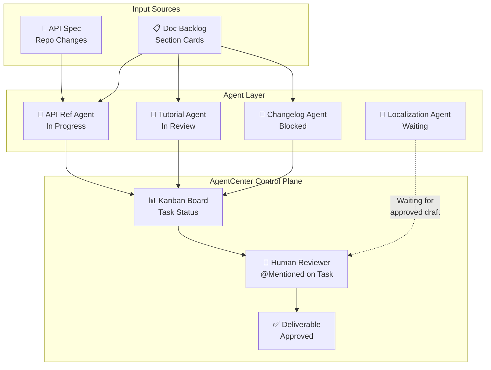

Technical documentation teams run more agents than most people realize. One drafts API reference pages from an OpenAPI spec. Another checks tutorial pages against the codebase and flags anything that's drifted. A third handles changelogs. A fourth is doing localization across three languages.

At two or three agents, you can track this in your head. At nine, you can't.

When a documentation team at a mid-size SaaS company gets past six agents, the cracks start showing. The getting-started guide gets rewritten twice because two agents ran against different versions of the spec. An agent processing section four of the integration guide stalls waiting on a code review, nobody sees it's blocked, and that section ships a week late. The changelog agent fails silently at 11pm and nobody notices until release day when the changelog is empty.

These aren't edge cases. They're what happens when you scale AI agents for technical documentation without a control plane.

## What Breaks Without Visibility

Technical documentation teams hit three specific problems as agent count grows.

**Version drift.** Your API reference agent pulls the spec at midnight. Your tutorial agent pulls it at 9am. By the time both finish, they're describing different parameter behaviors because the spec changed between those two runs. Neither agent logged which version it used. You find out two days later when a developer files a discrepancy report.

**Duplicate work.** An agent processing your authentication guide gets stuck waiting on a code change. Someone on the team doesn't see it's blocked and manually restarts it. Now two instances are processing the same section. Both deliver outputs. You spend an hour reconciling two drafts before you can decide which one to publish.

**Silent failures.** The changelog agent hit a rate limit at 11pm and exited without writing anything. The log is somewhere in your API provider's dashboard. Nobody looked. The changelog page didn't get updated. You find out at the next team standup when someone asks why the release notes are missing.

Once you're running eight agents or more, something from that list happens every week.

## How AgentCenter Handles a Documentation Workflow

The problem isn't the agents. It's the gap between agents, where tasks hand off between systems and humans need to know what's happening without checking three different dashboards.

**Kanban board for task ownership.** Every documentation section gets a card: getting started, API reference, authentication, changelog, tutorials. Each agent picks up its card, moves it to in progress, and moves it to review when done. Writers see the full board at a glance without asking anyone for status updates. When two agents are assigned to the same card, you catch it immediately.

**Real-time agent status.** If your API reference agent went idle at 10am and it's now 3pm, AgentCenter shows that. You don't have to poll API logs or wait for something to go wrong. You see it's stalled, you investigate, and you fix it before the API reference ships with missing content. The [agent monitoring dashboard](/features/agent-monitoring) shows status, cost, and recent output per agent in one view.

**Task handoffs with @mentions.** When the doc-writing agent finishes a draft, it @mentions the assigned reviewer inside the task thread. The reviewer gets notified, opens the task, reviews the draft, and marks it approved or leaves comments. The conversation is attached to the task, not buried in Slack or email.

**Deliverable review inside the tool.** Agents submit completed drafts as deliverables inside AgentCenter. Writers open the deliverable, read it, and approve it or request revisions. You can see the full history of what each agent produced and when, which makes it easy to spot if the same content was generated twice.

**Per-agent cost tracking.** Documentation teams share API budgets and often discover they've overspent at month end. AgentCenter breaks costs down by agent, so you can see if your API reference agent costs four times more than your changelog agent and investigate why before the bill is a surprise. When you're running localization across four languages, knowing per-language cost per run matters.

## The Numbers for Documentation Teams

A documentation team of four to six writers typically runs 8 to 15 agents: one per major section, plus changelog, localization, and QA agents. The Pro plan ($29/month, up to 15 agents and 15 projects) fits most teams. If you're running localization across six languages with separate agents per language, Scale ($79/month, up to 50 agents) is the right fit.

What it replaces: shared spreadsheets tracking which sections are processed, Slack threads for agent status updates, manual checks in API provider dashboards to see if an agent ran and what it returned.

Check [AgentCenter features](/features) to see how task management and deliverable review work together.

## Before vs. After

| | Without AgentCenter | With AgentCenter |
|---|---|---|
| Visibility | Manual log checks and Slack updates | Real-time Kanban board per agent |
| Task handoffs | Email or Slack DMs to reviewer | @mentions on the task thread |
| Error detection | Notice days later when content is wrong | Idle/blocked status visible immediately |
| Cost tracking | Monthly API invoice with no breakdown | Per-agent cost tracking |
| Time spent debugging | 2 to 4 hours per incident | 20 to 30 minutes |

## Where to Start

Set up the Kanban board first. Create one card per major documentation area: getting started, API reference, changelog, and tutorials. Assign each card to its agent. You'll immediately see which areas have active agents, which are idle, and which sections have no agent assigned at all.

That one view catches the most common problem: an agent that went quiet and nobody noticed. Once you can see what each agent is doing, you can start wiring up @mention handoffs between agents and human reviewers so nothing waits in a queue that nobody's watching.

---

*Technical documentation teams that add a control plane early spend less time firefighting later. [Start your 7-day free trial](/pricing).*
