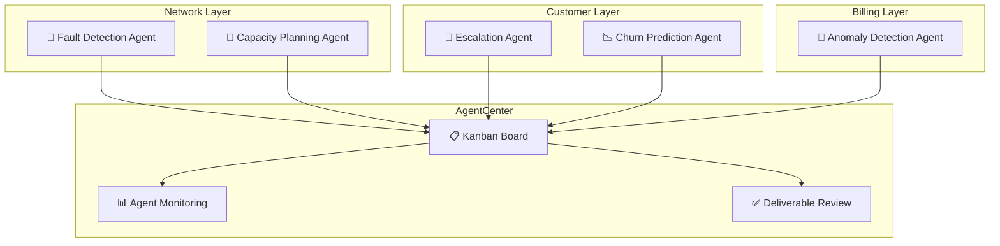

Telecom operations teams are running more AI agents than almost any other technical function. Network fault detection agents. Billing anomaly agents. Churn prediction agents. Customer escalation agents. Capacity planning agents. You deploy them because the volume of signals, tickets, and alerts is simply too high for humans to process in real time.

Then you get to month three and realize you have no idea which agents are actually doing useful work.

## The Problem at Scale

A mid-sized telecom ops team — managing regional infrastructure, billing systems, and first-level customer support automation — typically runs 15 to 40 active agents. Those agents touch different systems: network management platforms, CRM, billing infrastructure, ticketing systems. Some run continuously. Some trigger on alerts. Some are chained together.

Without a control plane, here's what breaks.

**You lose visibility into handoffs.** Your network fault agent detects an anomaly and hands it off to a ticket-creation agent. That agent queues a task for a remediation agent. If anything fails in that chain, you find out when the SLA clock runs out, not when the handoff fails.

**You can't see cost by agent.** You get a monthly LLM bill. You know the total. You don't know that your churn prediction agent is consuming 60% of it because someone changed its prompt to include full call transcripts.

**Debugging takes days, not hours.** A billing agent incorrectly flags a batch of enterprise accounts for manual review. You know the output is wrong. You don't know whether the fault is in the agent's prompt, the upstream data it received, or the API call it made. You're reading raw logs across three systems.

## How AgentCenter Fits Into Telecom Ops Workflows

### Real-time agent status

Every agent shows its current state: online, working, idle, or blocked. When your fault detection agent goes idle during a peak alert window, you see it immediately — you don't wait for someone to notice alerts aren't getting processed.

For telecom ops, this matters most at 2am when a network event fires and you need to know whether your detection-to-remediation pipeline is actually running.

### Task orchestration with visible handoffs

AgentCenter's [task orchestration](/features/task-orchestration) lets you wire agents together with explicit task dependencies. When a fault detection agent creates a task and hands it to a ticketing agent, that handoff is tracked. If the ticketing agent fails, the fault shows up in the Kanban board as a blocked task — not as a silent gap in your remediation flow.

Compare that to the current reality for most telecom ops teams: you find out about handoff failures from customers, not from your own systems.

### Agent monitoring with cost visibility

The [agent monitoring dashboard](/features/agent-monitoring) breaks down performance and token spend per agent. For a telecom team running five or six distinct agent types, this means you can see:

- Which agent is consuming the most compute time
- Which one has the highest error rate
- Whether a specific agent's output quality dropped after a prompt change

When your billing anomaly agent starts flagging 300% more accounts than usual, you catch it the same day, not after the false positives have already hit the review queue.

### Deliverable review for high-stakes outputs

Telecom ops agents often produce outputs that feed into billing decisions, customer communications, or network changes. You don't want those going straight to production without a review step.

AgentCenter's approval workflows let you route specific agent deliverables — say, any churn intervention recommendation or billing adjustment — through a human sign-off before they execute. You get speed without losing control.

### @Mentions and task threads

When something goes wrong with an agent task, you need to pull in the right person fast. AgentCenter's @mentions let you tag a specific engineer on a task thread directly in the dashboard. No hunting through Slack channels to find who owns the billing agent this week.

## The Numbers for Telecom Ops Teams

A typical telecom ops team running AI agents in production has:

- **15–40 active agents** covering network, billing, and customer layers
- **Multiple concurrent pipelines**, some running 24/7, some triggered by events
- **3–5 team members** who need visibility across all of it

The **Pro plan at $29/mo** covers up to 15 agents — right for teams consolidating their initial fleet. The **Scale plan at $79/mo** fits teams at 20+ agents running across multiple projects. See [full pricing details here](/pricing).

What it replaces: custom scripts checking agent status, manual log reviews, spreadsheets tracking which agents ran when, and ad-hoc Slack messages asking "is the billing agent still up?"

## Before vs After AgentCenter

| | Without AgentCenter | With AgentCenter |
|---|---|---|
| **Visibility** | Log files and manual checks | Real-time status per agent, all in one dashboard |
| **Task handoffs** | Silent failures discovered after the fact | Tracked dependencies with visible blocked states |
| **Error detection** | Alerts from downstream systems or customers | In-dashboard error flags per agent, same-session |
| **Cost tracking** | Monthly bill, no breakdown by agent | Per-agent token spend visible at any time |
| **Debugging time** | Hours to days tracing logs across systems | Drill into a specific task and its full output history |

## Where to Start

If your team is new to AgentCenter, set up [agent monitoring](/features/agent-monitoring) first. Connect your existing agents and watch what the status view shows you over 48 hours. Most teams see at least one agent behaving unexpectedly within the first day — stuck, silent, or burning tokens on something it shouldn't be.

That first unexpected finding is the whole argument for having a control plane.

---

*Telecom ops teams that add a control plane early spend less time firefighting later. [Start your 7-day free trial](/pricing).*
