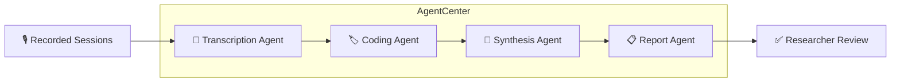

You finish a usability study on a Friday. 38 recorded sessions. Each one needs a transcript, theme codes, and a written summary before Monday's product review.

Managing AI agents for UX research is deceptively straightforward until something breaks. You have agents for transcription, coding, and synthesis. They've been running for two weeks. Your problem isn't building them — it's knowing when one stops.

## The Pipeline That Fails Quietly

UX research workflows are sequential by nature. Transcription feeds into coding. Coding feeds into synthesis. Synthesis feeds into the stakeholder report. If anything in that chain fails without a signal, you don't find out until someone asks a question the data can't answer.

Without a control plane, here's what breaks:

**Silent gaps.** Your transcription agent processes 35 out of 38 sessions, then fails on 3 files with unusual audio encoding. The coding agent picks up the 35 completed transcripts and runs. The synthesis agent produces a complete-looking report. It's missing 3 participants — two of whom were your most critical edge cases — and nobody knows until the PM asks why two user flows aren't in the findings.

**No cost visibility.** You're paying per-token at every stage. A standard 45-minute interview costs roughly $0.35 in transcription plus coding. A 2-hour session with a detailed participant? Could be $1.20. Multiply across 38 sessions, three stages, and sprint after sprint. Without per-task breakdowns, you're reading the monthly LLM bill and guessing where it came from.

**Hung agents with no signal.** Your synthesis agent handles large batches slowly. Sometimes it finishes in 40 minutes. Sometimes it doesn't finish at all. It sits there. You check back after 3 hours and find it stalled on session 14. The whole research report is blocked.

## How an AI Agent Control Plane Fits a Research Workflow

### Kanban Board — See Every Interview's Status

The [Kanban board](/features/task-orchestration) maps directly to how research pipelines move. Each interview is a task. You create columns for Queued, Transcribing, Coding, Synthesizing, and Ready for Review.

Every task shows which agent is handling it and where it sits in the pipeline. When the coding agent finishes session 22 but session 19 is still in the Transcribing column at hour 6, you don't need to dig through logs — you can see it on the board.

This replaces the spreadsheet that half your team uses to track interview status and the other half ignores.

### Real-Time Agent Status — Catch Stalls Early

AgentCenter shows each agent as online, working, idle, or blocked in real time. When your synthesis agent goes idle mid-batch, you see it within minutes.

You can also set task timeouts. If synthesis takes more than 90 minutes on a standard batch, you get flagged. The agent doesn't silently hang — it surfaces the problem so you can restart it before the afternoon is gone.

### Cost Tracking — Per Interview, Per Stage

[Agent monitoring](/features/agent-monitoring) breaks down token spend by task. You can see that session 31 cost $1.40 in transcription because the participant spoke for 2 hours and 10 minutes. You can see the total cost for last week's 38-session study broken down by stage.

When a new research sprint costs 60% more than last month's and your manager asks why, you have the answer in two clicks.

### Deliverable Review — QA Before It Reaches the PM

Research synthesized by agents isn't always right. A coding agent might miss a recurring frustration that appears across 8 sessions because the exact phrasing varies. The synthesis agent might overweight sessions from early in the batch and underrepresent later ones.

AgentCenter's deliverable review workflow routes every synthesis output to a researcher before it goes anywhere. The researcher approves, requests a revision, or adds a comment. The PM gets the output after a human has looked at it — not raw agent output with "looks good" assumed.

This is how you catch a synthesis agent that tagged 12 out of 38 sessions with the wrong theme before the product team builds a roadmap based on it.

## The Numbers for a UX Research Team

A team running a full research pipeline typically operates 8 to 12 agents: transcription, speaker diarization, coding, synthesis, insight tagging, clip extraction, and stakeholder summary formatting.

The [Pro plan at $29/month](/pricing) covers 15 agents. That's less than one billable research hour per month.

What it replaces: manual status tracking in Notion, separate cost reports from your LLM provider, researcher-to-PM status updates on Slack, and the "did the agent finish?" check-ins that interrupt everyone's afternoon.

## Before vs After

| | Without AgentCenter | With AgentCenter |
|---|---|---|
| **Visibility** | Check Slack, rerun scripts, or ask whoever built the agents | Kanban board shows every interview's current stage |
| **Task handoffs** | Hope the coding agent picked up all transcription outputs | Task status confirms each handoff completed |
| **Error detection** | Find out at report review that 3 sessions are missing | Flagged the moment the transcription agent stalled |
| **Cost tracking** | Monthly LLM bill with no per-task breakdown | Per-task token cost by session and stage |
| **Debugging time** | 2-4 hours reconstructing what happened | Agent logs and task history in one place |

## Where to Start

Set up the Kanban board first. Create one column per pipeline stage and connect your agents to it. Even before cost tracking or automated alerts are configured, you'll immediately see where interviews pile up and which stages finish faster than expected.

Once the pipeline is visible, the stalls become obvious. That's the first problem worth solving.

---

*UX research teams that add a control plane early spend less time firefighting later. [Start your 7-day free trial](/pricing).*
