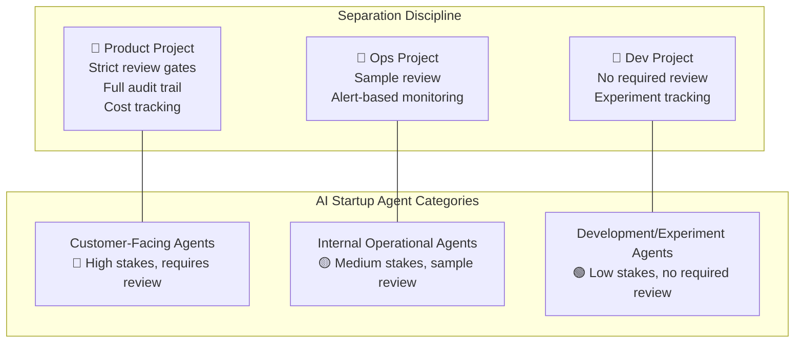

AI startups are in an unusual position. They're building products with AI agents, which means they're often building the infrastructure to run those agents at the same time. You're shipping customer-facing features, and also figuring out how to monitor the agents that power those features, and also responding to incidents when agents fail.

It's a lot to hold at once with a team of 4-8 people.

The temptation is to defer operational discipline until "when we scale." That deferral is expensive. By the time you're at scale, you have technical debt in your agent infrastructure that's painful to fix under pressure.

## The Specific Bottlenecks AI Startups Hit

**Product agents and internal agents mixed together.** The same engineering team is running agents that power the customer product and agents that do internal work (research, content, analysis). With no separation, it's easy to lose track of which agents are customer-facing and which aren't — and to apply the same operational rigor to both when they have different consequences.

**Growth breaks things.** An agent that works fine at 100 tasks/day behaves differently at 1,000 tasks/day. Most startups don't load test before they need to. The first indication that scale is a problem is a production incident after growth.

**Customer-specific customizations.** As you add customers, you add agent customizations. Different prompts per customer segment. Different review gates for enterprise vs self-serve. Without a structured way to manage this, you end up with a growing collection of one-off configurations that's hard to maintain.

## How AgentCenter Addresses AI Startup Needs

**Project separation for different agent types.** Customer-facing agents in one project (strict review, full audit trail). Internal agents in another project (lighter review, alert-based). Experiment agents in a third project (no required review). Different governance for different stakes.

**Scale-ready from the start.** The [task orchestration](/features/task-orchestration) and agent status monitoring in AgentCenter don't change as your volume grows. You instrument once, and the tooling handles increased volume. No rebuilding monitoring infrastructure when you hit 10x your early user count.

**Deliverable review workflow that PMs can use.** At startups, it's often a product manager or a non-engineer who reviews customer-facing agent outputs. AgentCenter's review interface works for non-engineers. You don't need an engineer to approve a marketing deliverable.

## Feature-to-Workflow Mapping

| AI Startup Challenge                 | AgentCenter Feature       | How It Helps                      |
| ------------------------------------ | ------------------------- | --------------------------------- |
| Product vs internal agent separation | Multi-project workspaces  | Different governance per project  |
| Customer-facing quality control      | Deliverable review gate   | Required approval before delivery |
| Scale preparation                    | Architecture built for it | No rework when volume grows       |
| Cost per customer                    | Per-project cost tracking | Know your per-customer AI spend   |
| PM involvement in review             | Non-engineer dashboard    | No engineering required to review |
| Agent fleet growth                   | Scale plan (50 agents)    | Room to grow without migration    |

## The Numbers

An early-stage AI startup typically runs 5-15 agents: product features, internal tooling, and experiments. The [Pro plan](/pricing) at $29/month handles 15 agents across 15 projects — giving you room to separate customer-facing, internal, and experimental workloads cleanly.

For startups with multiple product lines or customers with separate configurations, Scale at $79/month handles 50 agents and 50 projects. At $79/month, that's less than a day of engineer time per month to maintain — which is what you'd otherwise spend on custom monitoring infrastructure.

## Before vs After AgentCenter

|                    | Without AgentCenter   | With AgentCenter              |
| ------------------ | --------------------- | ----------------------------- |
| Visibility         | Logs and hope         | Real-time status              |
| Task handoffs      | Custom code           | Built-in orchestration        |
| Error detection    | User complaints       | Review gate + alerts          |
| Cost tracking      | Monthly provider bill | Per-customer, per-project     |
| Scaling operations | Rework when you grow  | Built for growth from day one |

## Where to Start

Start with your most customer-facing agent. Not your most complex one — your most consequential one. The agent whose output, if wrong, a customer notices immediately. Put a review gate on that agent first.

After 30 days, you'll have a rejection rate baseline. That baseline tells you how often the review gate is catching something before it reaches the customer. That number makes the business case for extending the review gate to other agents.

_AI startup teams that add a control plane early spend less time firefighting later. [Start your 7-day free trial](/pricing)._
