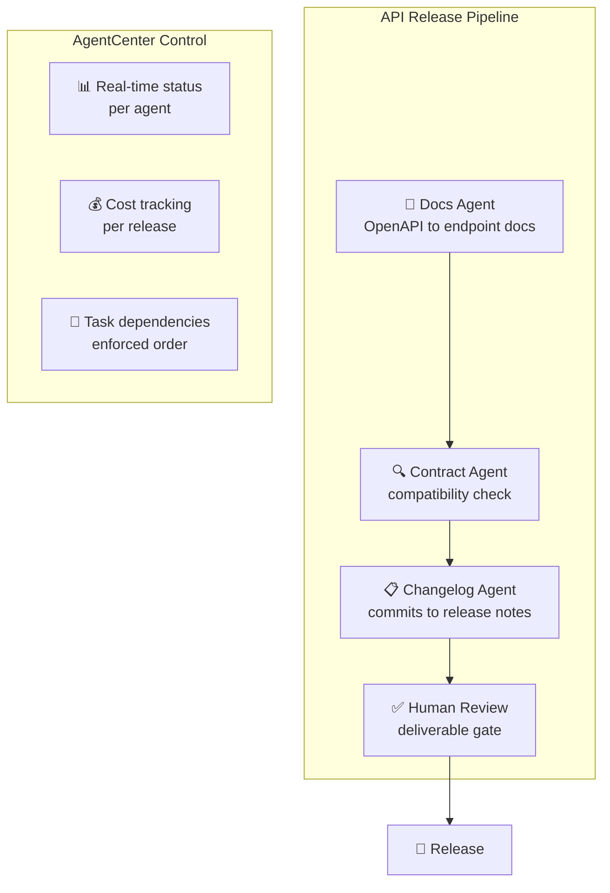

If you run an API product, you're probably already using agents somewhere. A docs generation agent that pulls from your OpenAPI spec. An agent that drafts the changelog entry for each release. Maybe a contract testing agent that checks whether your v2 routes are backward-compatible before you ship.

Each of those agents is useful. The problem is knowing whether they ran, whether the output was any good, and which one failed at 11pm when you were mid-release.

That's the real problem API product teams hit — not building agents, but watching them.

## The Bottleneck Isn't Building Agents, It's Visibility

Here's what an API product team's agent problems look like in production.

**Documentation lag.** Your docs agent runs after every merge to main. It generates endpoint descriptions, code samples, and parameter tables. But when it fails silently — because the OpenAPI spec has a malformed field — nobody knows. Developers hit your docs and get stale content from two releases ago. The agent ran. The output was bad. You had no review gate.

**Changelog gaps.** You have an agent that drafts changelog entries from git commits and PR titles. It works great when commits are clean. When a junior engineer writes "fix stuff" on 14 commits in a row, the agent produces a changelog entry that says almost nothing. That entry ships to your developer newsletter with zero review, and you spend the next morning fielding confused questions from API consumers.

**Contract test blindness.** You run a compatibility-check agent before every breaking change. It catches regressions in your request/response contracts. But the agent takes 25 minutes and sometimes hangs on large schema diffs. You have no visibility into whether it's running, stuck, or done. Half your team starts pinging each other on Slack asking "did the contract agent finish?"

These aren't agent logic problems. They're control plane problems. The agents work. You just can't see them.

## How API Product Teams Manage Agents in AgentCenter

**Kanban board across your release pipeline.** Every API release becomes a project in AgentCenter. The docs agent, contract agent, and changelog agent each get a task. You can see at a glance whether each one is running, idle, or blocked. When the contract agent hangs on a large schema diff, it shows as blocked on the [task board](/features/task-orchestration) — not invisible in a cron log nobody checks. Task dependencies enforce the right order: the changelog agent won't start until the contract agent finishes.

**Deliverable review on the changelog agent.** This is where API product teams see the most immediate return. You configure the changelog agent to submit its draft as a deliverable in AgentCenter before it ships anywhere. Your team reviews it in two minutes, approves it, and it goes out. No more developer newsletters with empty changelog entries. The review gate takes 10 minutes to set up and catches problems on every release.

**Real-time status on long-running agents.** The contract testing agent runs for up to 30 minutes on complex schema diffs. Instead of Slack pings asking "is it done?", everyone sees live status in the [agent monitoring](/features/agent-monitoring) view. When it finishes, the task moves to review automatically. When it hangs, you get an alert before it blocks the release.

**Per-release cost tracking.** API products grow in surface area. What costs $4 per release with 20 endpoints can cost $27 per release with 200. AgentCenter tracks token spend per agent, per task. You see exactly which agent is driving cost growth as your API expands — usually the contract agent — and decide whether to scope it differently.

## The Numbers for API Product Teams

A typical API product team runs 6–12 agents. During a major release: a docs generation agent, a changelog agent, a contract testing agent, an SDK example generator, and usually a diff agent that produces a human-readable summary of every breaking change.

That puts most API product teams on the **Pro plan ($29/mo, 15 agents)**. Teams shipping across multiple API versions simultaneously — v1, v2, and v3 beta — will need the Scale plan to keep agents across all three release tracks in separate projects.

What AgentCenter replaces: scattered cron jobs, manual Slack status pings, a Notion table tracking "did X agent run on Y release", and whoever's job it was to manually sanity-check the contract agent output before release.

See the [full plan comparison](/pricing) if you're deciding between Pro and Scale.

## Before vs After

| | Without AgentCenter | With AgentCenter |
|---|---|---|
| **Visibility** | Check cron logs, ask on Slack | Live status per agent on the release board |
| **Task handoffs** | Manually trigger each agent in sequence | Task dependencies enforce order automatically |
| **Error detection** | Agent fails silently, bad output ships | Alert on failure, review gate before output ships |
| **Cost tracking** | No idea what each release costs in API spend | Per-agent, per-release cost breakdown |
| **Debugging time** | 30–45 min tracing which agent produced bad output | Task thread shows input, output, and failure reason |

## Where to Start

If you're adding AgentCenter to your API release pipeline, start with the changelog agent.

Set it up as a task with a deliverable review gate. Have the agent submit its draft as a deliverable instead of shipping it directly. Add one reviewer. Ship only after approval.

That single change surfaces bad agent output before it reaches your developers. It also gives your team a concrete place to see what the agent is producing — which builds the habit of checking the board for the other agents too.

Once the changelog agent is in review, add the contract testing agent as a dependent task. Now you have a two-stage pipeline with full visibility. Add the docs agent as a third stage when you're ready. The whole setup takes under an hour.

Pro handles up to 15 agents, which covers the full release pipeline for most API teams. If you're managing multiple API versions in parallel, Scale gives you 50 agents and separate projects per version track.

---

*API product teams that add a control plane early spend less time firefighting later. [Start your 7-day free trial](/pricing).*
