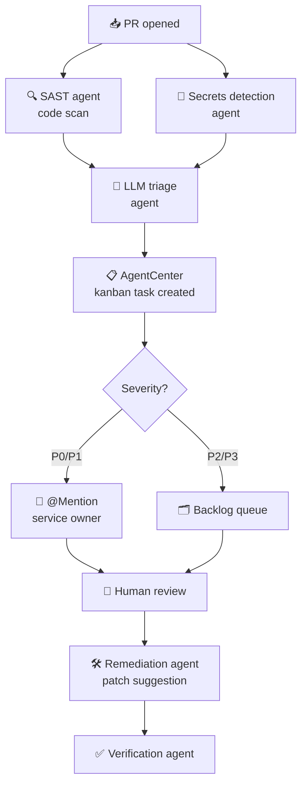

AppSec teams are running AI agents in production. Most can't tell you which agents ran last Tuesday, which ones errored out, or how much the week's triage work actually cost.

That's not a security problem. It's an operations problem. And it's the same one every team hits once they go past three agents.

## What AppSec Agents Actually Do All Day

Modern AppSec pipelines are already multi-agent, whether teams call them that or not. There's a SAST agent scanning code on every PR. A secrets detection agent watching commit history. A CVE triage agent pulling from your SCA tool and cross-referencing severity scores. Maybe a DAST agent running nightly against staging.

Each one does useful work. The problem is coordination. When 8 agents run independently with no shared view of what they're doing, three things go wrong fast.

**The scan agent fails silently.** Your SAST agent hits an out-of-memory error on a large repository. No alert. No Slack message. The engineering team keeps shipping. Three sprints later, someone notices the finding queue hasn't moved in weeks.

**The same finding gets triaged three times.** Your SAST tool, SCA tool, and DAST tool all flag the same vulnerable dependency. Three separate agents create three separate tasks. Three engineers each spend 20 minutes reading the same CVE and deciding the same thing.

**Token costs spiral before anyone notices.** A remediation agent set up to suggest patches for P2 findings runs against a backlog of 200 issues. At 2,000 tokens per suggestion, you've burned through $300 before the weekly cost review.

None of these are edge cases. They're what happens when agents run without a control plane.

## How AppSec Teams Use AgentCenter

### Agent Monitoring for Silent Failure Detection

[AgentCenter's agent monitoring](/features/agent-monitoring) is the first thing to set up. Connect your agents and you immediately see which ones are online, working, or have been idle longer than expected.

For AppSec, that idle-longer-than-expected signal matters. A SAST agent that was supposed to scan 12 PRs and is stuck on the first one isn't doing nothing. It's creating a security blind spot.

### Kanban Board for Finding Pipelines

The [task orchestration board](/features/task-orchestration) maps directly to how AppSec work actually flows: scan → triage → assigned → patched → verified. Each finding moves across columns. You can see at a glance which ones are stuck waiting for an engineer, and which have been sitting in "in review" for two weeks.

This matters because the worst part of vulnerability management isn't finding issues. It's knowing which ones are actually being worked on.

A concrete example: a DAST agent surfaces a SSRF finding in a payment service. It creates a task in AgentCenter, tagged critical. The task sits in the "triage" column until a senior engineer reviews it, approves it as valid, and moves it to the responsible service owner. That whole chain is visible. Nothing gets lost.

### @Mentions for Immediate Escalation

When a scan agent surfaces a critical finding, someone specific needs to know now. Not at the next standup.

With @mentions in AgentCenter, you wire a P0 finding directly to the engineer who owns that service. The task lands in their queue with the agent's output attached. There's a thread. The context stays together.

### Cost Visibility Per Agent

LLM costs in AppSec add up faster than most teams expect. Triage agents, remediation suggestion agents, and report generation agents can each consume significant token budgets when running against large finding queues.

AgentCenter shows per-agent activity so you can spot which agent is running expensive at what frequency, and set usage limits before a backlog run turns into an unexpected bill.

## AppSec Agent Workflow in AgentCenter

Each step is visible in AgentCenter. If the SAST agent stalls, you see it. If the triage agent errors on a specific finding, the task stays in the scan column instead of advancing. Nothing disappears silently.

## The Numbers for AppSec Teams

A 4-person AppSec team typically runs 8 to 15 agents: SAST, DAST, SCA, secrets detection, CVE lookup, triage, remediation suggestion, verification, and weekly report generation.

The [Pro plan](/pricing) covers 15 agents and 15 projects at $29 per month. That fits most AppSec teams without needing Scale.

What it replaces: a mix of Slack alerts that scroll off, JIRA queues nobody trusts, and ad-hoc scripts polling scan tool APIs to check whether things ran.

## Before vs After

| | Without AgentCenter | With AgentCenter |
|---|---|---|
| Visibility | Unknown which scan agents ran or errored | Real-time status on every agent, per repo |
| Task handoffs | Slack alert to JIRA ticket to forgotten | Kanban card moves when agent completes |
| Error detection | Silent failure discovered at next sprint | Alert fires the moment an agent errors |
| Cost tracking | Monthly surprise bill from LLM provider | Per-agent spend visible daily |
| Debugging time | 2-4 hours tracing which agent flagged what | Audit trail links every finding to the agent run |

## Where to Start

Set up agent monitoring for your SAST and secrets detection agents first.

These are the two categories most likely to fail silently. A SAST agent that stops running doesn't produce noise. It just stops producing findings. You won't notice until someone asks why the finding count dropped.

Connect both agents to AgentCenter, set an idle-alert threshold for each, and document which repositories they cover. That baseline is what everything else builds on.

---

*AppSec teams that add a control plane early spend less time firefighting later. [Start your 7-day free trial](/pricing).*
