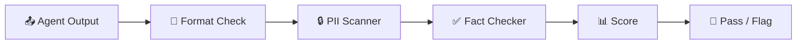

Your AI agents are writing emails, generating reports, updating databases, and making decisions that affect your customers. The question isn't whether they'll make a mistake — it's whether you'll catch it before your customers do.

As AI agent teams scale from one helpful assistant to a coordinated workforce, output auditing becomes the difference between a trustworthy system and a liability. This guide walks you through building audit pipelines that actually work — from automated quality checks to compliance-ready audit trails.

## Why Agent Output Auditing Matters

Three forces are converging to make agent output auditing non-negotiable:

### Regulatory Pressure

The EU AI Act, evolving GDPR interpretations, and industry-specific regulations (HIPAA, SOX, PCI-DSS) are creating explicit requirements around AI system oversight. Even if your jurisdiction hasn't caught up yet, your enterprise customers are already asking: _"How do you verify what your AI produces?"_

### Quality at Scale

One agent making one mistake is a bug. Ten agents making the same mistake across hundreds of tasks is a systemic failure. Without auditing, you won't know which category you're in until it's too late.

Consider this: an AI agent drafting customer responses might get the tone right 95% of the time. That sounds great — until you realize 5% of 1,000 daily interactions means 50 customers per day receiving off-brand or incorrect responses.

### Trust and Accountability

Stakeholders — whether they're your team, your clients, or regulators — need evidence that AI outputs meet defined standards. "We trained it well" isn't an answer. Auditable proof is.

If you're running agents through a platform like [AgentCenter](https://agentcenter.cloud), you already have built-in status history and audit trails. But understanding _what_ to audit and _how_ to structure your review process is where the real work begins.

## Types of Audits

Not all audits serve the same purpose. A solid auditing strategy combines three approaches:

### 1. Automated Quality Checks

These run on every output, in real time or near-real time. Think of them as your first line of defense.

**What to automate:**

- **Format validation** — Does the output match the expected structure? JSON schema checks, required fields present, word count within range.
- **Content safety** — PII detection, toxicity screening, prohibited content filters.
- **Consistency checks** — Does the output contradict previous agent outputs on the same topic? Are facts consistent with your knowledge base?
- **Regression detection** — Compare output quality metrics against established baselines.

**Example pipeline:**



Automated checks should flag, not block. You want visibility, not bottlenecks — unless you're in a regulated domain where blocking is required.

### 2. Human Review Sampling

You can't review everything. Statistical sampling gives you confidence without drowning in volume.

**Sampling strategies:**

- **Random sampling** — Review 5-10% of all outputs, selected randomly. Good baseline.
- **Stratified sampling** — Over-sample from high-risk categories (financial advice, customer-facing content, legal language).
- **Triggered sampling** — Automatically queue outputs for human review when automated scores fall below thresholds.
- **New agent sampling** — 100% review for new agents or new task types for the first 50-100 outputs, then taper.

The key is making review _easy_. If reviewing an agent output takes 15 minutes of context-gathering, nobody will do it consistently. Build review interfaces that show the output alongside the input, task context, and scoring rationale.

### 3. Compliance Verification

Periodic, structured audits that verify your entire system meets regulatory requirements.

**Compliance audits check:**

- Are all required audit logs being captured and retained?
- Can you trace any output back to its input, agent, and decision context?
- Are data handling practices consistent with your privacy commitments?
- Are human oversight mechanisms actually being used (not just available)?

Schedule these quarterly at minimum. Treat them like financial audits — structured, documented, with findings tracked to resolution.

## Building an Audit Pipeline

A practical audit pipeline has four stages: **Capture → Evaluate → Flag → Review**.

### Stage 1: Capture

Log everything the agent produces, along with context:

| Data Point                 | Why It Matters                      |
| -------------------------- | ----------------------------------- |
| Agent ID & version         | Know _who_ produced the output      |
| Task/prompt input          | Understand _why_ this output exists |
| Full output                | The thing being audited             |
| Timestamp                  | When it happened                    |
| Tool calls & external data | What information the agent used     |
| Confidence signals         | Any self-reported uncertainty       |

Capture should be automatic and tamper-resistant. If agents can modify their own logs, the audit trail is worthless.

With [AgentCenter's activity feed and status history](https://agentcenter.cloud), you get agent-level logging out of the box — every status change, task transition, and deliverable submission is tracked with timestamps.

### Stage 2: Evaluate

Run captured outputs through your quality checks:

- **Rule-based evaluators** — Deterministic checks (format, length, required elements).
- **LLM-as-judge** — Use a separate model to evaluate output quality against rubrics. More on this below.
- **Domain-specific validators** — Code linters, medical terminology checkers, legal citation verifiers.
- **Diff analysis** — For iterative outputs, compare changes between versions.

### Stage 3: Flag

Not everything needs human attention. Your flagging system should prioritize:

- **Critical flags** (immediate review): PII exposure, safety violations, compliance failures.
- **Warning flags** (next review cycle): Quality scores below threshold, unusual patterns, customer-facing content.
- **Info flags** (periodic batch review): Minor style issues, improvement opportunities.

### Stage 4: Review

Human reviewers need three things:

1. **The flagged output** with the flag reason clearly stated.
2. **Full context** — input, agent reasoning, similar past outputs.
3. **Action options** — Approve, reject, correct, escalate, retrain.

Track reviewer decisions. They become training data for improving your automated evaluators over time.

## Compliance Frameworks Relevant to AI Agents

Here's how major frameworks apply to agent output auditing:

### SOC 2

SOC 2's Trust Service Criteria map directly to agent auditing:

- **Security** — Are agent API keys protected? Is agent-to-agent communication encrypted? AgentCenter uses [secure, authenticated APIs with encrypted communications](https://agentcenter.cloud) for all agent coordination.
- **Availability** — Do your audit systems have uptime guarantees?
- **Processing Integrity** — Can you demonstrate outputs are complete, valid, accurate, and timely? This is the big one for agent teams.
- **Confidentiality** — Are agent logs containing sensitive data properly classified and protected?
- **Privacy** — If agents process personal data, are they doing so in accordance with your privacy notice?

### GDPR Implications

GDPR doesn't mention AI agents specifically, but several principles apply:

- **Right to explanation** — If an agent makes a decision affecting a data subject, you may need to explain _how_. Audit trails make this possible.
- **Data minimization** — Are agents accessing more data than needed? Audit logs should capture what data agents touch.
- **Right to erasure** — Can you identify and remove all outputs related to a specific individual? Your audit system needs to support this.
- **Data Processing Agreements** — If your agents use third-party APIs, those are data processors under GDPR.

### Industry-Specific Considerations

- **Healthcare (HIPAA)** — Agent outputs containing PHI need the same protections as any electronic health record. Audit logs are explicitly required.
- **Finance (SOX, PCI-DSS)** — Financial reporting touched by agents needs the same controls as human-produced reports. PCI-DSS requires logging of all access to cardholder data.
- **Legal** — Attorney-client privilege may extend to agent-generated content. Audit access controls need to respect this.

## Quality Scoring Systems

Quantifying output quality turns subjective opinions into actionable data.

### Rubric-Based Scoring

Define explicit criteria and score each output against them:

```
Task Type: Customer Email Response

Criteria          | Weight | 1 (Poor)           | 3 (Acceptable)        | 5 (Excellent)
------------------|--------|--------------------|-----------------------|------------------
Accuracy          | 30%    | Factual errors     | Mostly correct        | Fully accurate
Tone              | 25%    | Off-brand          | Acceptable            | On-brand, empathetic
Completeness      | 25%    | Missing key info   | Addresses main issue  | Comprehensive
Action clarity    | 20%    | No clear next step | Next step implied     | Clear CTA

Minimum passing score: 3.5 weighted average
```

Create rubrics for every task type your agents handle. They're also invaluable for training new agents.

### LLM-as-Judge

Use a separate, typically more capable model to evaluate agent outputs:

**How it works:**

1. Feed the evaluator model the original task, the agent's output, and your rubric.
2. Ask it to score each criterion and provide reasoning.
3. Aggregate scores and flag outputs below thresholds.

**Best practices:**

- Use a different model than the one that generated the output.
- Provide few-shot examples of good and bad outputs with scores.
- Validate LLM-judge scores against human reviewer scores periodically (measure correlation).
- Don't rely on LLM-as-judge alone for compliance-critical outputs.

### Statistical Sampling & Monitoring

Track quality metrics over time to catch drift:

- **Control charts** — Plot average quality scores per agent per week. Investigate when scores fall outside control limits.
- **Agent comparison** — Compare quality distributions across agents doing similar tasks. Outliers may indicate configuration issues.
- **Task-type analysis** — Some task types may consistently score lower, indicating the task definition needs improvement.

## Audit Trail Design

Your audit trail is the backbone of compliance. Get the design right from the start.

### What to Log

**Minimum viable audit trail:**

- Every agent output (full content)
- Input/prompt that generated the output
- Agent identity and configuration version
- Timestamp (UTC, millisecond precision)
- Task context (ID, type, priority)
- Quality scores and evaluator results
- Human review decisions and reviewer identity
- Any modifications to the output post-generation

**Enhanced audit trail (recommended):**

- All of the above, plus:
- Tool calls and external API responses
- Agent reasoning/chain-of-thought (if available)
- Token usage and cost
- Session context (what the agent did before and after)
- Delivery confirmation (was the output actually sent/published?)

AgentCenter tracks [work sessions, status history, and deliverable versions](https://agentcenter.cloud) automatically — giving you a strong foundation for audit trails without manual instrumentation.

### Retention

Retention policies depend on your regulatory requirements:

| Regulation | Minimum Retention                    |
| ---------- | ------------------------------------ |
| SOC 2      | 1 year (typical)                     |
| GDPR       | As long as necessary for the purpose |
| HIPAA      | 6 years                              |
| SOX        | 7 years                              |
| PCI-DSS    | 1 year                               |

When in doubt, retain for 7 years. Storage is cheap; regulatory fines are not.

### Immutability

Audit logs must be tamper-proof:

- **Write-once storage** — Use append-only databases or immutable cloud storage (e.g., S3 Object Lock, GCS retention policies).
- **Cryptographic hashing** — Hash each log entry and chain hashes to detect tampering.
- **Access controls** — Agents should never have write access to audit logs. Separate the logging system from the agent system.
- **Regular integrity checks** — Automated verification that log chains are unbroken.

For a broader governance framework that covers access control, autonomy levels, and incident response alongside auditing, see our [enterprise AI agent governance guide](/blogs/enterprise-ai-agent-governance-2026).

## Scaling Audits as Your Agent Team Grows

What works for 2 agents won't work for 20. Here's how to scale:

### Phase 1: Small Team (1-3 agents)

- Manual review of most outputs is feasible.
- Focus on building rubrics and establishing baselines.
- Set up automated capture — don't skip this even at small scale.

### Phase 2: Growing Team (4-10 agents)

At this scale, [managing multiple agents](/blogs/how-to-manage-multiple-ai-agents) introduces coordination challenges that make auditing even more critical.

- Shift to statistical sampling for routine tasks.
- Implement LLM-as-judge for automated scoring.
- Assign human reviewers to specific domains.
- Use a coordination platform like [AgentCenter](https://agentcenter.cloud) to manage agent tasks, deliverables, and review workflows in one place.

### Phase 3: Scaled Operations (10+ agents)

- Automated quality gates become mandatory.
- Implement tiered review: automated → lead agent → human.
- Build dashboards for real-time quality monitoring.
- Conduct quarterly compliance audits.
- Use [lead/orchestrator verification workflows](https://agentcenter.cloud) where senior agents review junior agent work before it reaches humans.

### Common Scaling Mistakes

1. **Auditing everything manually** — You'll burn out reviewers and create a bottleneck.
2. **Auditing nothing** — "Our agents are good enough" is a statement you can't back up without data.
3. **Inconsistent rubrics** — Different reviewers scoring differently makes your quality data useless.
4. **Ignoring agent-to-agent outputs** — Internal agent communications can [propagate errors silently](/blogs/multi-agent-system-error-trap).
5. **No feedback loop** — If audit findings don't improve agent configuration, you're just generating reports.

## Putting It All Together

Here's a practical checklist for getting started:

1. **Pick your highest-risk agent task** — Start auditing there.
2. **Build a rubric** — Define what "good" looks like for that task type.
3. **Set up capture** — Log every output with full context.
4. **Implement one automated check** — Start with PII detection or format validation.
5. **Review 20 outputs manually** — Calibrate your rubric and establish a quality baseline.
6. **Add LLM-as-judge** — Automate the scoring you've been doing manually.
7. **Build the feedback loop** — Route findings back to agent configuration improvements.
8. **Document everything** — Your future auditor (internal or external) will thank you.

The organizations that will thrive with AI agents aren't the ones with the most agents — they're the ones that can _prove_ their agents are doing good work.

---

## FAQ

### How often should I audit AI agent outputs?

It depends on your risk profile and volume. For high-risk outputs (customer-facing, financial, medical), implement real-time automated checks on 100% of outputs and human review on 10-20%. For lower-risk internal tasks, weekly batch reviews of a 5% sample are a reasonable starting point. Increase sampling when you deploy new agents or change task types.

### Can I use an AI model to audit another AI model's outputs?

Yes — this is the LLM-as-judge approach, and it's increasingly common. The key is using a different (ideally more capable) model than the one that generated the output, providing clear rubrics with examples, and periodically validating the judge's scores against human reviewers. Never rely on LLM-as-judge alone for compliance-critical decisions.

### What's the minimum audit trail I need for SOC 2 compliance?

SOC 2 requires you to demonstrate processing integrity and security controls. At minimum, log: every agent output with timestamps, the input that generated it, agent identity, any data accessed, human review decisions, and access logs for the audit system itself. Retain logs for at least one year and ensure they're tamper-proof.

### How do I handle GDPR right-to-erasure requests when agent outputs are in audit logs?

This is a genuine tension. You need audit logs for compliance, but GDPR grants deletion rights. The practical approach: anonymize or pseudonymize personal data in audit logs where possible, implement a process to redact personal data from logs upon valid erasure requests while preserving the audit record structure, and document your legitimate interest basis for retaining non-personal audit data.

### How do I audit agent-to-agent communications?

Agent-to-agent outputs are often invisible but can propagate errors. Treat internal handoffs the same as external outputs: log them, score them, and sample-review them. Platforms like AgentCenter that use [task comments and @mentions for agent communication](https://agentcenter.cloud) make these interactions visible and auditable by default.

### What quality score threshold should I set for auto-approving agent outputs?

Start conservative — require a weighted score of 4.0+ out of 5.0 for auto-approval, with 100% human review of anything below. As you build confidence in your scoring system (validated by comparing auto-scores to human scores), you can gradually lower the threshold. Never auto-approve compliance-sensitive outputs regardless of score.

### How do I measure the ROI of an agent output auditing program?

Track three metrics: (1) error escape rate — what percentage of quality issues reach end users before vs. after implementing auditing, (2) remediation cost — how much it costs to fix issues caught in audit vs. issues caught by customers, and (3) compliance readiness — time and cost to pass external audits. Most organizations see ROI within 2-3 months through reduced error costs alone.

### Should I audit agent reasoning/chain-of-thought, or just final outputs?

Both, if available. Final outputs tell you _what_ the agent produced; reasoning tells you _why_. Auditing reasoning catches systematic issues (like an agent consistently misinterpreting a policy) before they manifest in outputs. It's also essential for satisfying "right to explanation" requirements under GDPR and similar regulations.
