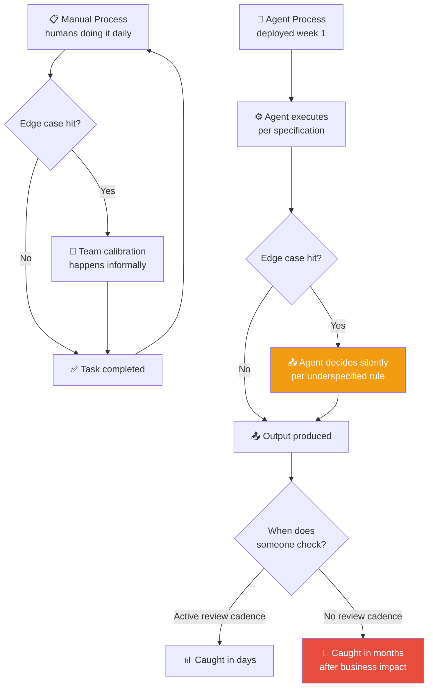

We had a process for classifying incoming reports from field agents. It had been running manually for 18 months. Four people took turns doing it. Everyone agreed it was tedious and consistent.

We thought "consistent" meant we understood it.

We built an agent to handle it. The agent ran for seven weeks before someone noticed the numbers were off. Not dramatically — the classification distribution had shifted about 12%, which was within the noise range of the metric we were tracking. A quarterly review caught it, not our monitoring.

When we traced it back, we found something embarrassing: the process wasn't actually consistent. The four people who ran it had developed different interpretations of one category boundary that nobody had ever written down. The agent had picked one interpretation and held it perfectly, every single time, for seven weeks.

That consistency — which we'd mistaken for correctness — was the problem.

## The assumption baked into every agent you build

When you build an agent to automate a process, you're making a bet: that you understand the process well enough to specify it. The agent doesn't check that assumption. It executes whatever you told it, at scale, without complaint.

This is where things go wrong. Not because the agent fails — because it succeeds, too well, on a flawed specification.

Manual processes have a self-correcting mechanism built in: the humans doing them notice when something feels wrong. They ask a question. They flag an edge case. They bring a judgment call to the team. That feedback loop disappears when you hand the process to an agent. The agent doesn't flag edge cases. It handles them — according to rules you may not have fully specified, or may have specified wrong.

The humans create informal calibration loops. Agents don't. The feedback that kept the manual process from drifting is gone the moment you automate it.

## What "we know this process" actually means

Most teams have a high-level picture of their processes. They know the inputs, the outputs, the rough steps. What they often don't know:

- Where the boundary cases live — the 8% of inputs that don't fit obvious categories
- How different people handle those cases (and that they handle them differently)
- What happens when the input is ambiguous and who makes that call
- What "good enough" means for step 3 versus step 7

This tacit knowledge doesn't feel like knowledge. It feels like common sense. It's the stuff nobody writes down because everyone "just knows."

When you specify a process for an agent, you discover how much of this you were carrying in your head. The agent forces you to make every decision explicit. If you leave a case underspecified, the agent fills it in — and you won't know it until something downstream surfaces the pattern.

## Three failure modes this creates in production

**The silent drift.** The agent handles an edge case one way from day one. Nobody notices because the metric it affects isn't closely monitored. By the time someone looks, the agent has made the same wrong decision 4,000 times.

**The uncaught escalation.** The process has a category of input that humans normally flag for review. Nobody documented it. The agent doesn't flag — it handles, because that's what it was built to do. The escalations that should have happened just don't.

**The hardened mistake.** Downstream systems adapt to the agent's output pattern. When you eventually correct the agent's behavior, everything downstream has to be corrected too. The wrong behavior has been institutionalized.

Each of these compounds the longer the agent runs before the issue is caught. And they're all harder to see than a crash. A crash announces itself. These don't.

## What to do instead

Spend twice as long understanding the process before building the agent. Not specifying the agent — understanding the process.

Sit with the people who do it manually. Watch what they do when they hit an edge case. Ask what they'd do if nobody else was available. Find the decisions they make without thinking about them. Write those down.

Map every fork in the process — not just the main path, but the cases where someone has to think for more than five seconds. Those are the spots where your agent specification needs to be explicit, not assumed.

Then build a review cadence into your [agent monitoring setup](/features/agent-monitoring) from day one. Not just "did it complete" — but "are the outputs in the expected distribution?" A 5% shift in category ratios might be noise. It might also be the agent handling a new input type incorrectly. You want to know which before week seven.

## Who this matters most for

If you're automating a process owned by a different team, this problem is worse. You're not even the person who understands the process — you're working from a description given to you by someone who does. The gap between "how it works" and "how they explained it to you" gets encoded into your agent's behavior from day one.

If you're automating a process that "everyone just does," the same risk applies. The consistency you think you have may be four people's slightly different interpretations averaged together. Your agent will pick one and hold it forever.

Both situations call for the same thing: get the ambiguities on paper before you get the agent in production. Use the [agent dashboard](/features/agent-dashboard) to track output patterns once it's running, and set alerts when distributions shift rather than waiting for quarterly reviews to catch the drift.

## The honest caveat

This isn't a technology problem. AgentCenter can show you when your agent's output distribution changes. It can alert you when tasks take longer than expected, when error rates climb, when outputs start getting flagged. What it can't tell you is that the process specification was incomplete from the start.

That's a process problem. The tooling helps you catch the symptoms. The work of understanding what you're automating — really understanding it, not just knowing its shape — has to happen before you write a single prompt.

AgentCenter also won't save you if the process itself was wrong to begin with. Agents are fast at scale. That's a feature when the process is right and a liability when it isn't.

---

*The dashboard won't fix a broken agent. But it will tell you which one is broken at 3am. [Try AgentCenter free](/pricing).*
