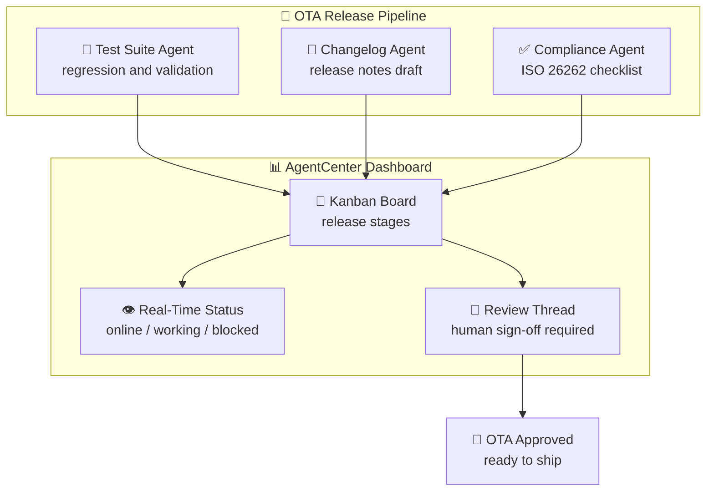

Automotive software teams move fast. Vehicle programs, SOP dates, certification windows. When AI agents enter the picture, the first two or three are manageable. You know what they do, who owns them, and roughly when they run.

By the time you hit 10, that clarity is gone.

## What Breaks Without a Control Plane

Most automotive software teams add agents the same way: one engineer builds a test report agent, another wires up a changelog generator, someone else creates a telemetry anomaly detector. Each works fine in isolation. None coordinate in any structured way.

The coordination happens in Slack. "Did the regression agent finish?" "Did someone review that compliance output?" "Why is the telemetry pipeline quiet today?"

This breaks at around agent 8. Here's how it breaks specifically for automotive teams.

### OTA Release Pipeline Coordination

An over-the-air update involves multiple agents: test suite runners, regression checkers, changelog generators, build report aggregators. They run in sequence. If one blocks or finishes silently without anyone noticing, the next stage waits, and nobody knows why the release is behind until a stakeholder asks at the weekly sync.

Without a single view across those agents, you piece together status from four Slack channels and three terminal sessions.

### Safety Documentation Review Gaps

Agents that draft FMEA sections or check outputs against an ISO 26262 checklist are genuinely useful. But only if a human sees and approves the output before it moves forward. When the "approval workflow" is a Slack message that gets buried, documents ship unchecked. In a regulated environment, that's not just a process gap.

### Telemetry Agents Running Blind

Vehicle telemetry pipelines run continuously. An agent monitoring CAN bus data or generating weekly fleet health reports should run reliably. When one stalls at 3am, nobody notices until the morning report is missing. The first signal of a problem is the absence of output, not an alert.

## How AgentCenter Fits Automotive Agent Workflows

### Kanban Board for Release Pipeline Visibility

Each stage of your OTA release maps to a column on the [AgentCenter task board](/features/task-orchestration): testing, validation, compliance check, sign-off. Agents report their task status in real time. You see exactly where the pipeline is stuck without asking anyone.

**Example:** A test suite agent picks up a task card in "Testing" and moves it to "Done" when regression passes. If the agent blocks, the card stays. The team sees the hold before it becomes a scheduling conversation.

### Deliverable Review for Safety Documents

When an agent generates a FMEA section or produces a compliance checklist output, it submits it as a deliverable in AgentCenter. A human reviewer gets notified and approves or flags it before it moves forward.

This turns an implicit "someone should check this" into an explicit workflow with a timestamp. In automotive development, that audit trail matters during supplier audits and certification reviews.

### Real-Time Status for Always-On Telemetry Agents

The [agent monitoring view](/features/agent-monitoring) shows each agent as online, working, idle, or blocked. For telemetry agents that run around the clock, this is the difference between "I didn't know it stopped" and "I got a notification when it went silent at 3am."

### Cost Tracking Per Vehicle Program

Automotive teams often run agents across multiple vehicle programs at once. AgentCenter tracks costs per agent and per project, so you can see what each program spends on LLM calls. Useful when a program manager asks why the AI line item keeps growing.

## The Numbers for a Typical Team

Most automotive software teams run 8 to 20 agents per active vehicle program. The Pro plan at $29/month covers 15 agents and fits most teams working a single program. Teams managing two or more programs at once tend to move to Scale ($79/month, 50 agents).

What it replaces: Slack coordination, Confluence status pages, and the institutional knowledge of whoever originally set up the agents.

See [pricing details](/pricing) for a full plan comparison.

## Before vs After

| | Without AgentCenter | With AgentCenter |
|---|---|---|
| **Visibility** | Ask in Slack, check terminals | Live Kanban across all release agents |
| **Task handoffs** | Manual messages between engineers | Agents update task cards automatically |
| **Error detection** | Notice when output is missing | Notification when agent goes blocked |
| **Cost tracking** | Quarterly spreadsheet estimate | Per-agent, per-program cost breakdown |
| **Debugging time** | 30 to 60 minutes tracing what ran | Full timeline in the task audit trail |

## Where to Start

Set up the task board for your OTA release pipeline first. Create one project for the release, one task per agent stage (test, validate, compliance, sign-off), and connect your existing agents to report status via the AgentCenter API.

The first time an agent stalls mid-pipeline and you catch it in 5 minutes instead of 2 days, you'll know this was worth the setup time.

---

*Automotive software teams that add a control plane early spend less time firefighting when release week hits. [Start your 7-day free trial](/pricing).*
