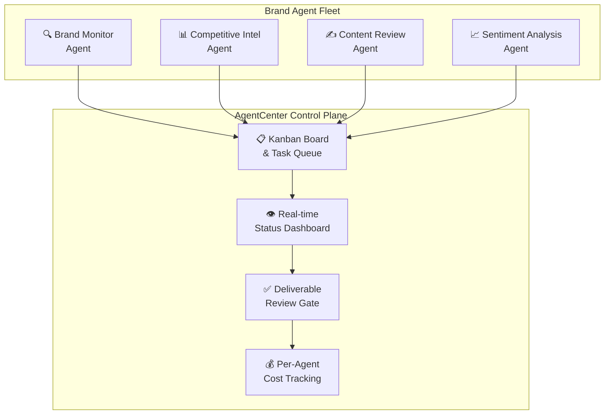

Brand teams don't think of themselves as running infrastructure. But if you're managing 4 monitoring agents, 2 competitive intel agents, and a handful of content review agents, you are running infrastructure. You just don't have a dashboard for it.

## The Daily Problem Brand Agents Create

Here's a real scenario. Your brand monitoring agent runs overnight. It's supposed to flag press coverage, social mentions, and customer reviews that need a response. By 9am, it's produced a deliverable. You read it over coffee, notice it missed a major Reddit thread from 3 hours ago, and spend the next hour figuring out whether the agent failed, got rate-limited, or simply didn't have access to that source.

That's not a minor inconvenience. That's the whole morning gone — and you still don't have an answer.

Most brand management teams hit three specific walls when they run agents without a control plane:

**No visibility into what ran and when.** Your monitoring agent says it ran. But ran at what time? On which sources? With what query parameters? When something gets missed, you're tracing back through logs trying to reconstruct what happened.

**Approval workflows don't exist.** Your content review agent flags a brand guideline violation. That flag lands in a task queue you check manually — or doesn't land anywhere at all, because there is no queue. You find out about it when a stakeholder emails you.

**Cost attribution is guesswork.** Four agents, different models, different cadences. Which one is eating your API budget? You don't know until the invoice arrives.

## How Brand Management Teams Use AgentCenter

Brand teams typically run 5-12 agents: brand mention monitors, competitive positioning trackers, content brand-compliance reviewers, sentiment analyzers, and crisis alert agents. Here's which AgentCenter features do the most work for this role.

### Kanban Board: Know What Ran Without Reading Logs

Each agent gets a project in AgentCenter. Each monitoring cycle becomes a task card. When your overnight monitoring agent finishes, a card moves from In Progress to Review. If it's still sitting in In Progress at 8am, you know to investigate before the daily standup — not at 2pm when someone asks why a story got missed.

You're not reading logs. You're checking a board that shows you the current state of your entire agent fleet at a glance.

### Deliverable Review Gates: Stop Brand Risks Before They Ship

Your content review agent flags a new campaign asset for brand guideline issues. In AgentCenter, that flag shows up as a deliverable — a task output waiting for human review. You see it, approve or reject it, and the decision is logged with a timestamp.

That audit trail matters. If something slips through and a stakeholder asks "why did this go out?", the answer isn't buried in a Slack thread from three weeks ago. It's in the [review history with full task context](/features/task-orchestration).

### Real-Time Agent Status: Know What's Running During a Crisis

[Agent monitoring](/features/agent-monitoring) shows you which agents are online, which are idle, and which are blocked. For brand teams, this matters most when something is actively happening. During a PR crisis, you need to know your sentiment analysis agent is running right now and pulling current data — not that it ran 6 hours ago and went idle.

When your crisis alert agent shows as blocked at 11am, that's a problem you can fix before it becomes a bigger one.

### Cost Tracking: See Which Agent Is Spending the Most

If you're running a heavier model for competitive intelligence and a cheaper one for routine monitoring, AgentCenter breaks down cost by agent. When your API bill spikes, you see exactly which agent drove it. Pull up its task history, see what it processed that week, and decide whether the spend was worth it.

## The Numbers

A mid-size brand team typically runs 6-10 agents across monitoring, compliance review, and competitive intel. That fits on the [Pro plan at $29/month](/pricing) (15 agents, 15 projects). Teams that also run content generation or crisis response agents often move to Scale to keep each workflow in its own project with isolated cost tracking.

What it replaces: manual log checking, spreadsheet task tracking, ad-hoc Slack approvals, and the mental overhead of trying to remember which agent last ran what.

## Before vs After AgentCenter

| | Without AgentCenter | With AgentCenter |
|---|---|---|
| **Visibility** | Check logs manually to know what ran | Kanban board shows every agent's last run and current status |
| **Task handoffs** | Agent output goes to shared folder; someone notices eventually | Deliverable triggers review gate with automatic notification |
| **Error detection** | Discover missed coverage when a stakeholder asks | Agent status shows blocked or failed before the morning standup |
| **Cost tracking** | Total API spend shows up in monthly invoice | Per-agent cost breakdown visible at any time |
| **Debugging time** | 30-60 minutes tracing logs to find what happened | 5 minutes: check task history, see exactly what the agent processed |

## Where to Start

Set up the Kanban board first. Create one project per major brand workflow — overnight mentions, competitive intel, content review. Add your existing agents and give each monitoring cycle a due date.

After two weeks, you'll have a task history showing exactly which agents are delivering and which ones keep missing things. That pattern is harder to see when everything lives in separate log files. With AgentCenter, it shows up on the board.

---

*Brand management teams that add a control plane early spend less time firefighting later. [Start your 7-day free trial](/pricing).*
