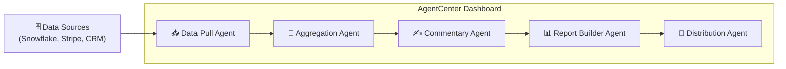

Nightly at 11 PM, your BI agents kick off. They pull from the data warehouse, run aggregations, write commentary, and prepare the morning dashboard. By 7 AM, your CFO expects a fully populated board-pack summary in their inbox.

At 7:15, they message you. The agents ran, but the KPI commentary is empty.

Business intelligence teams are increasingly the heaviest AI agent users that nobody thinks about. You're running report agents, anomaly detection agents, data quality checks, and executive summary writers. The problem isn't building these agents — it's knowing what each one did when you weren't watching.

## The Pipeline That Breaks at 2 AM

BI workflows are batch-heavy and time-sensitive. Most of the work happens outside business hours, which means failures happen outside business hours too.

Without a control plane, here's what goes wrong:

**Silent failures on downstream agents.** Your data pull agent finishes successfully. Your aggregation agent reads the output and runs. Your commentary agent starts, hits a token limit on an unusually dense dataset, and exits silently. The aggregation is complete and the numbers look fine in the database. The report generates with empty commentary sections. Nobody notices until the 8 AM standup.

**Source failures that cascade.** BI pipelines pull from multiple sources — Salesforce, BigQuery, Stripe, Snowflake. When one source is unavailable at midnight, the agents that depend on it either fail or produce partial outputs. Without visibility into which data source caused which agent to stall, you're debugging at 6 AM with incomplete logs and a deadline that doesn't care.

**No cost tracking across runs.** A standard daily report agent costs around $0.20 in LLM tokens. An anomaly detection sweep across 90 days of transaction data can cost $1.80. When your team goes from 5 reports to 20 over a quarter, and costs jump from $180 to $1,800 per month, you should be able to explain why. Without per-report cost breakdowns, you're guessing.

## How BI Teams Use AgentCenter

### Real-Time Agent Status — Know Before the Execs Do

AgentCenter shows every agent's current state: online, working, idle, or blocked. When your commentary agent goes idle at 2:17 AM mid-batch, you see it on the [agent dashboard](/features/agent-dashboard) the moment you open the app — not when someone forwards you a confused Slack message at 8:30.

You can also configure task timeouts. If the anomaly detection agent hasn't completed within 45 minutes, the problem surfaces automatically. No more 6 AM forensics.

### Kanban Board — One View for Every Report

The [Kanban board](/features/task-orchestration) maps directly to a BI reporting pipeline. Each report is a task. Columns for Queued, Pulling Data, Aggregating, Writing Commentary, Ready for Review, and Sent.

If the weekly revenue variance report is still in the Aggregating column at 6:30 AM and the standup starts at 9, you know that before you've had your coffee.

This replaces the morning ritual of checking Slack, opening three terminal windows, and asking whoever built the agents what happened overnight.

### Cost Tracking — Per Report, Not Per Month

The [agent monitoring dashboard](/features/agent-monitoring) breaks token spend down by task. You see that the Q1 anomaly sweep cost $3.40 because the model processed six months of daily transactions across 14 product lines. You see that the executive summary agent costs $0.12 per run on a normal day but $0.89 when quarter-end data is 4x the usual volume.

When your analytics lead asks why the LLM budget doubled last month, you can show exactly which reports and which runs caused it.

### Recurring Task Automation — Set It and Monitor It

BI reporting runs on a schedule. AgentCenter's recurring task automation (Pro and above) lets you configure nightly runs, monitor each execution, and compare performance across runs. If this Tuesday's data pull took 40% longer than last Tuesday's, you can see that pattern before it becomes a 3-hour delay.

## The Numbers for a BI Team

A typical business intelligence team running agents in production operates 12 to 25 agents: one or two per report type, plus anomaly detection, data quality checking, executive commentary, and distribution.

The [Pro plan at $29/month](/pricing) covers 15 agents and fits small BI teams running a focused report catalog. The Scale plan at $79/month covers 50 agents for teams with a larger catalog or multiple business units feeding separate reporting pipelines.

What AgentCenter replaces: manual cron job monitoring, shared Slack channels for "did the agents run?" status checks, separate LLM cost dashboards from your provider, and the informal on-call rotation that exists only because someone needs to verify Tuesday night's agents finished before Wednesday's 7 AM leadership meeting.

## Before vs After

| | Without AgentCenter | With AgentCenter |
|---|---|---|
| **Visibility** | Check logs or wait for someone to notice | Real-time status on every agent in the nightly run |
| **Task handoffs** | Hope the commentary agent picked up the aggregation output | Task chain confirms each step completed before the next starts |
| **Error detection** | Executive notices missing data at 8 AM | Flagged at 2:17 AM when the commentary agent went idle |
| **Cost tracking** | Monthly LLM bill with no per-report breakdown | Token spend per task, per run, per report type |
| **Debugging time** | 2-4 hours tracing which source failed and when | Agent logs and task history in one place |

## Where to Start

Set up real-time status monitoring first. Connect your nightly report agents to AgentCenter and configure one task per report. Even before recurring automation or cost tracking are active, you'll immediately see which agents finish, which stall, and which never start.

Most BI teams find their first previously-undetected agent failure within the first week of monitoring — something that had been silently failing for weeks, producing reports that looked complete but weren't.

---

*Business intelligence teams that add a control plane early spend less time firefighting later. [Start your 7-day free trial](/pricing).*
