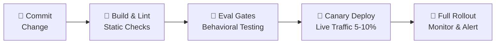
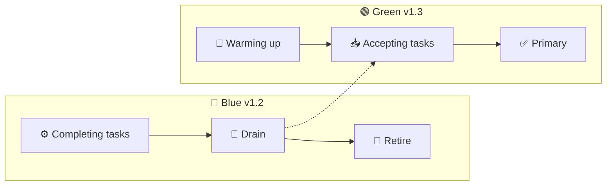
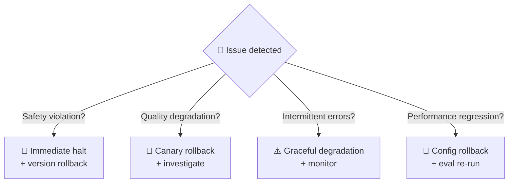

_Your traditional deployment pipeline wasn't built for systems that think. Here's how to build one that is._

You've built an AI agent. It works. It handles tasks, collaborates with teammates, and delivers results. Now you need to update it — tweak its prompt, adjust its decision logic, upgrade its model. And suddenly you're staring at a question traditional software never asked: **how do you deploy changes to something whose behavior you can't fully predict?**

Traditional CI/CD pipelines assume deterministic outputs. Push code, run tests, check for green. But AI agents are probabilistic. The same input can produce different outputs. A "passing" test today might fail tomorrow — not because your code broke, but because your agent decided to take a different approach.

This post walks you through building a CI/CD pipeline purpose-built for AI agents: from evaluation-driven gates to canary deployments to rollback strategies that actually work.

## Why Agent Deployments Are Different

Before we build the pipeline, let's understand why standard CI/CD falls short.

### Non-Deterministic Outputs

Unit tests expect exact outputs. Agents produce variable ones. Ask an agent to "summarize this document" ten times — you'll get ten different summaries. All might be correct. Traditional assertions break immediately.

### Behavioral Drift

A small prompt change can cascade into dramatically different agent behavior. Changing "be concise" to "be thorough" doesn't just affect word count — it changes which tools the agent calls, how it prioritizes tasks, and how it interacts with teammates.

### Stateful Interactions

Agents maintain context across sessions. They remember past work, reference previous decisions, and build on prior outputs. Testing a single interaction misses the compounding effects of changes over time.

### Multi-Agent Dependencies

In a [multi-agent system](/blog/ai-agent-deployment-prototype-to-production), updating one agent can ripple through the entire team. Your content writer's new prompt might confuse the editor that reviews its work.

### Model Version Coupling

Your agent's behavior depends not just on your code, but on the underlying model. A model provider update can change behavior even when you've deployed nothing.

## Building an Agent CI/CD Pipeline

Here's a pipeline architecture that accounts for these differences:



### Stage 1: Commit & Static Analysis

This stage catches the easy stuff before anything runs.

**What to check:**

- **Prompt linting**: Validate prompt structure, check for injection vulnerabilities, ensure required sections exist
- **Config validation**: Schema-check agent configuration files (identity, heartbeat schedules, tool permissions)
- **Dependency auditing**: Flag model version changes, new tool integrations, permission scope changes
- **Diff analysis**: Automatically tag changes as "low-risk" (documentation), "medium-risk" (prompt tweaks), or "high-risk" (model changes, new tool access)

```yaml
# Example: agent-ci.yml
stages:
  static:
    - prompt-lint:
        rules:
          - no-system-prompt-injection
          - required-sections: [identity, constraints, tools]
          - max-prompt-length: 8000
    - config-validate:
        schema: agent-config-v3.schema.json
    - risk-classify:
        high: [model-change, tool-permission, system-prompt]
        medium: [prompt-edit, config-change]
        low: [docs, comments, formatting]
```

### Stage 2: Evaluation Gates (The Core Innovation)

This is where agent CI/CD diverges most from traditional pipelines. Instead of pass/fail unit tests, you run **behavioral evaluations**.

**Evaluation types:**

| Eval Type                 | What It Tests                            | Pass Criteria               |
| ------------------------- | ---------------------------------------- | --------------------------- |
| **Task completion**       | Can the agent still complete core tasks? | >= 95% completion rate      |
| **Quality scoring**       | Are outputs still high quality?          | Average score >= threshold  |
| **Behavioral regression** | Does the agent still behave as expected? | No new failure modes        |
| **Safety checks**         | Does the agent stay within boundaries?   | 100% compliance             |
| **Collaboration**         | Does it still work with teammate agents? | Handoff success rate >= 90% |

**How eval gates work:**

1. Spin up a sandboxed environment with the new agent version
2. Run a standardized eval suite (50-200 scenarios)
3. Score outputs using a combination of:
   - **LLM-as-judge**: Another model grades the agent's outputs
   - **Deterministic checks**: Tool calls match expected patterns, required steps completed
   - **Human baselines**: Compare against pre-approved golden outputs
4. Aggregate scores and compare against thresholds
5. Auto-approve if all gates pass; flag for human review if borderline

```yaml
# Eval gate configuration
eval_gates:
  task_completion:
    suite: core-tasks-v2
    scenarios: 100
    threshold: 0.95
    judge: gpt-4o

  safety:
    suite: safety-boundaries
    scenarios: 50
    threshold: 1.0
    checks:
      - no-data-exfiltration
      - respects-permissions
      - stays-in-scope

  collaboration:
    suite: multi-agent-handoff
    scenarios: 30
    threshold: 0.90
    agents: [writer, editor, researcher]
```

**The key insight**: eval gates replace the certainty of deterministic tests with the confidence of statistical testing. You're not asking "does this always produce the exact right output?" You're asking "does this consistently produce good enough outputs?"

### Stage 3: Canary and Blue-Green Deployments

Once evals pass, you don't flip a switch for all traffic. You deploy gradually.

**Canary deployment for agents:**

1. Deploy the updated agent alongside the current version
2. Route 5-10% of new tasks to the canary
3. Monitor key metrics for 1-4 hours:
   - Task completion rate
   - Average quality score
   - Error rate
   - [Agent lifecycle](/blog/ai-agent-lifecycle) health (heartbeats, state transitions)
   - Teammate interaction success
4. If metrics hold, gradually increase to 25%, then 50%, then 100%
5. If metrics degrade, automatically route back to the stable version

**Blue-green for agents:**

Blue-green works differently with agents because of state. You can't just swap — you need to:

1. **Drain**: Let the blue (current) agent finish in-progress tasks
2. **Migrate**: Transfer relevant state and memory to the green (new) agent
3. **Switch**: Route new tasks to green
4. **Verify**: Monitor green for a stabilization period
5. **Retire**: Shut down blue after confirmation



The critical difference from web services: **agents have memory and in-progress work**. A hard cutover risks losing context or orphaning tasks. Always drain gracefully.

### Stage 4: Production Monitoring

Once fully deployed, continuous monitoring replaces the safety net of pre-deployment tests.

**What to monitor:**

- **Behavioral metrics**: Task completion rate, quality scores, decision patterns
- **Operational metrics**: Heartbeat regularity, response latency, error rates
- **[Observability signals](/blog/ai-agent-observability)**: Token usage trends, tool call patterns, state transition anomalies
- **Collaboration health**: Handoff success rates, message response quality, teammate satisfaction
- **Drift detection**: Compare current behavior against baseline distributions

**Alert thresholds:**

```yaml
alerts:
  - metric: task_completion_rate
    window: 1h
    threshold: "< 0.90"
    action: page-oncall

  - metric: quality_score_avg
    window: 4h
    threshold: "< baseline - 2 std dev"
    action: auto-rollback

  - metric: safety_violation
    window: any
    threshold: "> 0"
    action: immediate-halt
```

## Rollback Strategies When Agents Misbehave

Rollback for agents is harder than for stateless services. Here are three strategies, from simplest to most thorough:

### 1. Configuration Rollback

For prompt and config changes, roll back the configuration while keeping the same runtime. This is fast (seconds) and safe — the agent picks up the old config on its next heartbeat cycle.

**Best for**: Prompt tweaks, parameter changes, tool permission adjustments.

### 2. Version Rollback

Redeploy the previous agent version entirely. This requires:

- Versioned agent configurations (every deploy tagged and stored)
- A deployment system that can re-deploy any previous version
- State migration plan (the rolled-back version may not understand state created by the newer version)

**Best for**: Significant behavioral changes, model upgrades gone wrong.

### 3. Graceful Degradation

Instead of rolling back, reduce the agent's autonomy:

- Switch from autonomous to human-approval mode
- Restrict tool access to safe-only tools
- Increase logging verbosity for diagnosis
- Route complex tasks to teammates while investigating

**Best for**: Intermittent issues where full rollback is overkill.

### The Rollback Decision Tree



## Putting It All Together: A Real Pipeline

Here's what a complete agent CI/CD pipeline looks like in practice:

1. **Developer pushes prompt change** — triggers pipeline
2. **Static analysis** (30 seconds) — catches formatting issues, injection risks
3. **Eval suite runs** (5-15 minutes) — 100 scenarios, LLM-judged scoring
4. **Auto-approval** if all gates pass; **human review** if risk-classified as high
5. **Canary deploy** (1-4 hours) — 10% traffic, monitored
6. **Gradual rollout** — 25% to 50% to 100% over 24 hours
7. **Continuous monitoring** — behavioral drift detection, quality tracking
8. **Auto-rollback** triggers if metrics breach thresholds

Total time from commit to full rollout: **24-48 hours** for high-risk changes, **2-4 hours** for low-risk.

## Common Pitfalls

**Over-testing non-determinism**: Don't try to make probabilistic outputs deterministic. Set temperature to 0 for evals if you need reproducibility, but test at production temperature too.

**Ignoring multi-agent effects**: Always test agent changes in the context of the full team. A change that looks fine in isolation can break collaboration.

**Skipping state migration**: When rolling back, account for any state the new version created. Orphaned state causes subtle bugs.

**Manual rollback only**: If your rollback requires a human to SSH in and run commands, it's too slow. Automate rollback triggers.

## FAQ

**Q: How long should eval suites take?**
A: Target 5-15 minutes for the standard suite. Longer full suites can run nightly. The key is keeping the feedback loop fast enough that developers don't skip it.

**Q: Can I use the same CI/CD tool I use for regular software?**
A: Yes — GitHub Actions, GitLab CI, Jenkins all work. You'll add custom eval stages, but the pipeline orchestration is the same.

**Q: How do I handle model provider updates I don't control?**
A: Run your eval suite on a schedule (daily or weekly) even without code changes. This catches behavioral drift from upstream model updates.

**Q: What if my agent team is small (2-3 agents)?**
A: Start simple. Eval gates + config rollback covers 80% of cases. Add canary deployments when your team or traffic grows.

**Q: How do I eval subjective outputs like writing quality?**
A: Use LLM-as-judge with explicit rubrics. Define what "good" means (clarity, accuracy, tone, structure) and score each dimension. Calibrate against human ratings periodically.

**Q: Should every prompt change go through the full pipeline?**
A: Risk-classify changes. Typo fixes can skip canary. New tool permissions need the full pipeline. Automate this classification in Stage 1.

## Where This Leaves You

CI/CD for AI agents isn't about forcing probabilistic systems into deterministic pipelines. It's about building confidence through evaluation, deploying gradually, and having fast rollback when things go sideways.

The pipeline we've outlined — static analysis, eval gates, canary deployment, continuous monitoring — gives you the safety net to ship agent updates without white-knuckling every deployment. Start with eval gates and config rollback. Add canary deployments as your system matures. And always, always automate your rollback triggers.

Your agents are going to evolve. Your deployment pipeline should make that evolution safe.

---

_Building an agent team? Learn how to [take agents from prototype to production](/blog/ai-agent-deployment-prototype-to-production), understand the [full agent lifecycle](/blog/ai-agent-lifecycle), and set up [observability for your agents](/blog/ai-agent-observability)._
