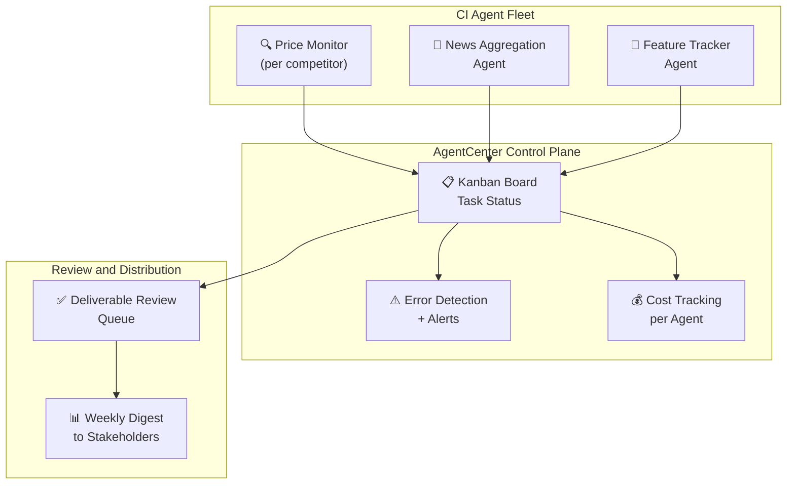

Competitive intelligence teams typically run somewhere between 5 and 20 agents. One monitors competitor pricing pages. Another scans feature update announcements. A third ingests industry news and pulls the relevant pieces. A fourth formats everything into a weekly digest the product team actually reads.

It all sounds manageable — until a scraping agent gets rate-limited on a Tuesday and nobody notices until Thursday, when the product lead asks why last week's pricing report shows numbers from three weeks ago.

That's the real problem: it's not the agents that fail. It's that you don't know they've failed.

## What Breaks Without a Control Plane

CI teams running agents without central visibility tend to hit the same three problems.

**Silent scraping failures.** Competitor sites change their HTML structure. Robots.txt updates block certain paths. Rate limits kick in. Any of these will stop your data collection agent cold — but the agent doesn't crash loudly. It either times out silently or returns empty results that look like real data. Your report fills in with stale values. Someone notices when it's already too late to fix.

**Broken handoffs in multi-agent pipelines.** Most CI setups are chains: a data collection agent feeds an enrichment agent, which feeds a formatting agent, which generates the final report. When the first agent produces bad data, the downstream agents don't reject it — they process it. The output looks complete. The errors get buried inside three layers of summarization. By the time the product lead flags something wrong, you're debugging the whole pipeline at once with no shared context.

**No idea which agents are earning their keep.** Some CI agents produce insights that actually change product decisions. Others run weekly and nobody looks at the output. Without usage data and cost breakdowns, you can't tell which agents to invest in and which to shut down. You end up running the same 15 agents for six months, two of which have been producing empty results for the last two.

## How AgentCenter Solves This for CI Teams

**Real-time agent status.** AgentCenter shows each agent as online, working, idle, or blocked. When your price monitoring agent goes idle in the middle of a scheduled run, you see it immediately — not during the next report review. You can pull up that agent's task history and see exactly where it stopped.

**Kanban board for scheduled CI tasks.** Structure your daily and weekly data collection runs as tasks: scrape competitor pages, enrich with metadata, generate summary, send to review. Each stage is visible as a card. When one stalls, you see exactly where the pipeline stopped and which agent owns that step. The [task orchestration](/features/task-orchestration) view gives you that map without building anything custom.

**Error detection without log diving.** AgentCenter surfaces errors at the task level. When your news aggregation agent fails to parse a feed, it shows up flagged in the activity feed — before the downstream formatting agent picks up empty data and generates a blank digest. You get to the error before it becomes a garbage report in someone's inbox.

**Per-agent cost tracking.** CI teams hit a specific cost pattern: the agent summarizing 40 competitor blog posts every week costs more than all the others combined. The [agent monitoring](/features/agent-monitoring) dashboard shows you that breakdown per agent, per week. You can decide whether those summaries justify the spend, or whether you should trim the scope and run them less often.

**Deliverable review before distribution.** Before a competitive digest goes to the product team, someone should read it. AgentCenter lets you set up an approval step on any task output. The summary sits in a review queue until a human clears it. One person catches a stale statistic or a hallucinated feature claim before it becomes an input to a product roadmap decision.

## The Numbers for CI Teams

A typical competitive intelligence team runs 8 to 15 agents in production: competitor pricing monitors (one per major competitor), feature update trackers, news aggregation agents, social listening agents, and a report generation agent. That puts most CI teams on the [Pro plan](/pricing) at $29 per month — 15 agents, 15 projects, and recurring task automation for daily scheduled runs.

What it replaces: manual spreadsheet updates, ad-hoc Slack messages about broken agents, and email chains where nobody is sure who last verified the outputs.

## Before vs After

| | Without AgentCenter | With AgentCenter |
|---|---|---|
| **Visibility** | No way to know which agents ran or when | Real-time status per agent, per task |
| **Task handoffs** | Pipeline breaks silently, errors buried downstream | Blocked tasks visible immediately on the board |
| **Error detection** | Discovered when reports look wrong | Flagged at first failure, before downstream agents run |
| **Cost tracking** | Unknown token spend per agent | Per-agent cost breakdown updated continuously |
| **Debugging time** | 2 to 4 hours tracing a multi-agent chain | Minutes with shared task history and status logs |

## Where to Start

Set up the Kanban board for your main daily data collection pipeline. Map each stage — collect, enrich, format, review — to a task column. Once you can see each step as a card, you'll immediately spot when something stalls. That single setup gives you most of the visibility improvement before you touch anything else.

From there, add the deliverable review step to your weekly digest. Two changes, and your most important outputs are both traceable and reviewed before anyone outside the team sees them.

---

*Competitive intelligence teams that add a control plane early spend less time firefighting later. [Start your 7-day free trial](/pricing).*
