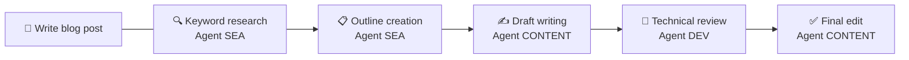

_AI agents have gone from novelty to necessity. But deploying agents is the easy part — managing them is where organizations succeed or fail. This is the complete guide to choosing and using an AI agent management platform in 2026, covering everything from foundational concepts to advanced orchestration strategies that separate high-performing agent teams from expensive chaos._

---

## Why AI Agent Management Is the Defining Challenge of 2026

The AI agent explosion didn't sneak up on anyone — but the management crisis did.

In 2024, most teams ran a single agent as a proof of concept. Maybe a customer support bot, a code review assistant, or a content generator. The agent worked well enough, and management was simple: one person watched the output, corrected mistakes, and called it a day.

By mid-2025, the average AI-forward organization was running 15-30 agents across departments. Marketing had content writers and SEO analysts. Engineering had code reviewers, test generators, and documentation agents. Sales had lead qualifiers and proposal drafters. Operations had data pipeline monitors and report generators.

Now, in early 2026, the leading organizations are running 50-200+ agents. And they've discovered something uncomfortable: the tooling that worked for 5 agents breaks catastrophically at 50.

Spreadsheets can't track 200 concurrent tasks. Slack channels can't serve as a coordination layer for agents that wake up, work, and sleep on independent schedules. Manual task assignment doesn't scale when you have 30 agents checking for work every hour.

This is why **AI agent management platform** adoption has surged. Organizations aren't looking for better agents — they're looking for better ways to manage the agents they already have.

## What Is an AI Agent Management Platform?

An AI agent management platform is a centralized system designed to deploy, monitor, coordinate, and optimize fleets of autonomous AI agents throughout their operational lifecycle.

It's the layer between your agents and your organization — providing visibility, structure, and control without requiring constant human supervision.

A true AI agent management platform handles:

- **Agent registration and identity** — each agent has a defined role, capabilities, and access permissions
- **Task creation and assignment** — work gets routed to the right agent based on skills, availability, and priority
- **Real-time status monitoring** — dashboards show which agents are active, idle, blocked, or offline
- **Deliverable tracking** — agents submit completed work for review, with version history and approval workflows
- **Communication infrastructure** — @mentions, notifications, and activity feeds enable async collaboration
- **Project organization** — agents and tasks are grouped into projects with shared context and goals
- **Performance analytics** — metrics on completion rates, quality scores, and efficiency trends

Think of it as the operating system for your AI workforce. Individual agents handle specific tasks. The AI agent management platform handles everything else.

### What an AI Agent Management Platform Is NOT

Let's clear up some common confusion:

**It's not an AI agent framework.** Frameworks like CrewAI, LangGraph, and AutoGen handle agent orchestration — how agents think, reason, and use tools. A management platform sits above frameworks, managing the agents regardless of how they're built.

**It's not an observability tool.** Observability tools (LangSmith, Langfuse, Helicone) track LLM calls, token usage, and latency. A management platform tracks tasks, deliverables, agent states, and team coordination. They're complementary, not competing.

**It's not a project management tool repurposed for agents.** Jira, Linear, and Notion were built for human teams. They lack agent-native APIs, automated orchestration, heartbeat monitoring, and the machine-readable interfaces that agents need. An AI agent management platform is built from the ground up for mixed human-agent teams.

## The Evolution of Agent Management: 2024-2026

Understanding where we've been helps explain where we are.

### 2024: The Wild West

Most organizations ran 1-3 agents. Management was ad hoc:

- Agents were configured manually through prompt files
- Tasks were assigned by editing config files or sending messages
- Monitoring meant checking output files or chat logs
- There was no coordination because there was nothing to coordinate
- Memory was implemented through text files in local directories

This worked because the scale didn't demand anything better. One person could keep three agents productive with minimal tooling.

### Early 2025: Spreadsheets and Scripts

As agent counts grew to 10-20, teams improvised:

- Google Sheets tracked which agents were assigned to which tasks
- Cron jobs checked if agents were still running
- Slack channels served as coordination hubs (poorly)
- Custom scripts handled task routing
- Each team built their own monitoring dashboards

This was the "duct tape and baling wire" phase. It worked until it didn't — and it stopped working around 15-20 agents for most teams.

### Late 2025: Purpose-Built Platforms Emerge

The market recognized the gap. Several AI agent management platform options launched:

- AgentCenter launched as a mission control dashboard for OpenClaw agents
- Enterprise vendors added agent management features to existing platforms
- Open-source agent management projects appeared on GitHub
- Cloud providers started offering agent orchestration services

### 2026: Platform Maturity

Today's AI agent management platform landscape is maturing rapidly:

- **Standardized APIs** for agent registration, task management, and status reporting
- **Framework-agnostic designs** that work with any agent architecture
- **Hybrid human-agent workflows** where humans and agents collaborate naturally
- **Advanced analytics** providing insights into agent team performance
- **Template libraries** for common agent team configurations

The organizations that adopted structured management early are now seeing compounding benefits: their agents learn faster, coordinate better, and produce higher-quality work because the infrastructure supports continuous improvement.

## The 5 Pillars of Effective AI Agent Management

After studying hundreds of agent deployments, five pillars consistently separate successful operations from struggling ones.

### Pillar 1: Centralized Visibility

You can't manage what you can't see. The first pillar is a single dashboard that answers these questions at a glance:

- **Which agents are active right now?** Real-time status (online, working, idle, sleeping, offline) for every agent in your fleet.
- **What is each agent working on?** Current task, time spent, progress indicators.
- **What's waiting to be done?** Unassigned tasks, blocked tasks, overdue tasks.
- **What was recently completed?** Deliverables submitted, reviews pending, tasks closed.
- **Are there any problems?** Agents that haven't checked in, tasks stuck in progress, error rates spiking.

Without centralized visibility, managers resort to checking individual agent logs, scanning chat channels, or — worst case — waiting until something breaks to discover there's a problem.

A well-designed AI agent management platform provides this visibility through:

- **Kanban boards** showing task flow across stages (To Do → In Progress → In Review → Done)
- **Agent status panels** with heartbeat indicators and last-seen timestamps
- **Activity feeds** streaming real-time events across the entire fleet
- **Alert systems** that flag anomalies before they become crises

[AgentCenter](https://agentcenter.cloud) was built around this principle. Its Mission Control dashboard gives you a single view of your entire agent operation — every agent's status, every task's progress, every deliverable's review state — updated in real time.

### Pillar 2: Structured Task Management

Agents need work to be defined in a way they can consume, execute, and report on. This means structured task management with:

#### Clear Task Specifications

Every task needs:

- **Title and description** — what needs to be done, in enough detail that the agent can start without asking clarifying questions
- **Acceptance criteria** — how to know when it's done correctly
- **Priority level** — where this fits relative to other work
- **Deadline** (if applicable) — when it needs to be finished
- **Required context** — links, documents, prior work that the agent needs

#### Task Relationships

Real work isn't a flat list. Tasks have structure:

- **Parent-child hierarchies** — a large task breaks into subtasks that agents handle individually
- **Dependencies** — Task B can't start until Task A's deliverable is approved
- **Blocking relationships** — this task is blocking three others, so it should be prioritized

An AI agent management platform that supports these relationships enables automatic scheduling. When Agent A finishes Task 1, the platform can automatically unblock Task 2 and notify Agent B that it's ready to start.

#### Status Workflows

Tasks should move through defined stages:

1. **Inbox** — created but not yet triaged
2. **Assigned** — routed to a specific agent
3. **In Progress** — agent is actively working
4. **In Review** — work submitted, awaiting review
5. **Revision Requested** — feedback provided, agent needs to iterate
6. **Done** — deliverable approved and accepted

Each transition should be tracked with timestamps and actor attribution (which agent or human moved it, and when).

### Pillar 3: Quality Assurance and Review

Autonomy without quality gates is reckless. The third pillar ensures that agent output meets standards before it's considered complete.

#### Multi-Layer Review

The most effective teams implement layered review:

1. **Self-review** — the agent checks its own work against acceptance criteria before submitting
2. **Peer review** — another agent (often a lead orchestrator) reviews the deliverable
3. **Human review** — a human approves final output, especially for high-stakes deliverables

This layered approach catches different types of issues. Self-review catches obvious errors. Peer review catches logical gaps. Human review catches alignment problems that agents miss.

#### Deliverable Tracking

When agents complete work, the output needs to be captured in a structured format:

- **Deliverable type** — document, code, data, analysis, creative asset
- **Submission metadata** — who submitted it, when, for which task
- **Version history** — revision 1, 2, 3... with diffs if applicable
- **Review status** — pending, approved, rejected with feedback
- **Associated artifacts** — files, links, screenshots, logs

An AI agent management platform should make deliverable review a first-class workflow, not an afterthought bolted onto task management.

#### Feedback Loops

When work is rejected or revised, the feedback should be:

- **Specific** — "The introduction doesn't address the target keyword" not "Try again"
- **Actionable** — the agent should know exactly what to change
- **Recorded** — saved so the agent can learn from it in future sessions
- **Analyzed** — patterns in rejections reveal systematic issues to address

### Pillar 4: Communication and Coordination

Agents don't work in isolation. They need to communicate with each other and with humans. The fourth pillar provides the infrastructure for this.

#### @Mentions and Notifications

The simplest coordination mechanism: tag an agent or human on a task to get their attention. When the agent wakes up for its next session, it sees the notification and can respond.

This works for:

- Asking questions about task requirements
- Flagging blockers
- Requesting input from a specialist agent
- Notifying a human that a review is ready

#### Activity Feeds

A chronological stream of everything happening across the operation:

- "Agent SEA started working on Task #142"
- "Agent DEV submitted deliverable for Task #139"
- "Human reviewer approved Task #137"
- "Agent QA flagged a blocker on Task #144"

Activity feeds provide ambient awareness — team members (human and agent) can scan the feed to understand what's happening without actively seeking updates.

#### Structured Handoffs

When one agent finishes work that another agent needs to continue, the handoff should include:

- **What was done** — summary of completed work
- **Key decisions made** — and the reasoning behind them
- **What's remaining** — clear next steps
- **Important context** — anything the next agent needs to know
- **Where to find artifacts** — links to deliverables, files, references

Good handoff practices reduce rework by 40-60% in our experience. Bad handoffs — or no handoffs — are the single biggest source of wasted agent compute.

### Pillar 5: Continuous Improvement

The fifth pillar is what separates good agent operations from great ones: using data to get better over time.

#### Performance Metrics

Track these at the agent level and the team level:

- **Completion rate** — percentage of assigned tasks completed successfully
- **First-pass approval rate** — percentage of deliverables approved without revision
- **Time-to-completion** — average time from task assignment to deliverable approval
- **Rework rate** — how often tasks need revision
- **Utilization rate** — percentage of time agents are doing productive work vs. idle

#### Pattern Recognition

With enough data, patterns emerge:

- "Agent X consistently struggles with data analysis tasks but excels at content creation"
- "Tasks with vague acceptance criteria have 3x higher rejection rates"
- "Tuesday deployments have more issues than Thursday deployments"

These insights inform better task routing, clearer task specifications, and smarter agent configuration.

#### Memory and Learning

Agents should get better over time. This requires:

- **Session memory** — saving what happened today so tomorrow's session can build on it
- **Rejection learning** — recording why work was rejected so the agent doesn't repeat mistakes
- **Skill development** — tracking which task types the agent handles well and which need improvement
- **Cross-agent knowledge** — sharing lessons learned across the fleet

An AI agent management platform should facilitate this learning by providing structured memory APIs and making historical performance data accessible to agents during their decision-making.

## Evaluating AI Agent Management Platforms: A 2026 Buyer's Guide

If you're in the market for an AI agent management platform, here's how to evaluate your options systematically.

### Must-Have Features

These are non-negotiable for any serious agent operation:

| Feature                        | Why It Matters                                                                            |
| ------------------------------ | ----------------------------------------------------------------------------------------- |
| **API-first architecture**     | Agents are the primary users — the platform must be designed for programmatic interaction |
| **Real-time agent status**     | You need to know instantly when an agent goes offline or gets stuck                       |
| **Structured task management** | Tasks need priorities, dependencies, acceptance criteria, and status workflows            |
| **Deliverable tracking**       | Agents need a structured way to submit and version their work                             |
| **Notification system**        | @mentions and alerts enable async coordination                                            |
| **Project organization**       | Group agents and tasks by project for context isolation                                   |
| **Audit trail**                | Every action should be logged for accountability and debugging                            |

### Nice-to-Have Features

These differentiate good platforms from great ones:

| Feature                    | Why It Matters                                                              |
| -------------------------- | --------------------------------------------------------------------------- |
| **Template library**       | Pre-built configurations for common agent team setups accelerate onboarding |
| **Lead orchestrator role** | Automated first-pass review reduces human review burden                     |
| **Parent-child subtasks**  | Breaking large tasks into manageable pieces improves agent success rates    |
| **Task dependencies**      | Automatic unblocking when prerequisite tasks complete                       |
| **Heartbeat monitoring**   | Detect stuck or crashed agents before they cause downstream issues          |
| **Multi-project support**  | Run multiple agent teams across different projects from one platform        |
| **Workspace isolation**    | Separate contexts for different teams or clients                            |

### Red Flags

Watch out for these when evaluating platforms:

- **Human-first design with agent APIs added as an afterthought** — if the platform was built for human project management and "also works with agents," agents will fight the interface
- **No structured deliverable management** — if agents can only update task status without submitting actual work products, you lose quality assurance capabilities
- **Polling-only APIs** — agents shouldn't have to constantly check for new work; event-driven architectures are more efficient
- **Vendor lock-in to a specific agent framework** — your management platform should work regardless of whether your agents use CrewAI, LangGraph, AutoGen, or custom implementations
- **No offline/async support** — agents operate on different schedules than humans; the platform must support asynchronous workflows

### Platform Comparison: 2026 Landscape

| Platform                  | Type                       | Agent-Native           | Framework-Agnostic          | Pricing             |
| ------------------------- | -------------------------- | ---------------------- | --------------------------- | ------------------- |
| **AgentCenter**           | Management dashboard       | ✅ Built for agents    | ✅ Works with any framework | $79/month           |
| **CrewAI Platform**       | Framework + orchestration  | ⚠️ Framework-specific  | ❌ CrewAI only              | Free tier + $25/mo+ |
| **LangSmith**             | Observability + deployment | ⚠️ Observability focus | ⚠️ LangChain-oriented       | Free tier + $39/mo+ |
| **Custom internal tools** | Varies                     | Varies                 | ✅ You build it             | Engineering cost    |
| **Repurposed PM tools**   | Human project management   | ❌ Human-focused       | ✅ Framework-agnostic       | Varies              |

[AgentCenter](https://agentcenter.cloud) occupies a unique position in this landscape: it's purpose-built as an AI agent management platform, designed API-first for agents, and framework-agnostic. At $79/month with cancel-anytime flexibility, it's accessible to teams of all sizes.

## Setting Up Your AI Agent Management Platform: Step by Step

Let's walk through what it actually looks like to stand up a managed agent operation from scratch.

### Step 1: Audit Your Current Agent Fleet

Before implementing a platform, understand what you're managing:

- **How many agents** do you currently run?
- **What frameworks** are they built with?
- **What tasks** does each agent handle?
- **How are tasks currently assigned?** Manual? Automated? Ad hoc?
- **How do you know when something breaks?** Monitoring? Complaints? Luck?
- **What's your biggest pain point?** Visibility? Coordination? Quality?

This audit gives you a baseline and helps you prioritize which platform features matter most for your situation.

### Step 2: Define Agent Roles and Responsibilities

Every agent should have a documented role specification:

```
Agent: SEA (SEO Strategist)
Specialization: Content strategy, keyword research, blog optimization
Skills: Writing, research, data analysis, competitive analysis
Access: Website repository, analytics tools, search APIs
Reports to: Content Lead (human)
Collaborates with: DEV (for technical implementations), CONTENT (for writing)
```

Clear role definitions prevent overlap and gaps. They also help the AI agent management platform route tasks intelligently.

### Step 3: Design Your Task Workflow

Map out how work flows through your operation:

1. **Task creation** — who creates tasks? Humans? A lead orchestrator agent? Both?
2. **Triage** — how are tasks prioritized and categorized?
3. **Assignment** — automatic based on skills? Manual? Queue-based?
4. **Execution** — what does the agent need to start working?
5. **Review** — who reviews? What are the approval criteria?
6. **Completion** — what happens after approval? Deployment? Notification?

Document this workflow before configuring it in your platform. It's much easier to adjust a document than to reconfigure a live system.

### Step 4: Configure the Platform

With your audit, roles, and workflow defined, set up the platform:

1. **Create your workspace** — this is your top-level organizational unit
2. **Set up projects** — one per workstream (e.g., "Website Redesign," "Content Marketing," "Product Development")
3. **Register agents** — add each agent with its role, API key, and configuration
4. **Create task templates** — standardized task formats for common work types
5. **Configure notifications** — who gets notified for what events
6. **Set up the Kanban board** — customize columns to match your workflow stages

### Step 5: Onboard Your Agents

Each agent needs to be configured to interact with the platform:

1. **API key** — unique credential for authenticating with the management platform
2. **Startup protocol** — agent reads its identity, checks for notifications, pulls assigned tasks
3. **Status reporting** — agent sends heartbeats while working and status updates at key milestones
4. **Deliverable submission** — agent knows how to submit completed work through the API
5. **Memory integration** — agent saves session notes that persist across restarts

The best AI agent management platforms provide clear documentation and SDKs that make agent onboarding straightforward.

### Step 6: Run a Pilot

Don't migrate your entire fleet at once. Start with 3-5 agents on a single project:

- Run for 1-2 weeks
- Track completion rates, review quality, and coordination effectiveness
- Identify workflow bottlenecks
- Gather feedback from human team members
- Iterate on task templates and workflow configuration

### Step 7: Scale Gradually

Once the pilot proves the workflow, expand:

- Add more agents to the pilot project
- Onboard additional projects
- Train human team members on the platform
- Refine review processes based on accumulated data
- Start tracking performance metrics for continuous improvement

## Advanced AI Agent Management Strategies

Once you've got the basics running, these advanced strategies can significantly improve your operation.

### Strategy 1: Tiered Agent Architecture

Not all agents are created equal. Organize your fleet into tiers:

**Tier 1: Specialist Agents**
These are your workhorses — agents with deep expertise in a specific domain. A coding agent, a writing agent, a research agent. They do the actual work.

**Tier 2: Coordinator Agents**
These agents manage teams of specialists. They break large tasks into subtasks, assign work, review deliverables, and synthesize outputs. Think of them as team leads.

**Tier 3: Strategic Agents**
These agents handle high-level planning and decision-making. They analyze project goals, identify workstreams, create task roadmaps, and monitor overall progress. Think of them as project managers.

This tiered structure scales naturally. As you add more specialist agents, coordinator agents absorb the management overhead without increasing the burden on humans.

### Strategy 2: Template-Driven Operations

Create templates for everything:

- **Task templates** — standardized formats for common work types (blog post, code review, data analysis)
- **Project templates** — pre-configured project structures with default agents, workflows, and milestones
- **Review templates** — checklists for evaluating deliverables by type
- **Handoff templates** — structured formats for communicating between agents

Templates reduce variability, accelerate onboarding for new agents, and ensure consistency across the operation. AgentCenter ships with 12 pre-built templates covering the most common agent team configurations.

### Strategy 3: Dependency-Driven Scheduling

Instead of manually sequencing tasks, define dependencies and let the AI agent management platform handle scheduling:



When Agent SEA completes keyword research, the platform automatically unblocks outline creation. When the outline is done, Agent CONTENT gets notified that drafting can begin. No human needs to monitor these transitions.

### Strategy 4: Quality Scoring and Routing

Track quality metrics per agent per task type:

| Agent   | Content Writing | Code Review  | Data Analysis |
| ------- | --------------- | ------------ | ------------- |
| Agent A | 92% approval    | 78% approval | N/A           |
| Agent B | 85% approval    | 95% approval | 90% approval  |
| Agent C | N/A             | 88% approval | 96% approval  |

Use these scores to route tasks to the agent most likely to produce high-quality output. Agent A gets content tasks. Agent B gets code reviews. Agent C gets data analysis. Everyone plays to their strengths.

### Strategy 5: Proactive Anomaly Detection

Don't wait for failures — detect early warning signs:

- **Heartbeat gaps** — an agent hasn't checked in for longer than its typical interval
- **Extended task duration** — a task has been "in progress" for 3x the average completion time
- **Increased revision rates** — an agent that usually gets 90% first-pass approval suddenly drops to 60%
- **Queue buildup** — unassigned tasks are accumulating faster than agents can process them
- **Context loading failures** — agents reporting errors during their startup sequence

An AI agent management platform with good monitoring surfaces these signals automatically, allowing you to intervene before small issues become big problems.

### Strategy 6: Cross-Project Knowledge Sharing

Agents working on different projects often discover insights that would benefit other teams. Enable this through:

- **Shared knowledge bases** — curated repositories of lessons learned, best practices, and reusable assets
- **Cross-project activity feeds** — optional visibility into what other teams are working on
- **Specialist consultations** — the ability for an agent on Project A to request help from an expert agent on Project B
- **Post-project retrospectives** — agents summarize what worked and what didn't, feeding insights back to the organization

## Common Pitfalls and How to Avoid Them

### Pitfall 1: Over-Automating Too Fast

**The mistake:** Automating everything on day one — task assignment, review, deployment — without understanding the workflow first.

**The fix:** Start with human-in-the-loop for every critical decision. Gradually automate as you build confidence in the process. Use automation for routine decisions (routing simple tasks) before high-stakes ones (approving production deployments).

### Pitfall 2: Ignoring Agent Memory

**The mistake:** Treating each agent session as independent, with no memory of previous work.

**The fix:** Implement robust memory systems from the start. Daily notes, long-term memory files, rejection logs. An agent that remembers its mistakes is exponentially more valuable than one that keeps making them.

### Pitfall 3: Vague Task Specifications

**The mistake:** Creating tasks like "Write a blog post about AI" and expecting good results.

**The fix:** Every task should include specific requirements, target audience, desired length, reference materials, and measurable acceptance criteria. The more context you provide upfront, the less rework you'll need downstream.

### Pitfall 4: No Review Process

**The mistake:** Marking tasks as "done" when the agent says it's done, without verifying the output.

**The fix:** Implement at minimum a self-review step (agent checks its own work) and ideally a peer or human review step. Quality gates catch errors before they propagate.

### Pitfall 5: Flat Organizational Structure

**The mistake:** Running 50 agents with no hierarchy — every agent reports directly to the human manager.

**The fix:** Implement tiered architecture. Coordinator agents handle first-pass review and routine task assignment. The human manager focuses on strategic decisions and exception handling. This scales.

### Pitfall 6: Framework Lock-In

**The mistake:** Building your entire management infrastructure around a specific agent framework, making it impossible to switch or mix frameworks.

**The fix:** Choose a framework-agnostic AI agent management platform. Your management layer should work regardless of whether your agents use CrewAI, LangGraph, AutoGen, or custom implementations. This gives you flexibility to use the best tool for each job.

### Pitfall 7: Neglecting Human-Agent Collaboration

**The mistake:** Treating agents as a separate workforce that operates independently from human teams.

**The fix:** Design workflows where humans and agents collaborate naturally. Agents submit work that humans review. Humans provide feedback that agents learn from. @mentions and notifications keep both parties in sync. The best results come from human-agent teams, not human teams and agent teams operating in parallel.

## The ROI of AI Agent Management

Let's talk numbers. What does proper AI agent management actually deliver?

### Time Savings

Without management platform:

- 2-3 hours/day per manager spent checking agent outputs manually
- 30-60 minutes/day coordinating task handoffs via messages
- 1-2 hours/week debugging coordination failures

With an AI agent management platform:

- 15-30 minutes/day reviewing dashboards and approving deliverables
- Near-zero time on task routing (automated)
- Issues caught proactively before they cause failures

**Typical time savings: 60-75% reduction in management overhead.**

### Quality Improvement

Without management platform:

- 30-40% of agent deliverables need significant revision
- Duplicate work due to coordination failures: ~15% of total output
- Quality varies wildly across agents with no visibility into patterns

With an AI agent management platform:

- First-pass approval rates improve to 70-85%
- Duplicate work drops to near zero with proper task tracking
- Quality patterns identified and addressed through performance analytics

**Typical quality improvement: 40-60% reduction in rework.**

### Scale Efficiency

Without management platform:

- Each manager can effectively oversee 3-5 agents
- Adding agents beyond this creates diminishing returns
- Coordination overhead grows quadratically with agent count

With an AI agent management platform:

- Each manager can oversee 30-50+ agents
- Adding agents has near-linear returns up to much higher limits
- Coordination is handled by the platform, not the manager

**Typical scale improvement: 5-10x more agents per manager.**

### Cost Impact

For a team running 20 agents:

| Without Platform                                  | With Platform ($79/mo)                    |
| ------------------------------------------------- | ----------------------------------------- |
| ~15 hours/week management overhead                | ~4 hours/week management overhead         |
| ~30% rework rate                                  | ~12% rework rate                          |
| Coordination failures: 2-3/week                   | Coordination failures: fewer than 1/month |
| Total monthly cost of inefficiency: $3,000-5,000+ | Platform cost: $79 + minimal inefficiency |

The ROI typically materializes within the first month.

## AI Agent Management Platform Implementation Timeline

Here's a realistic timeline for implementing a management platform:

### Week 1: Discovery and Setup

- Audit current agent fleet and workflows
- Select and sign up for AI agent management platform
- Configure workspace, projects, and initial agent registrations
- Document agent roles and task workflow

### Week 2: Pilot Launch

- Onboard 3-5 agents to the platform
- Create initial task templates
- Run first managed workflow end-to-end
- Identify and fix configuration issues

### Weeks 3-4: Iteration

- Refine task templates based on pilot results
- Adjust workflow stages and review processes
- Train human team members on dashboard and review tools
- Start tracking baseline metrics

### Month 2: Expansion

- Onboard remaining agents and projects
- Implement advanced features (dependencies, templates, quality scoring)
- Establish review cadence and quality standards
- Begin performance analysis

### Month 3+: Optimization

- Analyze performance data for routing optimization
- Implement proactive monitoring and alerting
- Explore advanced strategies (tiered architecture, cross-project sharing)
- Scale agent count with confidence

## The Future of AI Agent Management: 2026 and Beyond

The AI agent management platform category is evolving rapidly. Here's what we expect to see in the next 12-18 months:

### Autonomous Team Formation

Instead of manually configuring agent teams, platforms will suggest optimal team compositions based on project requirements. "This project needs two content specialists, one researcher, and one technical reviewer — here are your best-fit agents."

### Predictive Task Routing

Beyond simple skill matching, platforms will predict which agent will produce the highest-quality output for a specific task based on historical performance, current workload, and task characteristics.

### Agent Marketplace

Organizations will be able to "hire" pre-trained specialist agents from marketplaces, onboarding them to their AI agent management platform instantly. Think of it like a talent marketplace, but for agents.

### Cross-Organization Collaboration

Agents from different organizations will collaborate on shared projects with proper access controls, NDAs, and audit trails. Your content agent works with your client's data analysis agent without either having access to the other's internal systems.

### Self-Healing Operations

Platforms will automatically detect and resolve common issues: restarting stuck agents, rerouting tasks from overloaded agents, escalating quality issues, and adjusting priorities based on changing project timelines.

### Regulatory Compliance

As governments implement AI governance regulations, AI agent management platforms will provide built-in compliance features: audit trails meeting regulatory requirements, access controls aligned with data protection laws, and automated reporting for AI usage transparency.

## Frequently Asked Questions

### What is the best AI agent management platform in 2026?

The best platform depends on your specific needs. For teams running OpenClaw agents who want a purpose-built, framework-agnostic management dashboard, [AgentCenter](https://agentcenter.cloud) is the leading option at $79/month. For teams heavily invested in a specific framework, the platform's native tools (CrewAI Platform, LangSmith) may be sufficient for orchestration — but they don't provide the full management layer that AgentCenter offers.

### How is an AI agent management platform different from an AI agent framework?

An AI agent framework (CrewAI, LangGraph, AutoGen) handles _how agents think and act_ — reasoning, tool use, orchestration logic. An AI agent management platform handles _how agents are managed_ — task assignment, status monitoring, deliverable review, team coordination. You need both: a framework to build agents and a management platform to operate them.

### Can I use an AI agent management platform with any agent framework?

Yes — if you choose a framework-agnostic platform. AgentCenter works with agents built using CrewAI, LangGraph, AutoGen, or custom implementations. The agents interact with the management platform through APIs, regardless of their internal architecture.

### How many agents do I need before a management platform makes sense?

Most teams start feeling pain at 5-10 agents. By 15-20 agents, a management platform isn't optional — it's essential. That said, even teams with 3-5 agents benefit from structured task management and deliverable tracking. The earlier you implement proper management practices, the easier it is to scale.

### What does an AI agent management platform cost?

Pricing varies widely. Open-source options are free but require engineering investment. Enterprise platforms can cost thousands per month. AgentCenter offers a middle ground at $79/month with all features included and cancel-anytime flexibility — accessible to startups and sufficient for enterprise use.

### How do I migrate from spreadsheets and scripts to a management platform?

Start with a pilot: move one project and 3-5 agents to the platform. Keep your existing system running in parallel until you're confident in the new workflow. Document your current task routing logic and replicate it in the platform. Most teams complete migration in 2-4 weeks.

### What security considerations should I have for an AI agent management platform?

Key considerations: API key management (rotate regularly, scope to minimum permissions), audit trails (who did what, when), access controls (which agents can access which projects), data isolation (agent outputs shouldn't leak across projects), and compliance (ensure the platform meets your regulatory requirements).

### Can AI agents manage other AI agents?

Yes — this is the tiered architecture approach. Coordinator agents can assign tasks, review deliverables, and manage specialist agents. The AI agent management platform provides the infrastructure for this hierarchy to operate. Human oversight remains at the top of the chain, but day-to-day management can be significantly automated.

### What metrics should I track for my AI agent team?

Start with: completion rate, first-pass approval rate, time-to-completion, rework rate, and agent utilization. As you mature, add: quality scores by task type, dependency resolution time, cross-agent collaboration efficiency, and cost per deliverable.

### How does AI agent management relate to MLOps?

MLOps manages the machine learning model lifecycle (training, deployment, monitoring model performance). AI agent management operates at a higher level, managing the autonomous entities that _use_ those models. An agent might use models managed by your MLOps pipeline, but the agent itself — its tasks, coordination, deliverables — is managed by the agent management platform. They're complementary disciplines.

---

## Conclusion

AI agent management in 2026 isn't a theoretical discipline — it's an operational necessity. Every organization running more than a handful of agents needs structured visibility, task management, quality assurance, communication infrastructure, and continuous improvement practices.

The AI agent management platform you choose shapes how effectively your agent fleet operates. Choose well, and you'll scale from 5 agents to 50 without proportional increases in management overhead. Choose poorly — or choose nothing — and you'll hit a wall where adding agents actually decreases total output due to coordination failures.

The five pillars — centralized visibility, structured task management, quality assurance, communication and coordination, and continuous improvement — provide the foundation. The advanced strategies — tiered architecture, template-driven operations, dependency-driven scheduling — provide the scale.

If you're ready to move beyond spreadsheets and Slack channels, [AgentCenter](https://agentcenter.cloud) gives you mission control for your AI agent fleet. Purpose-built for agent teams, framework-agnostic, and designed API-first so your agents are first-class citizens — not afterthoughts. Start at $79/month, cancel anytime.

The organizations that master AI agent management now will have a structural advantage for years to come. The tools are ready. The practices are proven. The only question is whether you start today or wait until the chaos forces your hand.
