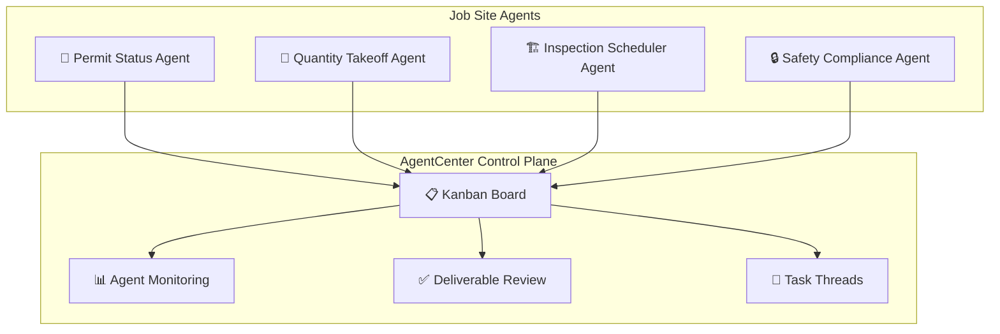

Construction tech teams often build their first agent for something specific. Maybe it's a permit status checker that hits county portals each morning and drops updates to a shared doc. Or an agent that extracts quantities from PDF drawings so estimators don't have to do it by hand.

That first agent works great. So you build a second one. Then a few more.

By the time you have 12 agents running across 3 active job sites, you've stopped knowing what any of them are actually doing on a given day. Outputs land in folders no one checks. Errors disappear into quiet cron logs. And you find out something broke when an estimator calls to say their takeoff numbers look wrong.

That's the coordination problem. The agents aren't the issue. The missing layer between them and your team is.

## What Breaks Without a Control Plane

Construction tech teams hit three failure patterns once they scale past 5 or 6 agents:

**Silent empty results from permit agents.** A permit status agent runs every morning and posts to Slack. County portal updates its session handling. The agent starts returning nothing. But the Slack message format looks fine, so nobody flags it for 10 days. By then, two subcontractor schedules are built on stale permit data.

**Untrusted takeoff outputs.** A quantity extraction agent processes structural drawings and writes results to a shared folder. Three estimators pull from it directly. When a drawing template changes mid-project, the agent extracts garbage for 5 runs before anyone notices. All three estimators are quoting from bad numbers.

**Broken agent chains.** The inspection scheduling agent depends on output from the permit agent. When permit data goes stale, the scheduler fills gaps with cached results. No single error is alarming. The combination causes a 3-day delay on a concrete pour because the inspection window was wrong.

These aren't edge cases. They happen when agents run in parallel with no shared view.

## How AgentCenter Fixes the Coordination Layer

**Kanban board for task visibility.** Each agent task appears as a card. When the permit agent returns empty results, the card sits in a visible column instead of disappearing into a Slack message. A PM or coordinator spots it in 30 seconds during their morning check. No message archaeology required.

[Task orchestration](/features/task-orchestration) in AgentCenter is built specifically for this: tracking what each agent produced, when, and whether it needs human attention before the next step depends on it.

**Real-time agent status.** AgentCenter shows whether each agent is running, idle, blocked, or erroring. When your inspection scheduler shows "blocked" because its upstream permit agent hasn't produced valid output, you see that immediately. Not 3 days later when someone asks why the inspection window was missed.

**Deliverable review before outputs get used.** Quantity takeoff results don't have to land in a shared folder and get trusted on arrival. Route them through a review step in AgentCenter. One person, 2 minutes, confirms the output looks right before it's available to the estimating team. That single gate would have caught the template issue in the example above on day one instead of day five.

**@Mentions and task threads.** When an agent produces something that needs a human decision, the task card in AgentCenter lets you tag the right person directly. Context lives on the task, not scattered across email threads or Slack DMs.

**Cost tracking per agent.** Permit research agents making hundreds of API calls per day add up fast. AgentCenter tracks cost per task so you can see exactly what each agent is spending per run. If your drawing extraction agent jumps from $0.60 to $4.10 overnight, you see it in the [agent monitoring](/features/agent-monitoring) dashboard before it hits your monthly bill.

## The Numbers for Construction Tech Teams

A construction tech team managing 3 to 5 active job sites typically runs 8 to 20 agents. The mix usually covers permit tracking, inspection scheduling, cost estimation support, safety compliance documentation, and RFI summarization.

The **Pro plan at $29/month** covers up to 15 agents across 15 projects. That handles most mid-sized teams. The **Scale plan at $79/month** fits teams managing larger project portfolios or running concurrent agents across many sites.

What it replaces: a combination of cron jobs, Slack channels nobody monitors consistently, and shared folders that everyone trusts more than they should.

## Before vs After AgentCenter

| | Without AgentCenter | With AgentCenter |
|---|---|---|
| Visibility | No shared view of which agents ran or what they returned | Real-time status board per project or job site |
| Task handoffs | Outputs land in shared folders; humans check when they remember | Task cards with status, dependencies, and review gates |
| Error detection | Failures discovered days later by affected users | Blocked or erroring agents visible immediately |
| Cost tracking | Monthly LLM invoice with no per-agent breakdown | Cost tracked per task, per agent, per project |
| Debugging time | 3 to 4 hours tracing what failed and when | 20 minutes in the activity log |

## Where to Start

Set up the kanban board first. Before adding monitoring or approval workflows, just get all your active agents posting task cards to one shared board. Even a single board with 8 agent outputs is more useful than 8 separate Slack channels. It creates a daily reference that every PM, estimator, and coordinator can check in under a minute.

Once you can see everything in one place, the gaps become obvious: which agents need a review gate, which ones have dependencies, and which ones are quietly failing.

---

*Construction tech teams that add a control plane early spend less time firefighting later. [Start your 7-day free trial](/pricing).*
