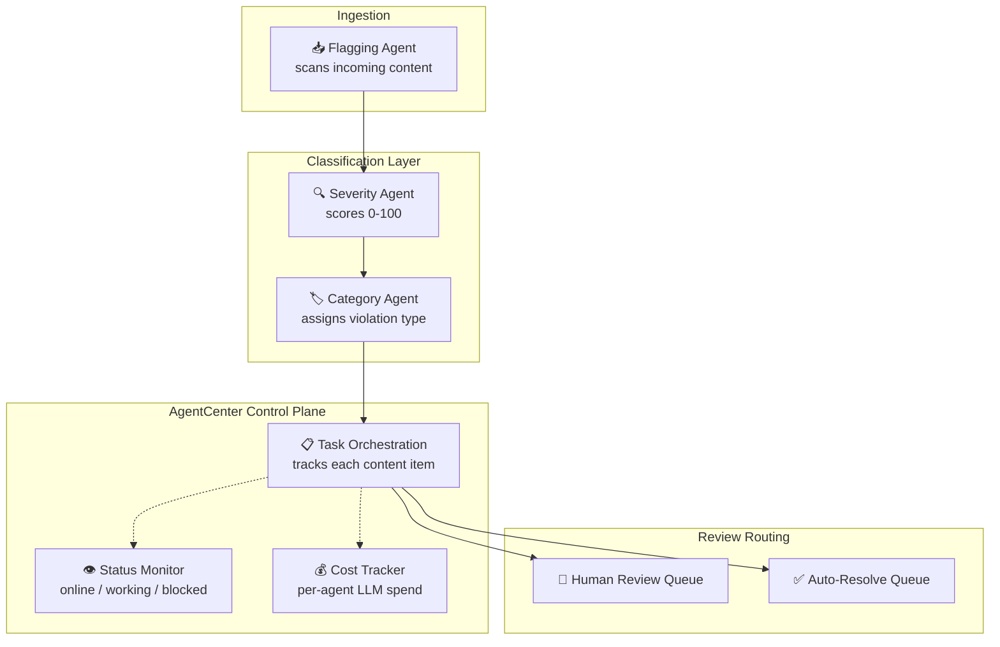

Content moderation teams run some of the most demanding agent pipelines in production. A typical setup has flagging agents scanning incoming content, classification agents scoring severity, routing agents assigning items to review queues, and reporting agents summarizing daily volumes. That's anywhere from 10 to 30 agents, running 24/7, with real consequences when something breaks.

The problem is that most teams manage all of this from log files, Slack pings, and gut feeling. There's no control plane. There's no single view. And there's definitely no early warning system.

## What breaks without a control plane

Running content moderation agents without visibility is like managing a review floor where you can't see which reviewers are working, which are stuck, and which stopped showing up entirely.

Here are three things that happen to content moderation teams once they scale past a handful of agents:

**The silent failure.** A flagging agent stops processing at 2am. No error thrown. No crash. It just stops. Because there's a buffer queue, items don't pile up immediately. By the time your morning shift notices, six hours of content has gone unflagged. You spend the first two hours of the day in logs piecing together what happened.

**Queue ownership confusion.** You have four classification agents feeding five review queues. One queue gets overloaded while two others sit empty. Nobody can trace which agent fed which queue without manually correlating timestamps across multiple log files. Items either wait hours or land with the wrong team entirely.

**Cost spikes nobody caught.** A classification agent hits an edge case and enters a retry loop. It makes 500 extra LLM calls on content it keeps failing to score correctly. This runs for two days. You find out when the invoice arrives.

## How AgentCenter fits into moderation workflows

Content moderation teams that add AgentCenter get a control plane between their agent code and their review team. Here's which features directly address the problems above.

### Real-time agent status

AgentCenter shows every agent as online, working, idle, or blocked. When a flagging agent stops processing, it shows as blocked within seconds. Your team lead sees it on the [agent monitoring dashboard](/features/agent-monitoring) without opening a terminal or Slack.

*Concrete example: your overnight flagging agent goes idle at 3:47am. On-call sees a blocked status at 3:48am. They restart the agent at 3:51am. Six hours of missed content drops to four minutes of downtime.*

### Task orchestration across queues

Each content item becomes a task in the [Kanban board](/features/task-orchestration). When a flagging agent marks something as potentially violating, it creates a task and passes it to the classification agent. When classification scores it above threshold, the task moves to the right review queue with the correct team tagged. You can see the full chain in one place.

No more guessing which agent sent what to which queue.

### Per-agent cost tracking

Every agent has its own cost counter in the AgentCenter analytics feed. If a classification agent's spend spikes 40x in an hour, you see it in real time. You can pause the agent, inspect the task log, and identify the offending items before the loop continues.

### Approval workflows for escalations

Some items can't be auto-resolved. They need a human call. AgentCenter's approval workflow lets classification agents flag escalations directly in the dashboard, where reviewers see them with full context attached. The reviewer approves or rejects in-platform, and the next agent picks up the decision automatically. No Slack threads. No email chains with missing context.

Here's how a typical moderation pipeline runs through AgentCenter:

## The numbers

A mid-sized content moderation team typically runs 12 to 25 agents: 3 to 5 flagging agents (split by content type or platform), 5 to 10 classification agents, 3 to 5 routing agents, and 2 to 3 reporting agents.

The Pro plan at $29/month covers up to 15 agents. Most teams start there. If you're running pipeline variants across multiple platforms or content categories, the Scale plan at $79/month covers up to 50 agents.

What it replaces: the combination of custom monitoring scripts, Slack alert bots, and shared dashboards most teams have assembled over time. See the [pricing page](/pricing) for full plan details. There's a 7-day free trial on all monthly plans.

## Before vs after

| Area | Without AgentCenter | With AgentCenter |
|---|---|---|
| Visibility | Check logs to know if agents are running | Live status per agent, visible to all leads |
| Task handoffs | Items fall between queues, hard to trace | Full chain from flagging to review in one view |
| Error detection | Silent failures found hours after the fact | Blocked status visible within seconds |
| Cost tracking | LLM invoice surprise at month end | Per-agent spend tracked in real time |
| Debugging time | 2 to 4 hours per incident | 15 to 30 minutes with full task trace |

## Where to start

Connect your flagging agents to AgentCenter first. Just getting real-time status on those agents changes how your team responds to incidents. You stop asking "is the flagging agent running?" and start getting alerted when it's not.

Once you're comfortable with what blocked vs idle looks like in your environment, add task orchestration for your review routing layer. That's where most teams see the biggest immediate win: items stop disappearing between queues, and you have a clear audit trail for every piece of content that went through your pipeline.

---

*Content moderation teams that add a control plane early spend less time firefighting later. [Start your 7-day free trial](/pricing).*
