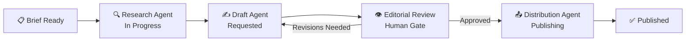

Running AI agents for content operations sounds great in theory. Research agent pulls trending topics. Draft agent turns briefs into first passes. SEO agent audits every post before it goes live. Distribution agent pushes approved content to your CMS, email queue, and social scheduler.

You build the pipeline and go.

Then you hit 12 agents. A brief sits unprocessed for three days because the handoff between the research and draft stages broke silently. A post goes live with wrong structured data and nobody knows which agent missed it. You spend $400 this month on model calls but have no idea which content type is eating most of the budget.

That's the part nobody plans for.

## What Breaks in a Content Operations Agent Pipeline

The problem isn't the agents themselves. The problem is that content operations is a chain of handoffs, and every agent in that chain is a potential failure point with no visibility attached to it.

Here are the three failure modes that hit content ops teams first:

**Silent handoff failures.** Your research agent finishes a batch of topic briefs and writes them to a shared folder. Your draft agent is supposed to pick them up. But a file path changed two weeks ago and nobody noticed. Sixty briefs are sitting there unprocessed. You find out when a writer asks why their content queue is empty.

**Error attribution eats your afternoon.** A post goes live with broken structured data. Was it the SEO agent that missed the flag? The QA agent that skipped the check? The distribution agent that reformatted the payload on the way to the CMS? You have logs somewhere, but they're spread across three systems and a Slack thread.

**Cost per piece is a guess.** You know total model spend. You don't know if it's the draft agent burning through GPT-4 on short posts, or the research agent making 200 API calls per batch to pull data you don't always use. You can't cut what you can't see.

## How AgentCenter Fits a Content Ops Workflow

The [AgentCenter dashboard](/features/agent-dashboard) sits between your agents and your team. You don't rewrite how your agents work. You add task tracking, status visibility, and review gates on top of what's already running.

### Kanban Board for Pipeline Stages

Every piece of content becomes a task card. You set up columns that match your actual workflow: Brief Ready, Research In Progress, Draft Requested, In Editorial Review, Approved, Published.

Agents update task status as they work. When the research agent finishes a brief, it moves the card forward. When the draft agent picks it up, the card moves again. The whole team sees the full pipeline in one view without asking anyone for a status update.

### Real-Time Agent Status Monitoring

AgentCenter's [agent monitoring](/features/agent-monitoring) shows which agents are online, working, idle, or blocked right now. When the SEO audit agent stalls on post 47, you see it immediately. No polling Slack. No waiting for a writer to report something feels off.

Run history per agent is also available. If drafts started coming back short last Tuesday, you can pull the activity log for that day and find exactly when the behavior changed.

### Deliverable Review and Approval

Drafts and research outputs appear as deliverables attached to their task cards. Editors review content directly in AgentCenter, leave comments via @mentions, and either approve or send back with specific revision notes. The draft agent picks up the revision flag and reruns.

No more "I left feedback in a Google Doc somewhere."

### Per-Agent Cost Tracking

AgentCenter's analytics break down model call costs by agent. You'll find out your draft agent costs four times your research agent per task. Not because drafts are harder, but because someone configured it to call a large model on posts where a smaller one would do.

That one finding typically saves content teams 20-30% on monthly model spend.

## The Numbers for Content Operations Teams

A typical content ops setup runs 8 to 15 agents: research, drafting, SEO auditing, QA, and distribution. The [Pro plan at $29/month](/pricing) covers up to 15 agents across 15 projects, which fits most teams. Teams running content at higher volume, or with more specialized agents per content type, fit better on Scale at $79/month.

What AgentCenter replaces: the shared Notion doc tracking agent status by hand, the custom scripts logging which agent ran last, the Slack threads that substitute for task handoff confirmations, and the monthly spreadsheet guessing at LLM cost by content type.

## Before vs After

| | Without AgentCenter | With AgentCenter |
|---|---|---|
| **Visibility** | No idea which agents are running or idle | Real-time status for every agent in the pipeline |
| **Task handoffs** | File-based, silent, easy to miss | Tracked task cards with stage transitions |
| **Error detection** | Discovered when writers ask why queues are empty | Flagged immediately in the monitoring view |
| **Cost tracking** | Total monthly spend only | Per-agent cost breakdown by task type |
| **Debugging time** | 45+ minutes across logs, Slack, and file systems | Under 10 minutes with run history |

## Where to Start

Set up the Kanban board first. Map your content stages to columns. Wire your two most active agents to update task status when they start and finish work. You don't need all 14 agents connected on day one.

Start with the draft agent and the editorial review column. Once editors can see incoming drafts as task cards and leave feedback without leaving the tool, you have proof the workflow holds. Add other agents from there.

The teams that get value fastest are the ones who resist trying to connect everything at once. Pick the one handoff that causes the most confusion, wire it up, and watch the Slack noise drop.

---

*Content operations teams that add a control plane early spend less time firefighting later. [Start your 7-day free trial](/pricing).*
