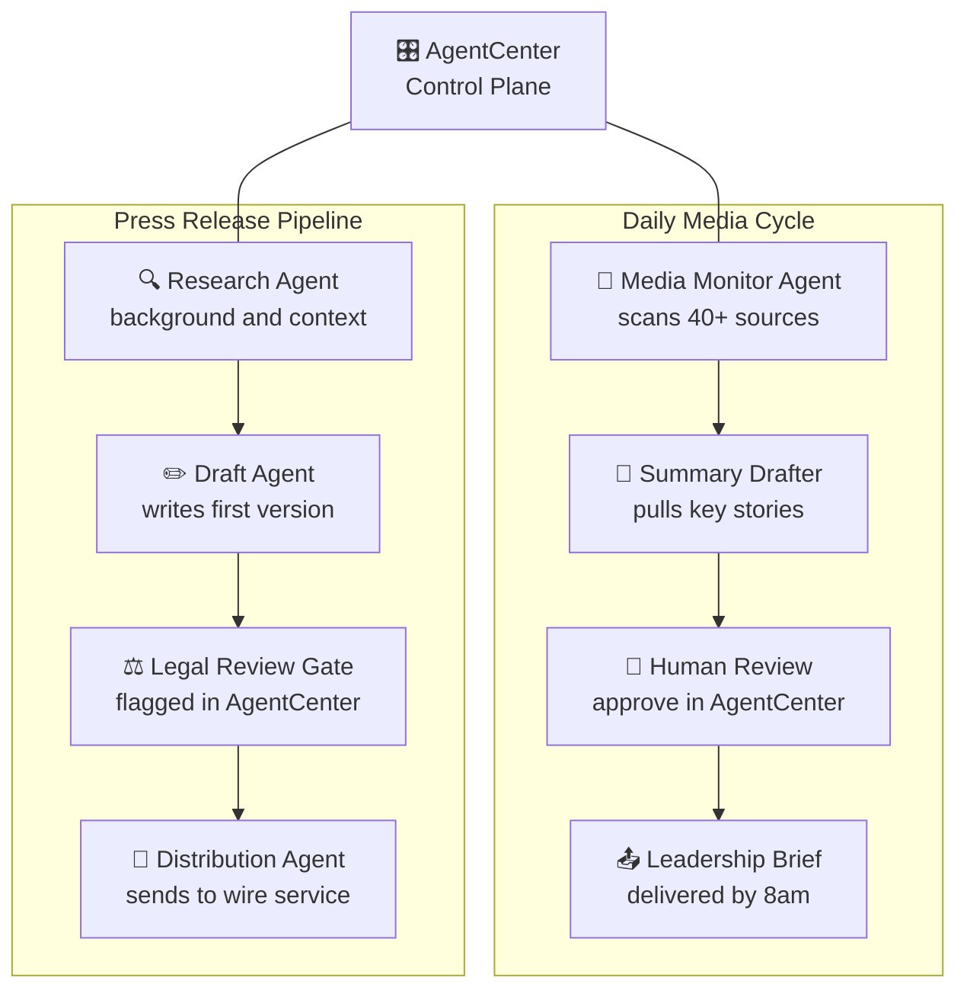

Corporate communications teams have a specific morning problem. By 7:45, someone needs a coverage summary ready for the CEO. By 9am, talking points drafted for a briefing call. Somewhere in between, a press release needs to move from research to draft to legal review.

That's three agent pipelines running in parallel. No single person is watching all of them. And when one breaks, you often find out at the wrong moment.

## The Control Problem Comms Teams Hit First

Corporate communications teams adopt AI agents faster than most. The use cases are obvious: media monitoring, sentiment tracking, draft generation, stakeholder briefing. But when you go from one or two agents to a set of them running daily workflows, the management overhead shows up in ways nobody planned for.

Here are three specific things that break without a control plane.

**You don't know if the morning scan finished.** Your media monitoring agent runs overnight. It covers 40+ sources, tags relevant coverage, and is supposed to have a summary ready before the 8am leadership call. But there is no status indicator. You find out it timed out when someone asks "did anything happen with the merger story?" and the answer is "we're not sure."

**Handoffs between agents go silent.** A research agent pulls background on a breaking story. A drafting agent is supposed to pick up that output and write the first version of a statement. When the research agent finishes late, or with partial output, the drafting agent runs on stale context. The draft comes out wrong. You don't know why until you trace it manually.

**You can't see what anything costs.** Ten agents are running across two client accounts. One of them is burning 4x the tokens of the others because the prompt pulls in too much context. You won't know until the API bill arrives. By then, a month of overspend is done.

## How AgentCenter Fits Into a Comms Workflow

### Real-time agent status

AgentCenter shows every agent as online, working, idle, or blocked. When your media monitoring agent is still running at 7:40am, you see it on the [dashboard](/features/agent-dashboard). You can decide whether to wait or pull what it has. You're not guessing. You're not waiting for a Slack message that never comes.

**Example:** The overnight media scan starts at 2am. By 6:30am, the AgentCenter status board shows it completed at 5:48am and the summary deliverable is in review. The comms lead approves it at 7:15am. The brief lands in the CEO's inbox at 7:30am.

### Task dependencies and sequencing

AgentCenter lets you set task dependencies so one agent can't start until another finishes. For a press release pipeline, that means the draft agent waits for the research agent to submit its output before it begins. The handoff is enforced, not assumed.

When the research agent runs late, the drafting agent sits in the queue. You see the blocked status. You can decide to push a partial or wait. Either way, you're in control.

See how this works in the [task orchestration features](/features/task-orchestration).

### Deliverable review before output ships

Every press statement, every CEO briefing, every draft that comes out of an agent goes through a review gate in AgentCenter. Your comms lead sees the deliverable, approves or flags it, and the next stage doesn't run until that decision is made. Nothing ships without a human in the loop.

This matters for communications work more than most. A draft that goes to wire without review is not a workflow problem. It's a crisis.

### Cost tracking per agent

AgentCenter shows token spend per agent and per task. When one agent is running 3x over the expected cost, you see it in the [agent monitoring view](/features/agent-monitoring) before the month ends. You can pull the task history, see what it's processing, and decide whether to trim the context window or route those tasks to a smaller model.

## The Numbers for a Typical Comms Team

A mid-size corporate communications team running agents for daily media monitoring, press drafting, stakeholder briefing, and social coverage usually operates 8 to 15 agents across two or three projects. That lands squarely in the Pro plan at $29 per month.

What it replaces: a mix of Slack threads for status updates, spreadsheets for tracking what ran, and mental models for remembering which agent handles which client. None of that scales past the first incident.

## Before vs After

| | Without AgentCenter | With AgentCenter |
|---|---|---|
| Visibility | Ask around to find out if the morning scan ran | Live status on each agent, visible at a glance |
| Task handoffs | Research output copied manually to drafting prompts | Enforced dependencies keep the pipeline in sequence |
| Error detection | Discover failures when a deliverable is missing | Blocked or failed agents show immediately |
| Cost tracking | Month-end bill with no breakdown | Per-agent, per-task cost visible in real time |
| Debugging time | 30-60 minutes tracing logs after a missed deadline | Activity feed shows when each step ran and what it returned |

## Where to Start

Set up your daily media cycle as a project in AgentCenter first. Add each agent stage as a task card (scan, summarize, review, brief), configure the dependencies between them, and turn on deliverable review for the summary step.

Once you can see the morning cycle running in the right order, the rest of the platform clicks into place. You already have the hardest workflow mapped. The others follow the same pattern.

---

*Corporate communications teams that add a control plane early spend less time firefighting later. [Start your 7-day free trial](/pricing).*
