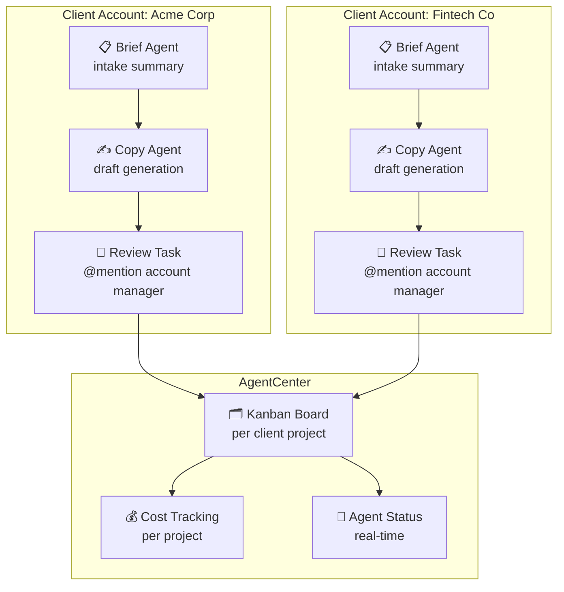

You're running a creative agency with 12 active clients. Each client has a brief agent, a copy agent, and a review-prep agent. That's 36 agents in production. And right now you have no clear picture of which one is working, which is stuck on a task, and which just finished a draft for the wrong client.

This is what AI agents for creative agencies look like without a control plane. Everything sort of works, until it doesn't, and then you spend an hour figuring out what happened.

## The Problem Isn't the Agents

The agents usually do their jobs fine. The copy agent writes copy. The briefing agent summarizes the intake call. The concept agent generates options for the deck.

The problem is the layer between the agent and the human. The handoffs. The attribution. The "wait, which version was approved?"

Most creative agencies start with a few agents running in scripts or notebooks. It works for one client. For two clients. By client five, someone is manually sorting agent outputs into client folders and DMing account managers when a draft is ready.

Three things break first.

**Per-client visibility disappears.** An agent finishing a draft doesn't know which client it belongs to unless you built that logic yourself. Without it, output lands in one pile. You spend 15 minutes on a Friday afternoon sorting which brief was for the SaaS client and which was for the CPG brand.

**Deliverable handoffs become Slack threads.** The copy agent finishes. Someone pastes the output into a channel. The account manager adds feedback three hours later. The original requester never sees it. The draft gets revised twice. Now you have three versions and no clear record of which one the client actually approved.

**Cost attribution is guesswork.** One client sends three briefs a week and needs four content variants per brief. Another sends one brief a month. But you're reading one monthly LLM invoice with no breakdown. You can't tell whether either client is actually profitable at the agent level.

## How AgentCenter Fixes the Workflow

**Kanban board per client project.** You create one project in AgentCenter per client account. Every agent task lives inside that project. When you open the dashboard in the morning, you see columns across all client projects: brief in progress, copy under review, delivered. You know at a glance which clients have active work moving and which pipelines are sitting idle.

This one step eliminates the folder-sorting problem. Agents work inside a project context. Output belongs to the project. The account manager for Acme Corp opens the Acme Corp project and sees only Acme Corp tasks.

**@Mentions and deliverable review.** When a copy agent finishes a draft, you create a review task and @mention the account manager. They get a notification, open the task, and see the agent output alongside any context from earlier in the pipeline. They approve it, reject it, or add a comment. The draft and the feedback live in one place. No version confusion.

This is what replaces the Slack thread pattern. The deliverable review workflow in [AgentCenter's task orchestration](/features/task-orchestration) gives you a formal handoff point instead of an informal message.

**Per-project cost tracking.** AgentCenter tracks what each agent spends on LLM calls, broken down by project. End of month, you can see what Acme Corp actually cost in agent compute versus the fintech client. That number tells you either what to charge clients or what your margin actually looks like per account. Most agency teams discover the answer is surprising in at least one direction.

**Real-time agent status.** The [agent monitoring dashboard](/features/agent-monitoring) shows which agents are actively working, which are idle, and which have been stuck on the same task longer than expected. You see a problem before it turns into a missed deadline.

## Creative Agency Teams: Agent Count and Plan Fit

A creative agency with 10-20 active client accounts typically runs 20-50 agents. The breakdown is usually: one briefing agent per active engagement, one or two copy or content agents shared across accounts, and a handful of specialized agents for things like social variants or SEO metadata generation.

At that scale, the Pro plan at $29/month (15 agents, 15 projects) covers most small agencies. Mid-size shops with 20+ active clients usually land on the Scale plan at $79/month for 50 agents and 50 projects.

What it replaces: a combination of shared Google Docs, a Notion database someone built six months ago, and Slack threads that account managers treat as a ticketing system. Migration is usually a two-hour setup. Time recovered per week in reduced coordination is typically 3-5 hours of account manager time.

Check [pricing](/pricing) if you want to map your current agent count to the right plan.

## Before vs After

| | Without AgentCenter | With AgentCenter |
|---|---|---|
| **Visibility** | No idea which agent is working on which client | Per-project dashboard showing live agent status |
| **Task handoffs** | Copy-pasted into Slack, picked up whenever | @Mention creates a formal review task with the deliverable attached |
| **Error detection** | Noticed when the client asks "where's the draft?" | Caught in the review step before it ships |
| **Cost tracking** | One monthly invoice with no client breakdown | LLM spend visible per project |
| **Debugging time** | Reconstruct from logs and DMs | Full task history per agent, per project |

## Where to Start

Create one project per active client before you assign any agents to tasks. Don't start with monitoring, cost tracking, or mentions. Just the project structure.

That single setup step changes what happens downstream. Agents stop running loose and start running inside a client context. Every other feature, from deliverable review to cost attribution, works correctly once that structure is in place.

After a week of running with projects active, you'll have cost data and a task history per client. That's when the rest of the dashboard becomes useful.

---

*Creative agency teams that add a control plane early spend less time firefighting later. [Start your 7-day free trial](/pricing).*
