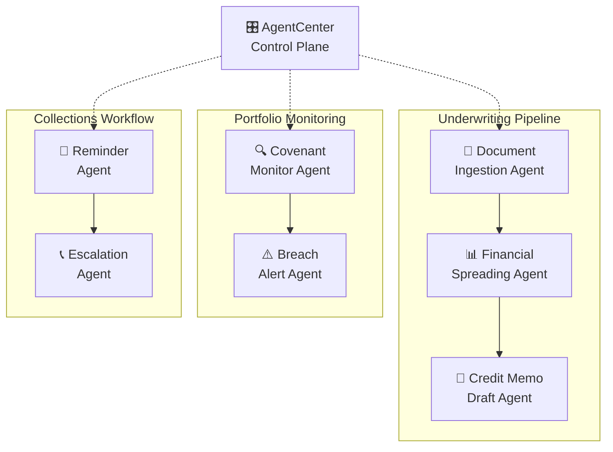

Credit operations teams at banks, credit unions, and lending platforms are running more AI agents than most people outside the team realize. Underwriting assistance agents, covenant monitoring agents, and collections queue agents have all made their way into production over the past 18 months. The problem is that most teams built them without a control plane.

That becomes obvious fast.

## Why Credit Operations Teams Hit the Wall

A typical credit operations team runs 8 to 15 agents by the time they've automated underwriting triage, covenant monitoring, and early-stage collections outreach. Each was built independently. Each has a different person who vaguely owns it. None of them share a common status view.

Three specific things break:

**Covenant monitoring agents run on stale data.** You deploy an agent to check for financial covenant breaches across your commercial loan portfolio: debt-to-equity ratios, DSCR thresholds, reporting deadlines. It runs every night. One night it pulls from a database view that was updated without anyone notifying the agent team. The agent still returns "no breaches." The covenant breach was real. Nobody finds out for six days.

**Underwriting review agents lose context mid-chain.** Credit underwriting often runs as a sequence: document ingestion agent, spreading agent, credit memo draft agent. If the spreading agent fails silently on an atypical income statement format, the memo draft agent starts with bad inputs and produces a plausible-looking but incorrect memo. The reviewer catches it two hours later. Nobody can tell which step failed or why.

**Collections sequencing agents run out of order.** Early-stage collections requires a precise sequence: payment reminder, escalation, external agency handoff. When agents run without enforced dependencies, the escalation agent can run before the reminder agent completes. A borrower gets an escalation call before receiving their first reminder. That is a regulatory exposure risk, not just an ops mistake.

## How AgentCenter Solves It

**Task dependencies stop out-of-order execution.** AgentCenter's [task orchestration](/features/task-orchestration) lets you enforce that the escalation agent cannot start until the reminder agent delivers a confirmed output. If the reminder fails, the escalation task stays blocked, with a clear status in the Kanban board and no silent advancement to the next stage.

The credit ops team sees exactly which task is blocked, which agent is holding it, and how long it has been waiting. That turns a 3-day log investigation into a 10-minute fix.

**Real-time agent status catches stale data runs.** When the covenant monitoring agent fails to reach its database source, it surfaces in the [agent monitoring dashboard](/features/agent-monitoring) as an error state rather than a clean completion. The on-call analyst sees it before the morning credit report runs. The breach gets caught before the six-day delay.

**Per-agent cost tracking finds the expensive edge case.** Underwriting agents processing non-standard financial structures (complex holding companies, split-year reporting, international subsidiaries) can consume 4x to 8x the normal token budget. Without per-task cost visibility, this shows up as an unexplained spike in your LLM bill at month end. In AgentCenter, every task logs actual token usage, and the team can filter by high-cost tasks to identify which document types are driving the budget.

**Deliverable review gates keep bad output from moving downstream.** The credit memo draft agent produces a document that goes directly to an underwriter for sign-off. In AgentCenter, that task stays in a "Pending Review" state until a human approves the deliverable. If the memo is rejected, the reason is logged against the task, not buried in a Slack thread that nobody searches later.

## The Numbers for Credit Operations Teams

A typical credit operations team running underwriting, monitoring, and collections agents has 8 to 20 agents in production. The Pro plan ($29/month) covers up to 15 agents and fits most teams that have not yet expanded to a full automated collections suite. Teams running 20 or more agents, including multi-product or multi-bank portfolios, generally move to Scale ($79/month) for the higher agent count and project separation.

What it replaces: a combination of cron jobs with Python scripts, Slack messages for status updates, and spreadsheets tracking which agent ran last night. The ops overhead to maintain those alternatives typically runs 4 to 6 hours per engineer per week.

See the full plan comparison at [agentcenter.cloud/pricing](/pricing).

## Before vs After AgentCenter

| | Without AgentCenter | With AgentCenter |
|---|---|---|
| **Visibility** | Check logs manually to confirm agents ran | Kanban board shows real-time status per agent |
| **Task handoffs** | Agents run independently with no enforced order | Task dependencies block downstream agents until upstream completes |
| **Error detection** | Failures surface only when downstream output is wrong | Blocked or errored agents appear immediately in the dashboard |
| **Cost tracking** | Monthly LLM invoice with no task-level breakdown | Per-task token usage logged and filterable by agent or document type |
| **Debugging time** | 2 to 4 hours tracing logs to find the failure point | Activity feed shows the exact step where the agent stopped |

## Where to Start

Set up task dependencies for your collections sequence first. It is the highest-risk workflow for regulatory exposure, and enforcing the escalation order takes about 20 minutes in AgentCenter once your agents are connected. Once that is working, add the covenant monitoring agent to the dashboard so the on-call team gets immediate visibility on any failed overnight run.

The underwriting pipeline comes next. Start with the step you are most nervous about failing silently.

---

*Credit operations teams that add a control plane early spend less time firefighting later. [Start your 7-day free trial](/pricing).*
