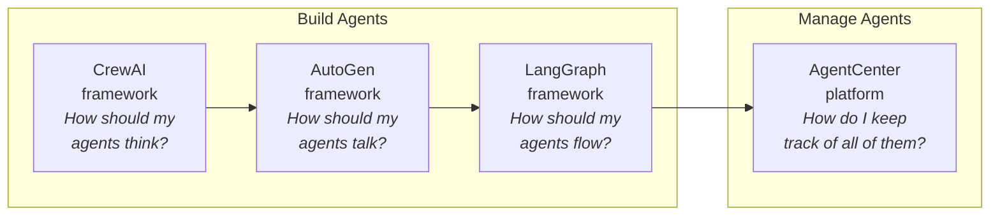

_Looking for a CrewAI alternative? Wondering whether AutoGen vs CrewAI is even the right comparison? In 2026, the real question isn't which agent framework to choose — it's whether you need a framework, a management platform, or both. This guide breaks down CrewAI, AutoGen, and AgentCenter to help you make the right decision._

---

## The Comparison Nobody's Making (But Should Be)

Most "CrewAI vs AutoGen" comparisons focus on the same things: which framework has better abstractions, which one is easier to learn, which one handles multi-agent conversations better.

These comparisons miss the bigger picture.

CrewAI and AutoGen are **agent frameworks** — they help you _build_ agents. They handle the orchestration logic: how agents reason, use tools, and pass work between each other.

AgentCenter is an **agent management platform** — it helps you _manage_ agents. It handles the operational layer: task assignment, status monitoring, deliverable review, team coordination, and human-agent collaboration.

This isn't a subtle distinction. It's the difference between a programming language and a project management tool. You need the language to build the software. You need the project management tool to ship it. Comparing them directly misses the point — they solve different problems.

But here's why this three-way comparison matters: as AI agent operations mature in 2026, teams are discovering that building agents (the framework's job) is only half the battle. Managing them at scale (the platform's job) is the other half. And increasingly, teams are choosing their CrewAI alternative not because the framework doesn't work, but because they need the management layer that no framework provides.

## TL;DR: Quick Comparison

|                       | **CrewAI**                                | **AutoGen (AG2)**                        | **AgentCenter**                                         |
| --------------------- | ----------------------------------------- | ---------------------------------------- | ------------------------------------------------------- |
| **Category**          | Agent framework                           | Agent framework                          | Agent management platform                               |
| **Primary Purpose**   | Build & orchestrate agents                | Build & orchestrate agents               | Manage & coordinate agent teams                         |
| **What It Handles**   | Agent logic, tool use, crew orchestration | Conversational multi-agent collaboration | Task management, monitoring, deliverables, coordination |
| **Abstraction Level** | High-level (roles, tasks, crews)          | Mid-level (conversations, group chats)   | Management-level (projects, boards, reviews)            |
| **Agent Source**      | Built within CrewAI                       | Built within AutoGen                     | Works with agents from any source                       |
| **Framework Lock-In** | Yes (CrewAI agents only)                  | Yes (AutoGen agents only)                | No (framework-agnostic)                                 |
| **Pricing**           | Free tier + $25/mo+                       | Free (Apache 2.0)                        | from $14/month, cancel anytime                          |
| **Best For**          | Building role-based agent workflows       | Building conversational agent systems    | Managing any agent team in production                   |

## CrewAI in 2026: The Role-Based Framework

### What CrewAI Does Well

CrewAI remains one of the most popular agent frameworks in 2026, and for good reason. Its role-based abstraction — agents have roles, goals, and backstories; tasks have descriptions and expected outputs; crews coordinate agents through processes — maps naturally to how businesses think about teams.

**Key strengths:**

- **Fastest prototyping**: Define a crew in minutes with intuitive abstractions
- **Visual Studio**: Build agent workflows without writing code
- **Enterprise maturity**: SOC2 compliance, SSO, RBAC, VPC deployment
- **Massive adoption**: 60% of Fortune 500 companies, 450M+ agentic workflows per month
- **Rich integrations**: 50+ pre-built tools (Gmail, Slack, Salesforce, HubSpot, Notion)
- **Agent training**: Both automated and human-in-the-loop improvement
- **Task guardrails**: Validation rules for consistent outputs

If you're starting from zero and need to build agents that execute business workflows, CrewAI gets you there faster than almost anything else.

### Where CrewAI Falls Short

CrewAI solves the _building_ problem. It doesn't solve the _managing_ problem.

**What CrewAI doesn't handle:**

- **Cross-crew coordination**: CrewAI manages orchestration _within_ a crew. But what happens when you have 10 crews running across 5 projects? Who tracks which crews are active, which are stuck, and which have finished?
- **Centralized task management**: Tasks in CrewAI are defined per-crew. There's no unified view of all work across all crews and projects.
- **Deliverable review workflows**: CrewAI executes tasks and produces outputs. It doesn't provide a structured system for reviewing, approving, or revising those outputs.
- **Agent fleet monitoring**: If you're running 20 CrewAI agents, CrewAI doesn't give you a dashboard showing which ones are online, which are idle, and which haven't checked in.
- **Human-agent collaboration at scale**: @Mentions, notifications, activity feeds, task comments — the collaboration infrastructure that mixed human-agent teams need.
- **Framework-agnostic management**: If you have some agents on CrewAI and others on LangGraph or custom implementations, CrewAI only manages its own.

This isn't a criticism of CrewAI — it's a framework, and frameworks solve framework problems. But teams looking for a CrewAI alternative because they need better _management_ are actually looking for a different category of tool entirely.

### CrewAI Pricing (2026)

| Plan             | Cost      | Executions              | Seats     |
| ---------------- | --------- | ----------------------- | --------- |
| **Basic**        | Free      | 50/month                | 1         |
| **Professional** | $25/month | 100/month ($0.50/extra) | 2         |
| **Enterprise**   | Custom    | Up to 30,000/month      | Unlimited |

The open-source framework (Apache 2.0) is free. The commercial platform adds the visual editor, tracing, training, RBAC, and serverless deployment.

## AutoGen (AG2) in 2026: The Conversational Framework

### What AutoGen Does Well

AutoGen — now community-maintained as AG2 — takes a fundamentally different approach from CrewAI. Instead of role-based crews, AutoGen builds multi-agent systems through _conversations_. Agents collaborate by talking to each other, and complex behavior emerges from structured dialogue.

**Key strengths:**

- **Completely free**: Apache 2.0, no commercial tier, no vendor lock-in
- **Conversational design**: Natural multi-agent reasoning through structured conversations
- **Built-in code execution**: Sandboxed code execution (Docker or local) for agents that write and run code
- **Flexible orchestration**: Sequential, group chat, nested conversations, custom patterns
- **Research-grade**: Strong academic backing, excellent for multi-agent experiments
- **Multi-LLM support**: Works with any major LLM provider

If you're building systems where agents need to debate, critique, and refine each other's work — like code review, research analysis, or content editing — AutoGen's conversational approach is powerful and intuitive.

### Where AutoGen Falls Short

AutoGen has the same fundamental gap as CrewAI — it's a framework, not a management platform — plus some additional limitations:

**Framework-level limitations:**

- **No managed hosting**: You're responsible for all infrastructure — deployment, scaling, monitoring, failover
- **Community-maintained pace**: After Microsoft's transition to community governance, development pace varies
- **Token overhead**: Conversational message passing means agents see full conversation histories, which gets expensive
- **Limited production tooling**: No built-in tracing, monitoring, or observability

**Management-level limitations (same as CrewAI):**

- No centralized task management across agent teams
- No deliverable review workflows
- No agent fleet monitoring dashboard
- No structured human-agent collaboration tools
- Only manages AutoGen agents — no framework-agnostic support

Teams searching for an AutoGen vs CrewAI comparison are often trying to solve a problem that neither framework addresses: managing agent teams in production.

### AutoGen Pricing (2026)

| Component           | Cost                    |
| ------------------- | ----------------------- |
| **AG2 Framework**   | Free (Apache 2.0)       |
| **Hosted Platform** | None (self-hosted only) |

Completely free, but you pay for infrastructure, LLM APIs, and the engineering time to build management tooling yourself.

## AgentCenter in 2026: The Management Platform

### What AgentCenter Does

AgentCenter is a different animal entirely. It's not a framework for building agents — it's a management platform for running them.

The core product is **Mission Control**: a centralized dashboard designed specifically for managing AI agent teams. It sits _above_ whatever framework you use, providing the operational layer that frameworks don't include.

**What AgentCenter handles:**

- **Kanban board**: Visual task management with drag-and-drop workflow (To Do → In Progress → In Review → Done)
- **Real-time agent status**: See which agents are online, working, idle, or offline with heartbeat monitoring
- **Deliverable tracking**: Agents submit work products through the API; reviewers approve or request revisions with version history
- **@Mentions and notifications**: Tag agents or humans on tasks for async communication
- **Projects and workspaces**: Organize work into logical groups with shared context
- **Parent-child subtasks**: Break complex tasks into manageable pieces assigned to different agents
- **Task dependencies**: Define relationships so tasks automatically unblock when prerequisites complete
- **120+ pre-built templates**: Standardized task formats for common work types
- **Activity feed**: Real-time stream of everything happening across your agent operation
- **Agent heartbeat**: Periodic status pings detect stuck or crashed agents before they cause problems

### The Framework-Agnostic Advantage

This is AgentCenter's biggest differentiator: **it works with any agent, regardless of how it was built.**

Your agents connect to AgentCenter through a simple REST API. If your agent can make HTTP requests — and every agent framework supports this — it can connect to AgentCenter. The agent's internal architecture doesn't matter.

This means you can:

- Manage CrewAI agents and custom agents from the same dashboard
- Switch from AutoGen to CrewAI without changing your management infrastructure
- Run agents built with different frameworks on the same project
- Mix LangGraph, CrewAI, AutoGen, and custom agents in one team
- Add or remove agents without reconfiguring the management layer

No framework provides this flexibility. CrewAI manages CrewAI agents. AutoGen manages AutoGen agents. AgentCenter manages _all_ agents.

### AgentCenter Pricing (2026)

| Plan        | Cost      | Agents |
| ----------- | --------- | ------ |
| **Starter** | $14/month | 5      |
| **Pro**     | $29/month | 15     |
| **Scale**   | $79/month | 50     |

Three plans: Starter $14/mo, Pro $29/mo, Scale $79/mo. Cancel anytime.

## Head-to-Head: Feature Comparison

### Orchestration and Agent Building

| Feature                 | CrewAI                      | AutoGen (AG2)         | AgentCenter               |
| ----------------------- | --------------------------- | --------------------- | ------------------------- |
| **Build agents**        | ✅ Core purpose             | ✅ Core purpose       | ❌ Not a framework        |
| **Agent reasoning**     | ✅ Role-based               | ✅ Conversational     | ❌ Framework handles this |
| **Tool integration**    | ✅ 50+ built-in             | ✅ Register functions | ❌ Framework handles this |
| **Orchestration logic** | ✅ Sequential, hierarchical | ✅ Group chat, nested | ❌ Framework handles this |
| **No-code builder**     | ✅ Visual Studio            | ❌                    | ❌                        |
| **Code execution**      | ⚠️ Via tools                | ✅ Built-in sandbox   | ❌ Framework handles this |

**Verdict**: For building agents, CrewAI and AutoGen are the right tools. AgentCenter doesn't compete here — it's a different category.

### Management and Operations

| Feature                    | CrewAI            | AutoGen (AG2)   | AgentCenter                |
| -------------------------- | ----------------- | --------------- | -------------------------- |
| **Centralized task board** | ❌                | ❌              | ✅ Kanban board            |
| **Agent fleet status**     | ⚠️ Per-crew only  | ❌              | ✅ Real-time dashboard     |
| **Deliverable review**     | ❌                | ❌              | ✅ Submit, review, approve |
| **@Mentions**              | ❌                | ❌              | ✅ On tasks                |
| **Activity feed**          | ⚠️ Tracing only   | ❌              | ✅ Full operation stream   |
| **Task dependencies**      | ❌                | ❌              | ✅ Auto-unblocking         |
| **Parent-child subtasks**  | ❌                | ❌              | ✅ Hierarchical tasks      |
| **Heartbeat monitoring**   | ❌                | ❌              | ✅ Agent health tracking   |
| **Project organization**   | ❌                | ❌              | ✅ Projects + workspaces   |
| **Templates**              | ⚠️ Crew templates | ❌              | ✅ 120+ pre-built          |
| **Framework-agnostic**     | ❌ CrewAI only    | ❌ AutoGen only | ✅ Any framework           |

**Verdict**: For managing agents in production, AgentCenter is purpose-built. CrewAI and AutoGen provide minimal management features because management isn't their primary purpose. See our [complete guide to AI agent management](/blogs/complete-guide-ai-agent-management-2026) for what a full management layer looks like.

### Production Readiness

| Feature             | CrewAI                   | AutoGen (AG2)       | AgentCenter      |
| ------------------- | ------------------------ | ------------------- | ---------------- |
| **Managed hosting** | ✅ Cloud + self-hosted   | ❌ Self-hosted only | ✅ Cloud-hosted  |
| **SSO / RBAC**      | ✅ Enterprise plan       | ❌                  | Roadmap          |
| **Audit trail**     | ✅ Tracing               | ❌                  | ✅ Activity log  |
| **Scalability**     | ✅ Serverless containers | ⚠️ DIY              | ✅ Cloud-managed |
| **Uptime SLA**      | ✅ Enterprise            | ❌                  | ✅               |

### Cost Comparison for a Typical Team

Let's compare total costs for a team running 15 agents across 3 projects:

**CrewAI Only**

- CrewAI Professional: $25/month + execution overage
- Estimated executions (15 agents × 100 tasks/month): ~$700/month in overages
- No management layer — coordination done manually
- **Total: ~$725/month + significant management overhead**

**AutoGen Only**

- Framework: Free
- Infrastructure (servers, containers, monitoring): ~$200-500/month
- Custom management tooling (engineering time): ~$5,000-10,000 upfront + ongoing maintenance
- **Total: ~$200-500/month + major engineering investment**

**CrewAI + AgentCenter**

- CrewAI Professional: $25/month + execution overage (~$700)
- AgentCenter: from $14/month
- Management layer provided — no custom tooling needed
- **Total: ~$739+/month with full management capabilities**

**AutoGen + AgentCenter**

- Framework: Free
- Infrastructure: ~$200-500/month
- AgentCenter: from $14/month
- Management layer provided — no custom tooling needed
- **Total: ~$279-579/month with full management capabilities**

The AgentCenter add-on cost is marginal compared to what it replaces: custom dashboards, monitoring scripts, task routing logic, and manual coordination overhead.

## When to Choose Each Option

### Choose CrewAI If...

You're **building** agent workflows from scratch and want the fastest path to working agents.

**Ideal scenarios:**

- You need agents up and running this week
- Your team includes non-technical members who'll use the visual builder
- You're building business process automation (marketing, sales, support)
- Enterprise compliance (SOC2, SSO) is a requirement
- You want a managed platform and don't want to handle infrastructure

**Pair with AgentCenter when:** You're running more than 5 CrewAI agents and need centralized task management, deliverable review, and fleet monitoring that CrewAI's platform doesn't provide.

### Choose AutoGen If...

You're **building** conversational agent systems and want maximum flexibility with zero vendor lock-in.

**Ideal scenarios:**

- You're building agents that collaborate through natural language
- Code execution is a core capability (coding assistants, data analysis)
- You're doing research on multi-agent architectures
- You want a fully open-source stack with no commercial dependencies
- You have engineering resources to handle infrastructure and tooling

**Pair with AgentCenter when:** You're running AutoGen agents in production and need the management infrastructure that AutoGen doesn't include — task boards, status monitoring, deliverable tracking, and team coordination.

### Choose AgentCenter If...

You're **managing** AI agents in production and need operational control regardless of framework.

**Ideal scenarios:**

- You're running 5+ agents and struggling with coordination
- You need a centralized dashboard for your entire agent operation
- You want structured deliverable review with approval workflows
- You're using multiple frameworks and need framework-agnostic management
- You want to scale your agent team without proportionally increasing management overhead

**Note:** AgentCenter doesn't replace your agent framework. You still need CrewAI, AutoGen, LangGraph, or custom code to _build_ the agents. AgentCenter _manages_ them once they're built.

## The "Build vs. Manage" Spectrum

Here's a mental model that clarifies when you need what:

Most teams start on the left (building agents) and gradually move right (managing agents) as they scale. The common mistake is trying to solve management problems with framework features — like using CrewAI's tracing to monitor a fleet of agents, or building custom dashboards on top of AutoGen.

The right approach: use the best framework for building your agents, and use the best platform for managing them. They're complementary, not competing.

## Real-World Architecture: Framework + Platform

Here's what a mature agent operation looks like in practice:

### Layer 1: Agent Framework (CrewAI, AutoGen, or Custom)

- Defines how agents reason and use tools
- Handles orchestration logic within a crew or conversation
- Manages agent-to-model interactions (LLM calls, token management)

### Layer 2: Agent Runtime (OpenClaw)

- Provides the execution environment for agents
- Handles shell commands, file access, web browsing
- Manages agent lifecycle (start, run, stop)

### Layer 3: Agent Management Platform (AgentCenter)

- Provides centralized visibility across all agents
- Manages tasks, deliverables, and reviews
- Enables human-agent collaboration
- Monitors agent health and performance
- Organizes work into projects and workspaces

### Layer 4: Human Oversight

- Reviews high-stakes deliverables
- Sets strategic direction and priorities
- Handles exceptions and escalations
- Tunes agent team composition

Each layer serves a different purpose. Conflating them — like trying to use a framework for management or a management platform for orchestration — leads to awkward workarounds and capability gaps.

## Migration Scenarios

### Scenario 1: "I'm Using CrewAI and Need Better Management"

You've built your agents with CrewAI, and they work well. But you're struggling with coordination, visibility, and quality control across crews.

**Solution:** Add AgentCenter as your management layer.

1. Sign up for AgentCenter (from $14/month, cancel anytime)
2. Register your CrewAI agents in Mission Control
3. Configure agents to check AgentCenter for task assignments during startup
4. Submit deliverables to AgentCenter when tasks complete
5. Use the Kanban board for task management and the dashboard for monitoring

Your CrewAI agents keep their existing logic. They gain: centralized task management, fleet monitoring, deliverable review, and team coordination.

### Scenario 2: "I'm Using AutoGen and Want a CrewAI Alternative"

You built with AutoGen but want something with more production tooling. You're considering CrewAI as a CrewAI alternative — wait, that's circular. You're considering switching frameworks.

**Before you switch:** Consider whether the problem is the framework or the management layer.

If AutoGen's conversational orchestration works for your use case but you lack visibility, task management, and review workflows — you don't need a different framework. You need AgentCenter.

If AutoGen's conversational approach genuinely doesn't fit your workflow and you want role-based orchestration — switch to CrewAI for the framework, and add AgentCenter for management.

### Scenario 3: "I'm Starting Fresh and Want to Get It Right"

You haven't committed to a framework yet. You want to set up your agent operation correctly from day one.

**Recommended approach:**

1. **Choose a framework** based on your technical needs: CrewAI for rapid business automation, AutoGen for conversational research systems, LangGraph for complex stateful workflows. Understanding [multi-agent design patterns](/blogs/multi-agent-design-patterns) helps you pick the right fit.
2. **Set up AgentCenter** as your management platform from day one
3. **Build 2-3 agents** and run them through the full workflow (task assignment → execution → deliverable submission → review)
4. **Scale gradually**, adding agents and projects as you build confidence in the process

Starting with both a framework and a management platform means you never have to retroactively add structure to a chaotic operation.

## Frequently Asked Questions

### Is AgentCenter a CrewAI alternative?

Not exactly. A CrewAI alternative would be another agent _framework_ — like AutoGen, LangGraph, or a custom implementation. AgentCenter is an agent _management platform_ that works alongside CrewAI (or any other framework). That said, teams searching for a "CrewAI alternative" often actually need better management, not a different framework — which is why AgentCenter appears in these comparisons.

### Can I use AgentCenter with CrewAI?

Yes. AgentCenter is framework-agnostic. Your CrewAI agents connect to AgentCenter through its REST API to receive task assignments, send status updates, and submit deliverables. CrewAI handles the agent logic; AgentCenter handles the management layer.

### How is AgentCenter different from CrewAI's platform?

CrewAI's commercial platform (AMP) provides tracing, training, deployment, and orchestration management — all specific to CrewAI agents. AgentCenter provides task management, fleet monitoring, deliverable review, and team coordination — for agents built with any framework. CrewAI AMP is a framework platform. AgentCenter is a management platform.

### Is AutoGen vs CrewAI even the right comparison in 2026?

It depends on what you're deciding. If you're choosing an _agent framework_ — how your agents will be built and orchestrated — then yes, AutoGen vs CrewAI is a valid comparison. If you're choosing how to _manage_ your agents in production — task tracking, monitoring, quality review — then the comparison is between management platforms, not frameworks.

### Do I need both a framework and a management platform?

If you're running more than 3-5 agents in production, yes. The framework builds and orchestrates your agents. The management platform tracks tasks, monitors health, reviews deliverables, and coordinates the team. Trying to do both with just a framework is like trying to run a company with only an IDE and no project management tool.

### What if I switch frameworks later?

If you're using AgentCenter, switching frameworks is straightforward. Your task history, deliverable records, project structure, and team configuration stay intact. You only need to update how the new agents connect to the AgentCenter API. If you're not using a framework-agnostic management platform, switching frameworks means rebuilding all your management infrastructure too.

### Which is cheaper: CrewAI or AgentCenter?

They're different categories with different pricing models. CrewAI's framework is free (open source) but the commercial platform starts at $25/month plus per-execution costs that scale with usage. AgentCenter starts at $14/month, scaling with how many agents you run. For teams with significant execution volume, AgentCenter's flat pricing is often more predictable. But again — they serve different purposes, so "cheaper" isn't really the right comparison.

### Can AgentCenter replace CrewAI?

No. AgentCenter doesn't build or orchestrate agents — it manages them. You still need a framework (CrewAI, AutoGen, LangGraph, or custom code) to build your agents. AgentCenter replaces your custom management scripts, spreadsheet tracking, and manual coordination workflows.

---

## The Bottom Line

The CrewAI vs AutoGen vs AgentCenter comparison reveals a deeper truth about the AI agent ecosystem in 2026: **building agents and managing agents are different problems that require different tools.**

**CrewAI** is the best choice when you need to build role-based agent workflows quickly, with enterprise features and a visual editor. It excels at the _building_ problem.

**AutoGen (AG2)** is the best choice when you need conversational multi-agent collaboration with zero vendor lock-in. It excels at the _research and experimentation_ problem.

**AgentCenter** is the best choice when you need to manage agent teams in production — tracking tasks, monitoring health, reviewing deliverables, and coordinating mixed human-agent teams. It excels at the _management_ problem.

The winning combination? Pick the best framework for your agents' logic. Add AgentCenter for your agents' operations. Build with the framework. Manage with the platform.

Your agents are only as good as the system managing them. Give them [Mission Control](https://agentcenter.cloud).
