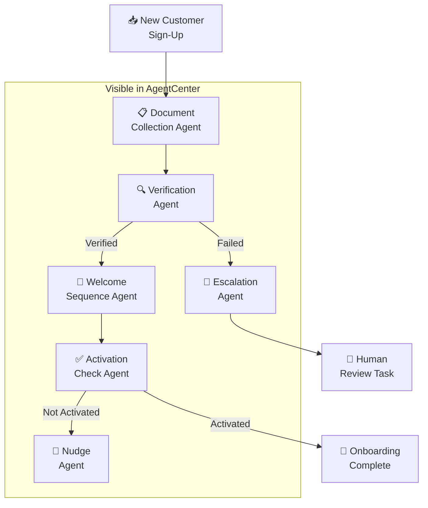

Customer onboarding teams have zero margin for error. A new user who hits friction on day one doesn't send a support ticket. They quietly churn. Managing AI agents for customer onboarding means managing the first impression your product makes at scale — and doing it across dozens of customers simultaneously.

Most teams find out their onboarding agents have been broken for three days when someone from sales flags a low activation rate. That's exactly what a control plane is supposed to prevent.

## What Breaks Without a Control Plane

Customer onboarding pipelines typically chain 6 to 12 agents together: document collection, ID verification, welcome email sequencing, feature walkthroughs, activation checks, and escalation routing. When you manage these as separate scripts or ad-hoc automation flows, three things go wrong regularly.

**Agent B has no idea agent A failed.** You have an agent that verifies uploaded documents and another that triggers the welcome sequence. If verification fails silently, the welcome sequence still fires — and a customer gets a "you're all set!" email when their account isn't actually ready. You find out when that customer contacts support two weeks later wondering why they can't access the feature they signed up for.

**You can't see where customers are stuck.** When activation rates drop, you trace through logs manually to figure out which agent in the chain is stalling. That takes hours. Meanwhile, more customers are hitting the same stuck point.

**Escalations don't reach the right person.** Onboarding agents regularly hit edge cases: unusual ID formats, missing fields, company email domains that bounce. When the agent fails, someone on your team needs to know and act on it fast. Without a shared task view, those escalations get lost in Slack threads or land in an inbox nobody checks at 2pm on a Friday.

## How AgentCenter Maps to Onboarding Workflows

**Kanban board for pipeline visibility.** Each onboarding task appears as a card in AgentCenter. You can see at a glance: 14 customers in document verification, 3 stuck in activation check, 2 flagged for human review. When activation rates drop, you look at the board, not at logs.

A concrete example: your verification agent creates a task in AgentCenter when a customer uploads docs. The task moves columns as each sub-step completes. If it stalls for more than 2 hours, it shows up in red. You don't need to run a query to find it.

**Real-time agent status.** AgentCenter shows each agent as online, working, idle, or blocked. When your welcome sequence agent shows "blocked" at 9am, you know something upstream failed. That's a five-second read that would otherwise take a 20-minute log investigation.

The [agent monitoring dashboard](/features/agent-monitoring) lets you track status across your full onboarding fleet without switching between five different tools.

**@Mentions for human escalation.** When your escalation agent hits an edge case it can't resolve, it creates a task in AgentCenter and @mentions the onboarding specialist on shift. That person gets a notification, sees the full customer context in the task thread, and resolves it without asking for background in Slack.

**Task orchestration for enforced handoffs.** You define in AgentCenter that the welcome sequence agent should only start after the verification agent marks its task complete. The dependency is enforced at the control plane level, not baked into each agent's code. That means you can change the sequence without touching agent logic.

The [task orchestration](/features/task-orchestration) feature handles this across any number of dependent agents.

**Error detection and cost tracking.** AgentCenter logs errors per agent and per task run. When your nudge agent starts retrying more than usual, you see the error spike in the activity feed before it affects dozens of customers. Cost tracking tells you if your verification agent's LLM calls are creeping up because edge cases are triggering longer reasoning chains — a pattern that usually means your prompt needs work, not your budget.

## The Numbers

A typical customer onboarding team runs 8 to 18 agents: document collection, verification, email sequencing, activation checks, nudges, and escalation routing. That fits the AgentCenter Pro plan at $29/month, which supports up to 15 agents across 15 projects.

What it replaces: most teams start with a mix of n8n or Zapier flows, a shared Notion doc for tracking escalations, and weekly log reviews to catch failures. AgentCenter consolidates that into one view with real-time status.

For larger enterprise onboarding pipelines with 20+ agents running across multiple products or regions, the Scale plan at $79/month covers up to 50 agents.

## Before vs After

| | Without AgentCenter | With AgentCenter |
|---|---|---|
| Visibility | You learn something's wrong when activation drops | Blocked tasks show up in the Kanban board before they affect metrics |
| Task handoffs | Agents fire independently, gaps happen silently | Dependencies enforced, each handoff confirmed before the next agent starts |
| Error detection | Found in weekly log reviews or by affected customers | Error spikes visible in the real-time activity feed |
| Cost tracking | No per-task data, billing surprises at month end | Per-agent cost tracked per run, visible against plan limits |
| Debugging time | 20 to 30 minutes to trace a failure across logs | 2 to 3 minutes to find the blocked task and read the error |

## Where to Start

Set up the Kanban board first. Map your onboarding pipeline to columns (Pending, Verifying, Sequencing, Active, Escalated) and have your agents create and move tasks as they work.

Within a day, you'll see which column has the most tasks sitting still. That's your current bottleneck. Add status monitoring for the agents feeding that column and you'll have the coverage that matters most, without having to instrument everything at once.

---

*Customer onboarding teams that add a control plane early spend less time firefighting later. [Start your 7-day free trial](/pricing).*
