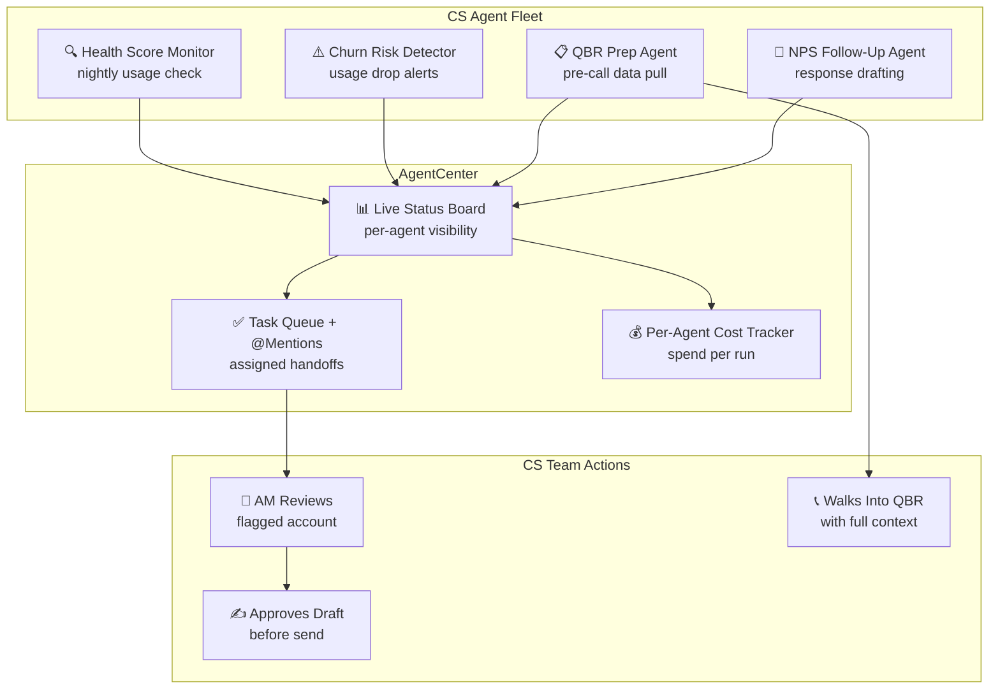

Your customer success team is probably running more agents than you think. A health score monitor checks product usage every night and updates your CRM. A churn risk detector fires when an account's usage drops below a set threshold. A QBR prep agent pulls call notes and usage data the morning before a quarterly review. An NPS follow-up agent drafts personalized responses based on survey scores.

That's four agents. One person built them six months ago. That person left. Nobody on the current team knows which agents are still running, which ones failed last week, or what they cost per month.

This is the problem AI agents for customer success teams run into at scale: the agents work fine until they don't, and when they break, you find out in the worst possible way.

## Three Failure Patterns CS Teams Hit Without a Control Plane

**The silent failure.** The health score monitor stopped running four days ago. No error, just stopped. Two accounts slipped from "healthy" to "churn risk" during that window because nobody caught the usage drop in time. The CS manager found out when an account manager called to ask why a renewal hadn't been flagged.

**The orphaned handoff.** The churn risk agent flagged an account and created a task. Nobody picked it up. Three days later, it's still unclear whether the account manager saw the flag, whether the agent completed the outreach draft, or whether the task is sitting in a queue somewhere unread. The only way to find out is to ask in Slack and wait.

**Zero cost visibility.** Nobody knows which agents cost what. The weekly executive report agent costs $3.10 per run. The nightly health monitor costs $0.40. When leadership asks to cut AI spend, the team is guessing which agents to scale back.

These aren't model problems or prompt problems. They're coordination problems, and they compound as the number of agents grows.

## How AgentCenter Fits a CS Team's Workflow

**Real-time agent status.** Every agent in your fleet shows its current state on a shared board: running, idle, blocked, or failed. When the health score monitor goes silent mid-run, the team sees it immediately on the [agent monitoring dashboard](/features/agent-monitoring). Not four days later on a renewal call.

**Task handoffs with @mentions.** When the churn risk agent flags an account, it creates a task with the account name, the specific risk signal, and an @mention to the assigned account manager. No buried Slack message. The AM gets a task with context, a deadline, and a clear next step. For teams where multiple agents hand off to multiple people, this makes the difference between a workflow that runs and one that stalls.

**Deliverable review and approval workflows.** High-stakes outputs like save emails or executive summaries route through an approval step before they go out. The agent drafts, the CS director reviews, the email sends only after sign-off. The [task orchestration features](/features/task-orchestration) handle this without any custom code.

**Per-agent cost tracking.** AgentCenter shows cost per run, per agent, and per billing period. When the QBR prep agent starts costing 5x more than expected because someone added a new data source, the team sees it in the dashboard before it hits the invoice. You can compare agents and identify where spend is concentrated.

**Recurring task automation.** Health checks, NPS sweeps, and renewal reminders run on a fixed schedule. If a run fails, the agent retries automatically. No cron job on someone's laptop. No manual checks every Monday to confirm the agent ran.

## The Numbers for CS Teams

A typical customer success team runs 8 to 18 agents once they're fully set up: health monitoring, churn detection, QBR prep, onboarding check-ins, NPS response drafting, renewal reminders, usage summaries, and stakeholder digests.

The Pro plan at $29/month covers up to 15 agents and 15 projects. Most CS teams fit comfortably here. For larger teams managing multiple customer segments or product lines, the Scale plan at $79/month supports 50 agents across 50 projects.

What it replaces: a collection of scripts, cron jobs running on a shared server nobody owns, and Slack messages that substitute for an actual workflow.

## Before vs After

| | Without AgentCenter | With AgentCenter |
|---|---|---|
| Visibility | Check a log file or ask in Slack | Live status per agent on a shared board |
| Task handoffs | Slack message, hope someone picks it up | Task assigned with @mention, deadline, and context |
| Error detection | Find out when a customer asks | Alert fires when an agent fails or goes silent |
| Cost tracking | Unknown until the invoice arrives | Per-agent cost per run, visible in the dashboard |
| Debugging time | 30 to 60 minutes tracing the failure | Find the failure in the activity feed in minutes |

## Where to Start

Set up the [Kanban board](/features/task-orchestration) for your health score monitoring agent first. Map the task flow from "account checked" to "flag raised" to "AM notified." One agent, one complete workflow, visible to the entire team.

Once you can see that agent's full lifecycle in a single view, you'll immediately know which other agents need the same treatment. That's usually the answer to "where do we even start" when the agent fleet has grown past what any one person can track.

The health monitor is the right first choice because it runs the most often, affects the most accounts, and is the one that causes the most damage when it fails silently.

---

*Customer success teams that add a control plane early spend less time firefighting later. [Start your 7-day free trial](/pricing).*
