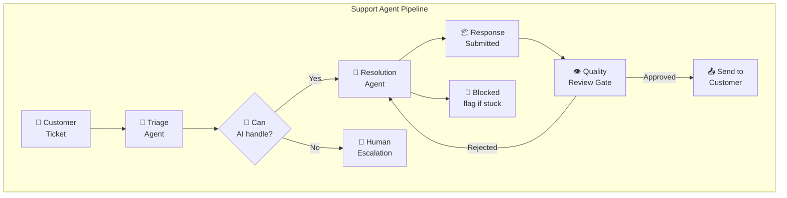

Customer support automation has a very short feedback loop. When an AI agent gives a wrong answer, you know about it within hours — sometimes minutes. A frustrated customer escalates. A ticket goes viral. The support team gets called in to clean it up.

That feedback loop is unforgiving. It makes agent management for support teams qualitatively different from other use cases.

## The Specific Bottlenecks Support Teams Hit

**Escalation failures.** The agent handles what it can and should escalate the rest to a human. But what does "what it can" mean exactly? When the agent's confidence boundary isn't clearly defined, it either escalates everything (useless) or handles things it shouldn't (dangerous). Getting that boundary right requires visibility into what the agent is actually deciding and why.

**Response drift on long-running tickets.** A customer opens a ticket Monday, gets a response from the agent. Same customer follows up Thursday. The agent doesn't have full context, responds inconsistently, and now the customer is confused and frustrated. Without a coordination layer that tracks the full ticket history and assigns the same agent context, each interaction can feel like starting from scratch.

**Volume spikes breaking the pipeline.** Support volume spikes are real. A product bug, a viral complaint, a seasonal rush. When 10x the normal ticket volume hits, you need to know which agents are overloaded, which queues are backing up, and whether to bring more capacity online — before customers notice the lag.

## How AgentCenter Addresses Support Team Workflows

**Task orchestration for ticket routing.** The [task orchestration feature](/features/task-orchestration) lets you define the pipeline: triage agent first, resolution agent second, escalation if blocked. Each ticket is a task. Each task has a clear state. You can see at any moment how many tickets are in triage, how many are being resolved, how many are blocked waiting for human attention.

**Deliverable review before response.** Before any agent response goes to a customer, it can pass through a review gate. A senior support specialist spot-checks 10% of responses. Quality issues get caught before they reach the customer. Over time, you build a record of what good responses look like, which feeds back into agent improvement.

**Real-time status for volume spikes.** The dashboard shows active task count, agent workload, and blocked items in real time. When volume spikes, you see the queue depth immediately — not after the backlog has been sitting for two hours.

## Feature-to-Workflow Mapping

| Support Challenge         | AgentCenter Feature          | How It Helps                          |
| ------------------------- | ---------------------------- | ------------------------------------- |
| Escalation routing        | Task orchestration           | Clear pipeline with human handoff     |
| Response consistency      | Task history + agent context | Full ticket thread available to agent |
| Volume spike visibility   | Real-time dashboard          | See queue depth instantly             |
| Response quality          | Deliverable review gate      | Catch bad responses before sending    |
| Escalated ticket tracking | @mentions + chat threads     | Notify human reviewers directly       |
| Cost per ticket           | Per-task cost tracking       | Track ROI of automation               |

## The Numbers

A mid-size support operation automating AI responses typically runs 3-8 agents handling different ticket categories. The [Starter plan](/pricing) at $14/month covers up to 5 agents — enough for a first deployment targeting your top 3-4 ticket types. As you expand coverage, Pro at $29/month handles 15 agents.

What AgentCenter replaces: ad-hoc monitoring via Slack channels, manual ticket audits done weekly instead of in real-time, custom scripts for queue depth monitoring, and spreadsheets tracking which agents handle which ticket types.

## Before vs After AgentCenter

|                 | Without AgentCenter          | With AgentCenter            |
| --------------- | ---------------------------- | --------------------------- |
| Visibility      | Check ticketing system logs  | Real-time agent status      |
| Task handoffs   | Custom escalation code       | Built-in with blocked state |
| Error detection | Customer complaints          | Review gate catches issues  |
| Cost tracking   | Provider aggregate only      | Per-ticket tracking         |
| Debugging time  | 3-5 hours finding root cause | 30-60 minutes               |

## Where to Start

Start with the triage agent, not the resolution agent. Use AgentCenter to route and categorize tickets first. This gives you visibility into ticket distribution before you hand off resolution to an agent. You'll also catch the edge cases that your resolution agent shouldn't handle before it gets a chance to.

_Customer support teams that add a control plane early spend less time firefighting later. [Start your 7-day free trial](/pricing)._
