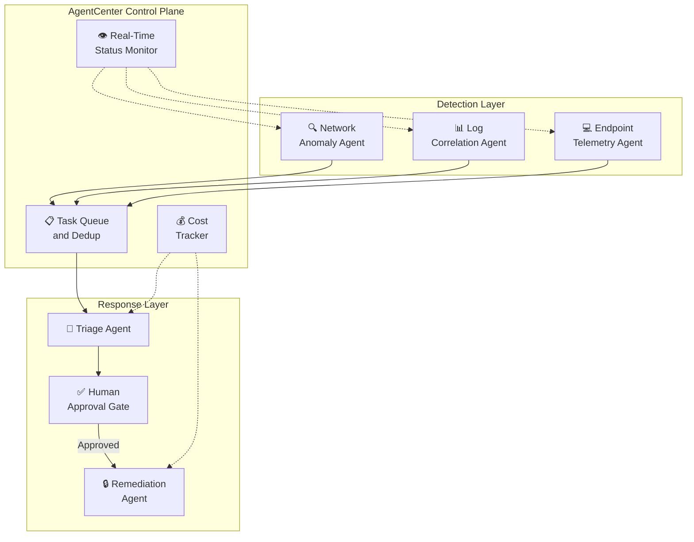

Cybersecurity operations teams are running AI agents in production. Not as experiments. As real parts of the threat detection and response workflow.

Threat hunting agents query log data at scale. Incident triage agents classify alerts. Vulnerability agents scan infrastructure on a schedule. And most of these teams have exactly one way to know if those agents are working: check Slack and hope no one's screaming.

The problem isn't the agents. It's that there's no control plane around them. No single place to see what's running, what's blocked, what's failing, and what one of them just decided to do to a production host.

## What Breaks When AI Agents for Cybersecurity Operations Run Without Coordination

### Alert flooding from uncoordinated detection agents

A common setup: one agent for network anomaly detection, another for endpoint telemetry analysis, a third correlating logs from the SIEM. All three can fire alerts independently. Without coordination, the same underlying event generates three separate alerts with different context and different urgency levels.

The analysts get 40 alerts when there's one incident. Not because the agents are wrong. Because none of them know the others are already working the same event.

### Parallel remediation actions

You build a triage agent and a remediation agent. Triage fires and hands off to remediation. Remediation starts isolating a host. Then triage fires again on a correlated event and sends a second handoff. Now remediation is running two isolation jobs simultaneously — when the second one should have been queued or rejected.

In a distributed system, parallel agent execution without coordination produces this kind of silent double-action. You don't find out until the second host is unreachable and the on-call engineer is asking why.

### No visibility into what agents are spending

Threat hunting agents that query log data at scale can burn through API credits fast. One security team had a threat hunting agent configured to run hourly queries across 90 days of log history. It cost about $2 per run. Then someone added a new query pattern and it jumped to $18 per run. It ran 264 times before anyone noticed.

There was no cost tracking per agent, no alerting on spend deviation. Just a surprise invoice.

## Managing AI Agents for Cybersecurity Operations with AgentCenter

### Real-time agent status

The [agent monitoring dashboard](/features/agent-monitoring) shows which agents are online, which are actively working, and which are blocked or idle. For a security team, this matters because you need to know whether your detection agents are actually running during a suspected incident — not just whether they ran successfully last night.

If your network anomaly agent is showing "blocked" at 2:47am during an active investigation, that's information you need immediately. Not in a log file you'll read at standup.

### Task orchestration and deduplication

[Multi-agent workflows](/features/multi-agent-workflows) in AgentCenter let you define which agents hand off to which, and in what order. For cybersecurity teams, this means your detection agents feed into a triage queue, not directly into remediation. Duplicate alerts from separate detection agents get collapsed before they generate duplicate triage tasks.

The remediation agent only picks up tasks that have been triaged and explicitly approved. No parallel double-actions. No missed handoffs.

### Deliverable review before any action

This is the most important feature for security operations. Before any remediation agent takes a containment or isolation action, you configure a review gate. The agent produces its recommended action — isolate host, block outbound rule, revoke API key — and that output goes into a human review queue.

A security analyst approves or rejects it. Approved means the agent proceeds. Rejected means the agent logs the decision and stops.

This is the gate that separates "the agent tried to isolate the CFO's laptop" from "someone caught that before it happened."

### Cost tracking per agent

AgentCenter tracks spend per agent, per task. You can see what each threat hunting agent is costing per run, spot deviations from baseline, and set budget alerts before a runaway query drains the monthly budget. The [agent monitoring features](/features/agent-monitoring) surface cost alongside performance, so you can catch a high-cost agent that's also producing low-value output.

## The Numbers

A typical security operations team running AI agents has:

- 2 to 4 detection agents (network, endpoint, log, DNS)
- 1 to 2 triage agents
- 1 remediation agent with human approval gates
- 1 to 2 threat hunting agents running on schedule
- 1 reporting agent for shift summaries

That's 8 to 10 agents. The **Pro plan** at $29/month covers 15 agents across 15 projects. Teams with SOC segmentation (separate projects per team or environment) or more than 15 agents fit the **Scale plan** at $79/month.

AgentCenter replaces ad hoc monitoring scripts, spreadsheet-based cost tracking, and manual Slack-based handoffs between agents.

## Before vs After

| | Without AgentCenter | With AgentCenter |
|---|---|---|
| **Visibility** | SSH into each agent host to check status | Real-time dashboard across all agents |
| **Task handoffs** | Agents hand off via shared queue with no audit trail | Structured task queue with full handoff history |
| **Error detection** | Find out when something breaks or gets missed | Alert on blocked agents, failed tasks, missed handoffs |
| **Cost tracking** | Monthly invoice surprise | Per-agent, per-task cost visible in real time |
| **Debugging time** | 45 to 90 minutes to reconstruct what happened | Activity feed shows full task timeline per agent |

## Where to Start

Set up the deliverable review workflow for your remediation agent first. It's the highest-risk agent you're running. It can take actions that affect live systems. Putting a human gate in front of it costs a few seconds per incident. Not having one costs you the incident.

Once that's in place, add real-time monitoring for your detection agents. You want to know when they go idle or blocked during an active investigation, not after.

One gate. One dashboard. That's more control than most security operations teams have today.

---

*Cybersecurity operations teams that add a control plane early spend less time firefighting later. [Start your 7-day free trial](/pricing).*
