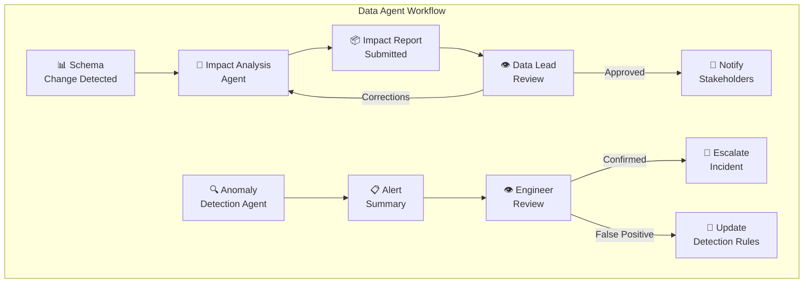

Data engineering teams are adopting AI agents for things that are genuinely painful to do manually: writing pipeline documentation, monitoring data quality anomalies, generating transformation code, and summarizing schema changes for stakeholders. The productivity gain is real.

The challenge is that data pipelines have downstream dependencies. An agent that makes a bad decision about a data quality issue, or that misidentifies a schema change, can cascade into broken reports and confused stakeholders. The tolerance for error is low.

## The Specific Bottlenecks Data Engineering Teams Hit

**Monitoring at pipeline scale.** A modern data stack might have 200-400 pipeline jobs. Monitoring data quality across all of them manually is impractical. AI agents can watch for anomalies — row count drops, null rate spikes, distribution shifts — but only if someone is watching the agents.

**Documentation debt.** Pipeline documentation is always out of date. AI agents can regenerate documentation automatically when schemas change. But auto-generated documentation that's wrong is worse than no documentation — it misleads whoever reads it. You need a review gate on auto-generated docs.

**Schema change impact analysis.** When an upstream data source changes its schema, the impact analysis is tedious: which pipelines does this affect, which dashboards break, which downstream consumers need to be notified? AI agents can do this analysis fast. The output needs human verification before it goes to stakeholders.

## How AgentCenter Addresses Data Engineering Workflows

**Structured review for high-stakes outputs.** When an impact analysis agent finishes, its report doesn't auto-send to stakeholders. It goes to a review queue. The data lead reads it, catches any analysis errors, and approves before anyone external sees it. This is the [deliverable review workflow](/features/agent-monitoring) applied to data engineering outputs.

**Coordination between analysis and execution agents.** When an anomaly detection agent flags an issue, it can hand off to an investigation agent that pulls more context, which hands off to a notification agent that drafts the stakeholder message. The [task orchestration](/features/task-orchestration) handles the sequencing. No custom webhook glue.

**Audit trail for data operations.** Every agent-driven action is logged in AgentCenter: what task was assigned, what the agent produced, who reviewed it, and what decision was made. For data teams under compliance requirements, this audit trail is part of what makes AI agents viable for regulated workflows.

## Feature-to-Workflow Mapping

| Data Engineering Challenge  | AgentCenter Feature     | How It Helps                                       |
| --------------------------- | ----------------------- | -------------------------------------------------- |
| Schema impact review        | Deliverable review gate | Human verification before stakeholder notification |
| Anomaly investigation chain | Task orchestration      | Detection to investigation to notification         |
| Documentation review        | Review workflow         | Auto-generated docs need approval                  |
| Multi-pipeline monitoring   | Real-time agent status  | See which monitoring agents are active             |
| Compliance documentation    | Task audit trail        | Record of every agent decision                     |
| Cost per analysis           | Per-task cost tracking  | Know your AI ops budget                            |

## The Numbers

A data engineering team monitoring a mid-size data stack might run 5-15 agents: anomaly detection agents per critical pipeline, documentation agents, schema impact agents, and notification agents. The [Pro plan](/pricing) at $29/month handles 15 agents across 15 projects.

For larger organizations with dedicated data products per business unit, Scale at $79/month handles 50 agents and 50 projects — enough to have separate projects per data domain.

## Before vs After AgentCenter

|                 | Without AgentCenter            | With AgentCenter                      |
| --------------- | ------------------------------ | ------------------------------------- |
| Visibility      | Monitor outputs directly       | Dashboard shows all agent status      |
| Task handoffs   | Custom alerting pipeline       | Orchestrated automatically            |
| Error detection | Missed anomaly or bad analysis | Review gate catches before escalation |
| Cost tracking   | LLM provider aggregate         | Per-analysis tracking                 |
| Audit trail     | Custom logging                 | Built-in task history                 |

## Where to Start

Start with your most painful manual task: probably schema impact analysis or pipeline documentation. Deploy one agent for that task, add a review gate, and run it for 30 days.

Measure two things: how many hours the agent saved versus doing it manually, and how many times the review gate caught something that would have gone out wrong. Both numbers help you make the case for expanding to more agents.

_Data engineering teams that add a control plane early spend less time firefighting later. [Start your 7-day free trial](/pricing)._
