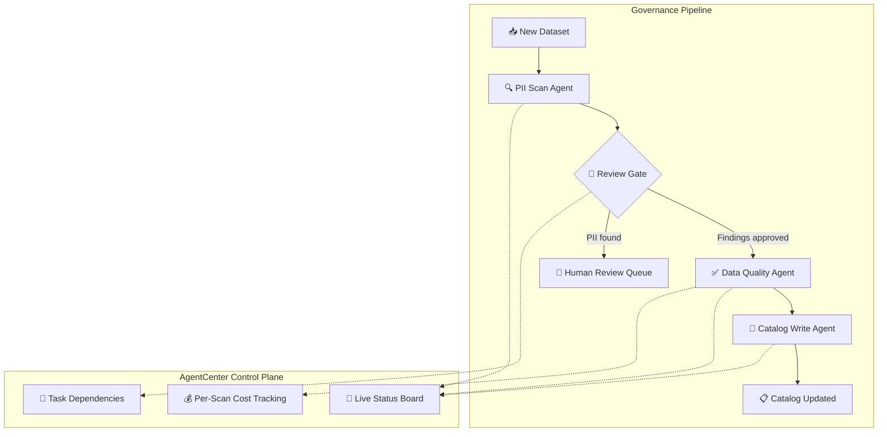

Data governance teams carry a specific kind of operational pressure: the data they protect is the data everyone else uses to make decisions. When a PII scan agent silently skips 40,000 records overnight, nobody knows until an auditor asks why those records were never flagged.

More governance teams are running AI agents now — PII scanners, data quality checkers, metadata enrichers, policy violation detectors. The tooling for building these agents has gotten good. The tooling for knowing what they're actually doing in production has not kept pace.

That gap is where most compliance failures start.

## The Data Governance AI Agent Bottleneck

Three failure patterns show up repeatedly for governance teams running agents without a control plane.

**Silent partial runs.** Your PII scan agent runs from 2am to 4am and completes without errors. The log says "scan complete." What it doesn't say: the agent processed datasets 1 through 12, hit a schema change on dataset 13, and skipped the remaining 28 datasets without raising an alert. Zero errors, incomplete coverage. You find out during the quarterly audit, not the morning after.

**Passed checks against the wrong criteria.** A data quality agent runs row-count and null-field checks on your revenue tables. Three weeks ago, someone renamed a column. The agent still references the old column name. It's checking a field that no longer exists, reading back nulls, and reporting "no violations." Everything passes. Everything is wrong.

**Out-of-order catalog writes.** You have a quality check agent and a metadata catalog agent. They both run on a schedule. Some mornings the catalog write finishes before the quality check does. Now the data catalog shows records marked "reviewed" that were never actually checked. The two agents have no awareness of each other and nothing enforces the correct sequence.

These aren't edge cases. They're the default outcome when governance agents run as isolated cron jobs without coordination.

## How AgentCenter Manages Data Governance AI Agents

### Real-Time Agent Monitoring

With [agent monitoring](/features/agent-monitoring), every governance agent shows its live state: running, idle, blocked, or errored. Your overnight PII scan doesn't disappear into a cron log — you see it started at 02:04, is on dataset 17 of 40, and has flagged 3 records so far.

When it stops mid-run because of a schema mismatch, you know at 02:31 instead of 9am. That's the difference between a one-hour fix and a compliance incident.

### Task Dependencies for Correct Sequencing

The out-of-order catalog write problem is solved by enforcing dependencies through [task orchestration](/features/task-orchestration). You configure the catalog write agent as dependent on the quality check agent. The catalog write doesn't start until the quality check passes and is marked complete.

This isn't a workaround — it's the correct way to model a pipeline where step order is a compliance requirement. You set it once and it holds across every run.

### Deliverable Review Gates

PII classifiers produce false positives. A phone number in a comments field, an email address in a log column, a partial SSN that matches a product code — these get flagged by pattern matching and they're not always what they look like.

When your PII scan agent submits its findings as a deliverable in AgentCenter, a governance analyst reviews the output before any downstream action runs. They see exactly what was flagged, confirm the findings, and approve. Then the remediation step proceeds.

Skipping this gate is how a governance team accidentally marks 8,000 records for deletion because the agent misclassified a product field. That conversation with the engineering team is not a good one.

### Per-Scan Cost Tracking

PII scan agents call out to an LLM for each record they classify. At scale, that adds up fast. AgentCenter tracks cost per agent, per task run — not a monthly API bill, a per-scan breakdown showing what each dataset actually cost.

When one dataset consistently costs 8x the others, that's a signal worth investigating. Usually it's the agent retrying repeatedly because the schema is inconsistent, not the size of the dataset.

## The Numbers for a Typical Governance Team

Most mid-size data governance teams run between 8 and 18 agents in production:

- 2-4 PII scan agents, segmented by data sensitivity tier or environment
- 3-6 data quality check agents, one per business domain
- 2-3 metadata enrichment or catalog write agents
- 1-2 policy violation detection agents

The [Pro plan at $29/month](/pricing) covers 15 agents and handles most governance setups. Teams covering multiple business units or regulated data environments often move to Scale at $79/month for 50 agents.

What it replaces: cron job logs that nobody reads, a Slack channel where agents post results that scroll off overnight, a Notion doc with a status table that was last updated in February, and a standing Monday meeting to find out what actually ran last week.

## Before vs After AgentCenter

| | Without AgentCenter | With AgentCenter |
|---|---|---|
| **Visibility** | Cron logs, if you check them | Live agent status board with run history |
| **Task handoffs** | Agents race each other | Enforced dependencies — quality before catalog |
| **Error detection** | Next morning, via failed report | Real-time: blocked or errored agents surface immediately |
| **Cost tracking** | Monthly API invoice, undifferentiated | Per-agent, per-scan spend in the dashboard |
| **Debugging time** | 2-4 hours reconstructing what ran | 15-30 minutes with full task history and deliverables |

## Where to Start

Connect your PII scan agent first.

It's the agent with the most direct compliance exposure and the one where silent failures carry the most risk. Set it up in AgentCenter, enable live status monitoring, and run it for one week without changing anything else. Watch what it actually does.

Most teams are surprised. The agent that was "working fine" turns out to have been timing out on specific dataset types, running partial scans, and reporting clean results on incomplete data. Once you can see that, you can fix it. Until you can see it, you're filing compliance reports based on what you hope happened.

After the first week, adding the task dependency between quality check and catalog write takes less than an hour.

---

*Data governance teams that add a control plane early catch compliance gaps months before they become audit findings. [Start your 7-day free trial](/pricing).*
