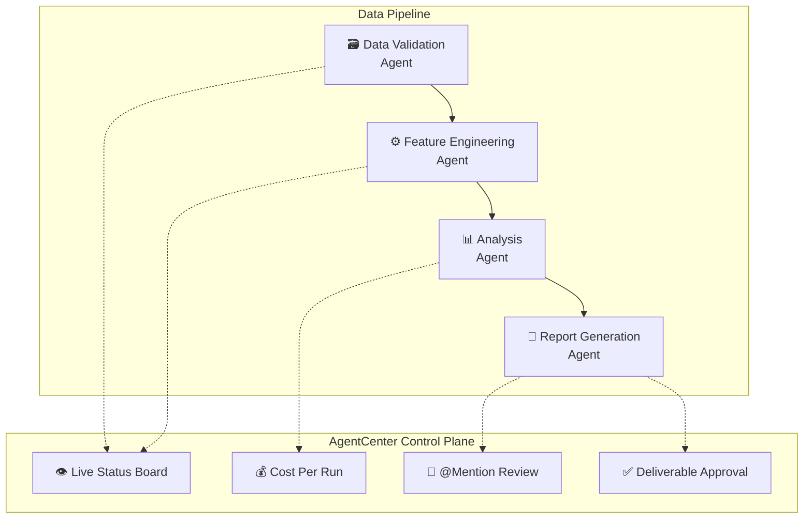

You built 6 agents over the last quarter. One pulls and validates data from your warehouse. One runs exploratory analysis. One generates the weekly business review. One monitors for anomalies in key metrics. The agents work fine in isolation. The problem is that on any given Tuesday morning, you can't tell at a glance what's running, what finished overnight, or which one threw an error.

That's the core challenge when you're managing AI agents for data science teams. It's not a model problem. It's a visibility and coordination problem.

## The Bottleneck Isn't the Agents — It's the Control Gap

Data science agent pipelines tend to break in the same three ways.

**Analysis provenance disappears.** When an agent generates a business insight or summary report, there's no record of which version of the prompt ran, when it ran, or whether the underlying data was stale. Two analysts can look at two different outputs and have no idea which one reflects the current state.

**Pipeline handoffs are manual.** Agent A finishes processing at 11pm. Agent B is supposed to pick up its output. But there's no actual handoff mechanism — someone has to check Slack or a shared doc to know it's safe to proceed. When that person is on leave, the chain breaks.

**Costs are invisible.** A data agent running against a wide dataset with a poorly scoped prompt can burn 20x the tokens of a tuned one. Without per-agent cost tracking, teams don't find out until the end-of-month LLM bill arrives with a single line item.

## How AgentCenter Fits Into a Data Science Workflow

### Real-time agent status

Every agent shows up on the [AgentCenter dashboard](/features/agent-dashboard) as online, working, idle, or blocked. When the feature engineering agent gets stuck because the upstream schema changed, it shows blocked — not silent — and the team sees it before the downstream agents try to run on bad data.

Concrete example: validation agent finishes at 10:43am, marked complete. Feature engineering agent is working. If it goes blocked, that status is visible immediately — not discovered two hours later when the report agent delivers garbage output to a stakeholder.

### Task orchestration and @mentions

Data science pipelines often need a human checkpoint before results go anywhere important. AgentCenter's @mention system lets you tag a team member directly in a task thread when analysis output needs review. The reviewer approves or edits. The reporting agent picks up the approved version.

This replaces the Slack-thread-with-screenshots workflow. The difference is that context stays attached to the task, not buried in a channel.

### Per-agent cost tracking

[AgentCenter's agent monitoring](/features/agent-monitoring) shows cost broken down per agent per run. For data science teams, this means seeing exactly which analysis agent is spending the most tokens — and tuning it before it becomes a budget line item, not after.

One team found that their exploratory analysis agent was re-running full-context passes on datasets that hadn't changed. They had no idea until they could see cost per run. The fix took 20 minutes. The monthly savings were real.

### Deliverable review before distribution

Before a report agent's output reaches a business stakeholder, it goes into a review queue. The data scientist approves or edits it. No unreviewed AI summary lands in an executive's inbox by accident.

This is the highest-ROI feature for data science teams because the alternative is silent — a report that looks right but isn't, with no record of who signed off on it.

## The Numbers

A typical data science team runs 5-12 agents. A solo data scientist at a startup might run 3-4. A larger org running multiple data products might run 20+.

| Team size | Typical agent count | Plan |
|---|---|---|
| Solo data scientist | 3-5 | Starter ($14/mo) |
| Small team (3-6 people) | 6-12 | Pro ($29/mo) |
| Multi-product data org | 15-30+ | Scale ($79/mo) |

What it replaces: shared Google Sheets to track agent run status, Slack threads for pipeline handoffs, end-of-month cloud bills with no breakdown, manual report delivery with no version history.

See the full [pricing page](/pricing) to pick the right tier.

## Before vs After

| | Without AgentCenter | With AgentCenter |
|---|---|---|
| **Visibility** | Ask whoever deployed it what's running | Live agent status on the Kanban board |
| **Task handoffs** | Slack DMs to check if the previous step finished | @mentions and task threads per pipeline step |
| **Error detection** | Next day's report reveals last night's silent failure | Blocked status appears as it happens |
| **Cost tracking** | Monthly LLM bill with no per-agent breakdown | Cost per agent per run, visible in real time |
| **Debugging time** | 2-3 hours tracing logs across notebooks and consoles | Activity feed shows the full run timeline in one place |

## Where to Start

Set up the Kanban board and connect your existing agents before you add any new ones. Getting visibility on what's already running is the fastest win — and it changes how the team talks about agent failures.

Once status is visible, add cost tracking and deliverable review. Those two features alone change what "production-ready" means for a data science agent.

---

*Data science teams that add a control plane early spend less time firefighting later. [Start your 7-day free trial](/pricing).*
