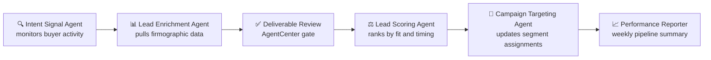

Demand gen teams have a specific kind of problem with AI agents. They don't run one or two. They run eight or twelve — intent monitors, enrichment agents, campaign analysts, content personalizers, lead scorers. Each one does something useful on its own. Together, they create a coordination problem nobody planned for.

## The Real Problem Is Not the Agents Themselves

It's what happens when they all run simultaneously and nobody knows what state each one is in.

Your intent monitoring agent picks up a spike in buyer signals from a target account. It's supposed to hand that off to the enrichment agent, which populates the record with firmographic data, which then triggers the lead scoring agent, which adjusts campaign targeting. Four agents, four steps, one pipeline.

When that pipeline works, it's great. When it doesn't, here's what actually happens: the intent signal gets logged, but the enrichment agent never fires because it was already queued on a different account. The lead scorer runs on stale data. Campaign targeting updates based on last week's scores. Nobody notices for three days because every individual agent shows green status.

That's the demand generation failure mode — not a crash, but a silent coordination breakdown.

## Three Bottlenecks Without a Control Plane

**Pipeline ordering breaks under load.** Intent signals, enrichment, scoring, and targeting are supposed to run in sequence. Without enforced task dependencies, two agents race. The scorer runs before enrichment finishes. A campaign gets updated on incomplete data.

**Cost attribution disappears.** Your enrichment agent hit an expensive data provider API 4,000 times last month. But which campaigns benefited? Which target accounts drove that cost? Without per-agent cost tracking, the bill arrives and nobody can explain it.

**Errors in enrichment data propagate forward.** If an enrichment agent returns a bad company size classification, the scorer picks it up, the targeting agent routes based on it, and the wrong content goes to the wrong segment. By the time anyone catches it, the campaign has been running for a week. A review gate before handoffs would have caught it in five minutes.

## How AgentCenter Maps to Demand Gen Workflows

**Task orchestration with enforced dependencies.** In AgentCenter, you configure enrichment as a dependency of scoring, and scoring as a dependency of targeting. Agents don't start until upstream tasks complete. No racing. No stale data handoffs. The Kanban board shows you exactly where each account is in the pipeline at a glance.

**Real-time agent status across the fleet.** You have 12 agents running. Three are working, two are idle, one is blocked waiting on an API response. You see that in the [agent monitoring dashboard](/features/agent-monitoring) without opening a single log file. The blocked agent is visible in under 30 seconds.

**Deliverable review before targeting updates.** Your enrichment agent submits its output as a deliverable. A team member reviews it before it moves to scoring. This is the gate that catches bad data before it contaminates a campaign segment. You configure the review workflow once; after that it runs automatically for every batch.

**Per-agent cost tracking.** AgentCenter shows you what each agent spent per task. Your enrichment agent ran 800 queries this week against two data providers — here's the breakdown by account tier. You can see whether expensive accounts justified the enrichment cost, and which campaign drove the ROI.

**@Mentions and task threads.** When an intent signal agent flags a high-priority account, you @mention the campaign manager directly in the task thread. They see the signal, the enriched record, and the scoring result in one view without switching tools. Handoffs that used to happen in Slack become part of the task record instead.

## The Numbers for Demand Gen Teams

A typical demand gen team running agents in production manages:

- 2 to 4 intent monitoring agents (one per target segment or ICP tier)
- 2 to 3 lead enrichment agents (often one per data provider)
- 1 to 2 lead scoring agents
- 1 to 2 campaign targeting or content personalization agents
- 1 performance reporting agent

That's 8 to 12 agents for a team in active campaign mode. The **Pro plan** at $29/month handles up to 15 agents across 15 projects — the right fit for most demand gen teams. Teams running multiple ICPs or several product lines in parallel will need the **Scale plan** at $79/month (50 agents).

AgentCenter replaces: a mix of Notion boards for tracking, Slack threads for coordination, and shared spreadsheets for cost estimates — none of which connects to the actual agents.

See the [full plan breakdown](/pricing) to match your current fleet size to the right tier.

## Before vs After

| | Without AgentCenter | With AgentCenter |
|---|---|---|
| **Visibility** | Check logs across four agents to know pipeline state | Single board shows every agent's current status |
| **Task handoffs** | Agents start regardless of upstream status | Dependencies enforced — downstream waits for upstream |
| **Error detection** | Bad enrichment data caught days later via campaign QA | Deliverable review flags bad output before it moves forward |
| **Cost tracking** | Monthly API bill, no per-agent or per-campaign attribution | Per-task cost visible by agent, segment, and campaign |
| **Debugging time** | 2 to 4 hours tracing logs to find what broke | 10 to 20 minutes in AgentCenter's activity feed and task history |

## Where to Start

Set up [task dependencies](/features/task-orchestration) first. Before monitoring, before cost tracking, before anything else — wire the pipeline so enrichment cannot start until intent is confirmed, and scoring cannot start until enrichment completes. This one change eliminates the most common failure mode (agents running on incomplete data) and gives you a live view of your pipeline in the Kanban board.

Once dependencies are in place, add deliverable review for the enrichment step. That's the highest-leverage review gate in a demand gen pipeline — bad data at that stage compounds through every step after it.

---

*Demand gen teams that add a control plane early spend less time firefighting later. [Start your 7-day free trial](/pricing).*
