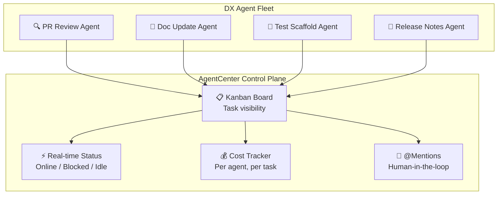

If you work on a developer experience team, your job is to make other engineers' lives easier. Somewhere along the way, that job started requiring you to manage a small fleet of AI agents. Nobody told you how hard that would get.

You've got an agent that reviews PRs. Another that generates test scaffolding from changed files. One that updates internal docs when APIs change. Maybe one that summarizes release notes and posts them to Slack.

Four agents. Sounds manageable. Except two of them are running on the same task, one stopped responding yesterday, and you found out via a confused Slack message from another team at 11am.

## The Bottleneck: DX Teams Run Agents Without a Control Plane

DX teams build carefully for other engineers while running their own tooling in "we'll fix it later" mode. That backfires fast with agents.

**Problem 1: Your code review agent fails silently on large PRs.** The agent times out or hits a token limit, posts nothing, and the PR sits without feedback. Nobody knows if the agent ran or just had nothing to say. Engineers start reviewing manually because they can't trust the automation.

**Problem 2: Your doc-update agent and your changelog agent both fire on the same merge.** They fetch the same diff, process it in parallel, and occasionally write conflicting summaries. You find out when a confused writer asks why two docs contradict each other.

**Problem 3: You have no idea what the onboarding agent costs.** You set it up six months ago. It runs for every new repo created. You've added 40 repos since then. You're pretty sure the token costs are significant — but looking would require digging through raw API logs.

These aren't edge cases. They're what happens when agents run without visibility.

## How AgentCenter Solves This for DX Teams

### Kanban Board for Agent Tasks

Every PR the review agent picks up gets a card on the [task orchestration board](/features/task-orchestration). You can see which cards are in progress, which are blocked, and which completed — without parsing logs. When the large-PR timeout happens, it shows up as "blocked" with an error reason, not as radio silence.

### Real-Time Agent Status

The doc-update and changelog agents both show as "working" when they're processing the same merge. You see the conflict before it writes bad output. You can pause one and let the other finish first.

### Cost Tracking Per Agent

The onboarding agent has its own cost view via [agent monitoring](/features/agent-monitoring). You can see exactly how many tokens it consumed last month, broken down by repo. If a repo triggered the agent 40 times, you'll see that. A single month of cost visibility usually pays for the tool.

### @Mentions and Task Threads

When the PR review agent flags a security pattern it can't auto-resolve, it escalates via @mention to whoever owns that repo. The escalation lives in the task thread, not buried in a Slack channel where it gets lost in 20 minutes.

### Deliverable Review and Approval

For the changelog agent, you set up an approval step before it posts to external channels. Agent drafts the note, a team member approves it, then it goes out. You stop shipping changelog summaries that got the version number wrong.

## The Numbers for DX Teams

A typical DX team at a mid-size company runs 4 to 10 agents: code review, doc sync, test generation, internal bots. Teams supporting multiple product squads sometimes reach 20 or more.

The [Pro plan at $29/month](/pricing) covers 15 agents and 15 projects, which fits most DX teams. If you're supporting more than 4 or 5 product squads with dedicated agents per squad, Scale at $79/month covers 50 agents.

What it replaces: custom monitoring scripts, shared Slack channels used as "is the agent running?" dashboards, and spreadsheets tracking which agent owns which repo.

## Before vs After

| | Without AgentCenter | With AgentCenter |
|---|---|---|
| **Visibility** | Check logs manually to see what ran | All agent tasks on the Kanban board in real time |
| **Task handoffs** | Two agents process the same event, conflict silently | Task visibility prevents duplicate processing |
| **Error detection** | Silent failure until another team reports it | Blocked status visible immediately with error reason |
| **Cost tracking** | Monthly API bill with no breakdown by agent | Cost tracked per agent per task, updated live |
| **Debugging time** | 45 minutes in API logs to find what failed | Click the task card, see the error, fix the config |

## Where to Start

Set up the Kanban board first. Connect your existing agents and let it run for a week without changing anything else. Just watching what appears on the board — and what doesn't — tells you more about your agent fleet than you'll get from logs in a month.

Once you can see what's running, you'll know where to add cost tracking and approval workflows.

---

*Developer experience teams that add a control plane early spend less time firefighting later. [Start your 7-day free trial](/pricing).*
