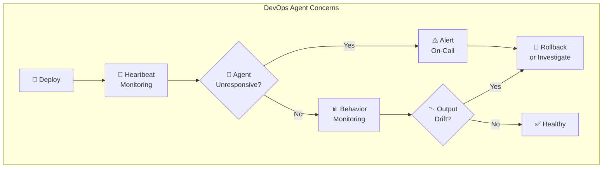

DevOps teams get handed AI agents the same way they get handed everything else: "here, run it in prod." The agent was built by someone else, probably works locally, and now it's your problem to keep it alive at 2am.

The catch is that AI agents fail differently than services. A service crashes. An agent drifts. It keeps running, keeps responding, and quietly starts producing worse outputs until someone notices a downstream effect three days later.

That's the DevOps problem with AI agents. You need to keep the infrastructure up and catch behavioral degradation — at the same time.

## The Specific Bottlenecks DevOps Teams Hit

**No health check standard.** Every agent team builds their own heartbeat, if they build one at all. You end up with 6 different monitoring approaches across 6 different agent projects. Some are logging to CloudWatch. Some are sending Slack messages. One is just checking if the process is running.

**No deployment rollback for agents.** You know how to roll back a service — revert the image, redeploy. Rolling back an agent is murkier. The agent's behavior depends on the prompt, the model version, and sometimes fine-tuning that lives outside your deployment pipeline. You have to know which of those changed.

**Alert fatigue from agent noise.** Agents make a lot of external calls. Each one can fail intermittently. If you're not careful, your PagerDuty queue fills up with transient errors that the agent already retried and recovered from. Real signal gets buried.

## How AgentCenter Addresses These for DevOps

**Standardized status across all agents.** The [agent dashboard](/features/agent-dashboard) shows every agent's status in one view: online, working, idle, or blocked. No more piecing together logs from 6 different sources. You define the heartbeat interval; AgentCenter flags anything that goes silent.

**Task-level audit trail.** Every task assignment, status change, and deliverable submission is logged. When an agent starts behaving oddly, you can pull up the task history and see exactly when behavior changed. That timestamp usually points you to a model update, prompt change, or infrastructure event.

**Configurable alert thresholds.** You set the thresholds that matter to you — task duration, cost per run, error rate. AgentCenter doesn't alert on every retry. It alerts when patterns cross your thresholds. One failed API call won't page you. Five failed calls in ten minutes will.

## Feature-to-Workflow Mapping

| DevOps Concern              | AgentCenter Feature                 | How It Helps                  |
| --------------------------- | ----------------------------------- | ----------------------------- |
| Is this agent alive?        | Real-time status + heartbeat        | One view, no custom code      |
| What changed when it broke? | Full task audit trail               | Correlate failures to changes |
| Deployment rollback         | Task version history + agent config | Know what to revert           |
| Alert noise                 | Configurable thresholds             | Only page on real patterns    |
| Cost overruns               | Per-task cost tracking              | Budget per project            |
| Multi-agent coordination    | Task orchestration                  | No custom orchestration glue  |

## The Numbers

A typical DevOps team managing AI agents runs 5-15 active agents across 3-8 projects. On the [Pro plan](/pricing) at $29/month, you get 15 agents and 15 projects — which covers most teams without headroom pressure.

For larger deployments (15+ agents), Scale at $79/month handles up to 50 agents and 50 projects, plus Cloud VM provisioning you don't have to manage yourself.

What does AgentCenter replace? Usually a combination of: custom heartbeat scripts, a shared Notion doc for agent status, CloudWatch alarms, and Slack notifications that nobody reads anymore. That's typically 8-12 hours of engineering time per quarter maintaining glue code.

## Before vs After AgentCenter

|                 | Without AgentCenter    | With AgentCenter       |
| --------------- | ---------------------- | ---------------------- |
| Visibility      | Check 6 different logs | One dashboard          |
| Task handoffs   | Custom queue code      | Built-in orchestration |
| Error detection | Manual log review      | Threshold-based alerts |
| Cost tracking   | CloudWatch estimates   | Per-task tracking      |
| Debugging time  | 2-4 hours per incident | 20-40 minutes          |

## Where to Start

Start with the heartbeat monitoring. Connect your most critical agent first and configure the silence threshold. Seeing "this agent hasn't checked in for 15 minutes" in a dashboard instead of discovering it from a user complaint is immediately useful.

Once that's working, layer in cost thresholds. DevOps teams almost always discover at least one agent that's been quietly burning budget on retries.

_DevOps teams that add a control plane early spend less time firefighting later. [Start your 7-day free trial](/pricing)._
