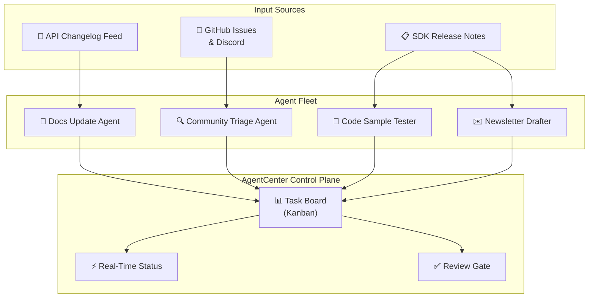

A developer relations team we spoke with had six agents running in production. One kept docs in sync after API changes, one scanned GitHub issues for recurring questions, one tested code samples against new SDK versions, and three handled different parts of the community newsletter pipeline.

Nobody knew which one was broken on any given day.

The docs agent had silently stopped updating three weeks earlier. The code sample tester had been retrying the same failing test for two days. The newsletter agents were publishing, but one of them had started dropping sections from the output. They found out about all three issues in the same week, from developer complaints.

That's the problem with running agents without a control plane.

## What Breaks When DevRel Agents Run Without Visibility

DevRel agents are quiet by design. They run in the background, handle repetitive work, and don't interrupt anyone. That's also why failures stay hidden.

**Docs drift silently.** A documentation update agent that breaks doesn't announce itself. It just stops updating. Developers hit stale docs, file issues, or give up. The team doesn't know until the support queue fills up.

**Code samples break without notice.** SDK updates happen on the engineering side without always triggering a DevRel alert. If you have an agent testing samples against the latest API version and that agent is stuck or looping, broken samples stay published. This erodes developer trust faster than almost anything else.

**Pipeline handoffs go missing.** A typical community newsletter pipeline involves a research agent, a drafting agent, and a review step. If the research agent produces partial output and the drafting agent accepts it silently, you publish something incomplete. The handoff gap is invisible unless someone is watching.

Three agents, three different failure modes. None of them loud enough to trigger an alert on their own.

## How AgentCenter Fits the DevRel Workflow

**Real-time agent status** is the first thing that changes. Instead of checking agent logs or waiting for developer complaints, you see which agents are online, working, idle, or blocked in the [agent monitoring dashboard](/features/agent-monitoring). The docs agent that silently stopped? It shows as idle with a timestamp. That's all you need to catch it early.

**Task orchestration** handles the pipeline handoff problem. When the research agent finishes, it hands off to the drafting agent through an explicit task in AgentCenter. If the research output is partial, the handoff task is flagged instead of silently passed through. You see the break before the newsletter is drafted, not after it's published. See how [task orchestration works](/features/task-orchestration) for multi-step pipelines.

**Deliverable review** matters a lot for DevRel work because the outputs go directly to developers. When the code sample tester runs against a new SDK version, its report lands in the review queue. A human scans it before samples get marked as verified. This isn't about slowing things down — it's about not publishing broken samples because an agent silently skipped a test case.

**@Mentions and task threads** give you a way to pull in the right person when something needs a decision. If the triage agent flags a GitHub issue as a potential breaking change, you @mention the relevant engineer directly in the task thread. The conversation stays attached to the issue, not buried in Slack.

## The Numbers for a Typical DevRel Team

A DevRel team of 3 to 8 people typically runs 6 to 15 agents:

- 1 or 2 docs update agents (one per major API surface)
- 1 community triage agent
- 1 to 3 code sample testing agents (per SDK or language)
- 2 to 4 newsletter pipeline agents
- 1 developer forum monitoring agent

That puts most DevRel teams on the **Pro plan at $29/month** (15 agents, 15 projects). If you support multiple products or platforms, Scale at $79/month gives you 50 agents and more project separation. See the full breakdown on the [pricing page](/pricing).

AgentCenter replaces the combination of scheduled cron jobs, status spreadsheets, Slack update threads, and manual log-checking that most DevRel teams currently use to track agent activity.

## Before vs After

| | Without AgentCenter | With AgentCenter |
|---|---|---|
| **Visibility** | Check logs manually or wait for complaints | Live status per agent on the Kanban board |
| **Task handoffs** | Silent — pipeline continues regardless of output quality | Explicit — blocked or flagged if upstream output is incomplete |
| **Error detection** | Developer reports or manual log review, days later | Stuck/idle agents visible within minutes |
| **Cost tracking** | Aggregate billing, no per-agent breakdown | Per-task and per-agent cost tracked in the dashboard |
| **Debugging time** | 2 to 4 hours tracing logs to find where a pipeline broke | Start from the failing task, check the thread, fix and re-run |

## Where to Start

Set up the task board first. Get all your active agents into AgentCenter projects, assign them tasks, and add status reporting. Don't start with the most complex agent — start with the most critical one.

For most DevRel teams, that's the docs update agent. It's the one that breaks most quietly and causes the most damage when it does. Once it's on the board with real-time status, you'll immediately have more visibility than you had before.

From there, add handoffs for your newsletter pipeline one step at a time. Research → Draft → Review. Each step gets its own task, and the dependencies make the pipeline visible.

---

*DevRel teams that add a control plane early spend less time firefighting later. [Start your 7-day free trial](/pricing).*
