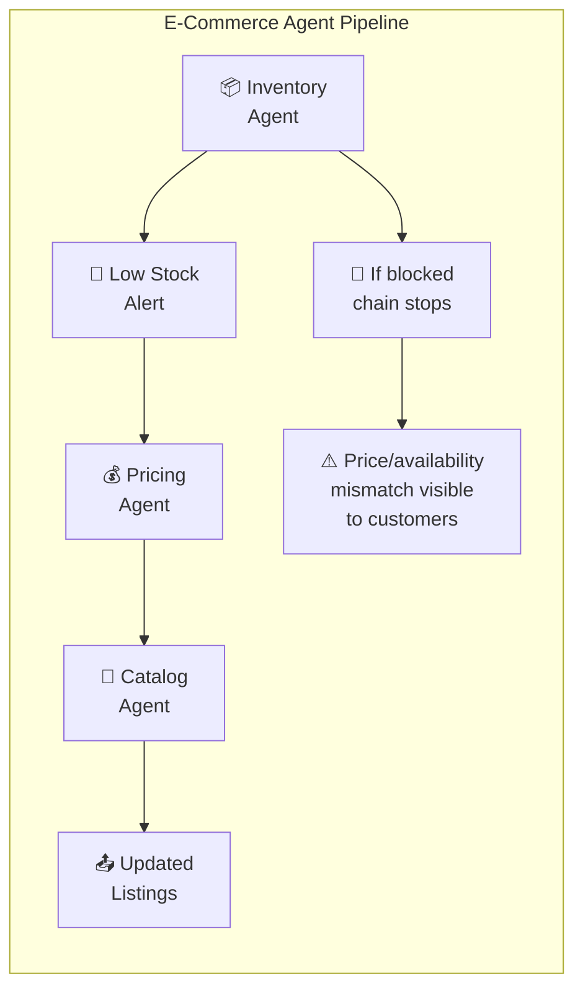

E-commerce operations teams were early adopters of AI agents because the use cases are obvious: product description generation, pricing analysis, inventory monitoring, customer support triage, review analysis. The ROI is clear. The implementation is usually fine. The operations are where it breaks down.

Running 8 agents for an e-commerce operation that processes 50,000 SKUs, handles 200 daily support tickets, and needs pricing updates done by 6am means you can't afford to find out something broke from a customer complaint.

## The Specific Bottlenecks E-Commerce Teams Hit

**Time-sensitive tasks that can't wait.** Pricing agents need to run by market open. Inventory alerts need to fire before items oversell. If an agent silently fails at 2am, you find out at 9am when customers have been seeing wrong prices for seven hours. There's no good recovery from that.

**High-volume, high-variability inputs.** A product catalog agent might handle 200 items one day and 2,000 the next. A seasonal sale changes the input distribution entirely. An agent tuned for normal volume may behave unpredictably under peak load — and e-commerce peaks are dramatic.

**Coordination between agents at critical moments.** The inventory agent flags low stock. The pricing agent needs that signal to adjust prices. The catalog agent needs to update availability copy. These three agents need to coordinate in a specific sequence. If one is blocked or slow, the whole chain delays.

## How AgentCenter Addresses E-Commerce Operations

**Real-time status for time-critical agents.** The [agent dashboard](/features/agent-dashboard) shows you at any moment whether your pricing agent is working, idle, or blocked. If it's 5:45am and the pricing agent hasn't run yet, you see that and can intervene — before market open, not after.

**Task orchestration for chained pipelines.** When the inventory agent flags a low-stock item, [task orchestration](/features/task-orchestration) routes that signal to the pricing agent automatically, with the right context. No custom webhook code. No polling. The chain runs reliably because it's managed.

**Deliverable review for catalog content.** Before any agent-generated product description goes live, it passes through a review gate. A merchandising team member approves or edits. Quality stays consistent. Brand voice doesn't drift based on whatever the model generated that day.

## Feature-to-Workflow Mapping

| E-Commerce Challenge         | AgentCenter Feature        | How It Helps                       |
| ---------------------------- | -------------------------- | ---------------------------------- |
| Time-critical agent failures | Real-time status + alerts  | See blocked agents before deadline |
| Inventory-to-pricing chain   | Task orchestration         | Automatic coordination             |
| Catalog content quality      | Deliverable review gate    | Human approval before publish      |
| Support ticket volume spikes | Agent status + queue depth | See backlog building instantly     |
| Cost per SKU tracking        | Per-task cost monitoring   | Know your cost per listing         |
| Seasonal load changes        | Agent status at scale      | 50 agents on Scale plan            |

## The Numbers

A mid-size e-commerce operation typically runs 6-12 agents: catalog, pricing, inventory, support triage, review analysis, and possibly a couple of custom agents for specific business rules. The [Pro plan](/pricing) at $29/month handles 15 agents and 15 projects — enough for most e-commerce teams with room to grow.

For large catalogs or high-volume support operations, the Scale plan at $79/month handles 50 agents.

## Before vs After AgentCenter

|                 | Without AgentCenter       | With AgentCenter              |
| --------------- | ------------------------- | ----------------------------- |
| Visibility      | Check logs in the morning | Real-time dashboard overnight |
| Task handoffs   | Custom webhook glue       | Built-in orchestration        |
| Error detection | Customer complaints       | Threshold alerts              |
| Cost tracking   | Monthly billing total     | Per-SKU, per-task             |
| Debugging time  | 2-4 hours per incident    | 20-45 minutes                 |

## Where to Start

Start with your most time-critical agent — probably pricing or inventory. Connect it to AgentCenter first. Set a completion-by alert: if this agent hasn't finished by 5:30am, page the on-call. That single alert changes your overnight reliability posture immediately.

Once that's stable, add the catalog and support agents. The review gate is especially valuable for catalog content — it's the place most e-commerce teams see the highest ROI from human oversight.

_E-commerce teams that add a control plane early spend less time firefighting later. [Start your 7-day free trial](/pricing)._
