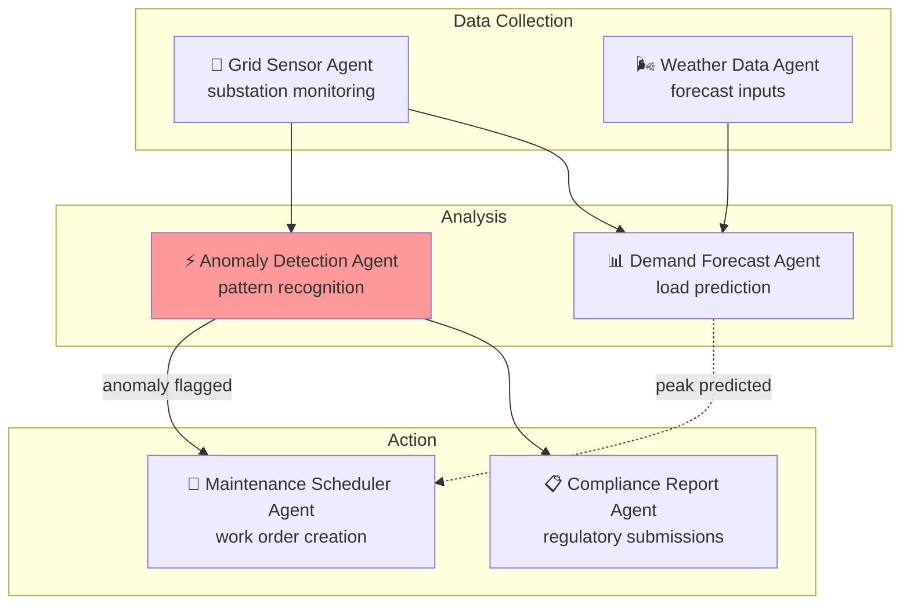

You have 14 agents watching different parts of your grid. One monitors substation load. Another processes sensor readings from wind turbines. A third pulls weather data to adjust demand forecasts. A fourth kicks off maintenance work orders when anomalies hit a threshold.

At 2:47am, the demand forecast is wrong. You don't know which agent caused it. You're not sure which ones are even running right now.

That's the situation most energy operations teams end up in after the first few months of running agents in production.

## The Specific Problems That Show Up at Scale

Running one or two agents is manageable. You know what they do, you can tail the logs, you catch failures fast. Once you're at 8 or more agents handling different segments of your operations, a few things break down.

**No single view of what's running.** Your grid monitoring agents, your demand forecasting agents, your maintenance scheduling agents — they all run independently. When something goes wrong, you're checking logs in three different places trying to reconstruct what happened and when.

**Handoffs between agents are invisible.** A sensor reading triggers an anomaly detection agent, which is supposed to hand off to a maintenance scheduling agent, which should create a work order. When that chain breaks, you find out from a missing work order, not from the system that missed the handoff.

**Cost attribution is impossible.** Your LLM bill goes up 40% in November. You know it's demand forecasting season, but you can't tell which agent ran extra calls or why. You're guessing which agent to fix.

## How AgentCenter Solves This for Energy Teams

This is what a typical energy operations agent fleet looks like. AgentCenter sits on top of all of it and gives you a control plane for the whole thing.

### Real-Time Agent Status

The [agent monitoring dashboard](/features/agent-monitoring) shows every agent in your fleet: online, working, idle, or blocked. When an agent stalls at 3am, you see it immediately — not when someone notices wrong data in the morning report.

For an energy ops team, this matters most for your always-on monitoring agents. If your substation sensor agent goes idle, you want to know before the next shift starts, not after an incident.

### Task Tracking with the Kanban Board

The [Kanban board](/features/task-orchestration) shows every task your agents are working on. When your anomaly detection agent flags a pattern and hands off to the maintenance scheduler, both tasks appear on the board. You can see the handoff happened, what was passed, and whether the work order was created.

Without this, you're reverse-engineering the handoff from two separate log files. With it, you see the whole chain in one place.

### Per-Agent Cost Tracking

AgentCenter tracks token usage and cost per agent, per task. When November rolls around and your LLM costs spike, you can pull up the demand forecasting agent's activity log and see exactly when and why it ran extra calls. That narrows a 4-hour debugging session to a 10-minute investigation.

### @Mentions for On-Call Coordination

When an agent flags a high-priority anomaly, your on-call engineer needs to know immediately. AgentCenter's @mention system lets you tag engineers directly inside the task thread. The context stays attached to the task — what the agent detected, what it did, what it handed off — so the on-call engineer doesn't have to reconstruct the situation from scratch.

## The Numbers for Energy Operations Teams

A typical energy ops team running agents in production has:

- 8 to 20 agents covering different operational segments
- Always-on monitoring agents plus scheduled reporting agents
- 3 to 6 people who need visibility into agent activity

The **Pro plan at $29/month** covers 15 agents and 15 projects — enough for most mid-sized operations teams. If you're running a larger fleet across multiple sites or regions, the **Scale plan at $79/month** gives you 50 agents. [See full pricing](/pricing).

What it replaces: custom monitoring scripts, shared Slack channels for agent alerts, manual log reviews, and spreadsheets for tracking which agent owns which task.

## Before vs After AgentCenter

| | Without AgentCenter | With AgentCenter |
|---|---|---|
| **Visibility** | No unified view — check logs per agent | Live status board for all agents |
| **Task handoffs** | Invisible — find failures from missing work orders | Full handoff history visible per task |
| **Error detection** | Find out hours later when something downstream fails | Blocked or failed agents visible immediately |
| **Cost tracking** | Monthly LLM bill with no per-agent attribution | Per-task, per-agent cost breakdown |
| **Debugging time** | Hours tracing logs across systems | Task history with full context in one place |

## Where to Start

Set up agent status monitoring first. Connect your grid monitoring agents to AgentCenter and put the status board on your operations screen. When you can see in real time which agents are active versus idle or blocked, you've solved the biggest single problem energy ops teams hit.

From there, wire in your anomaly detection and maintenance scheduling agents so the handoffs show up in the Kanban board. That's usually the second thing teams wish they had set up from day one.

---

*Energy operations teams that add a control plane early spend less time firefighting later. [Start your 7-day free trial](/pricing).*
