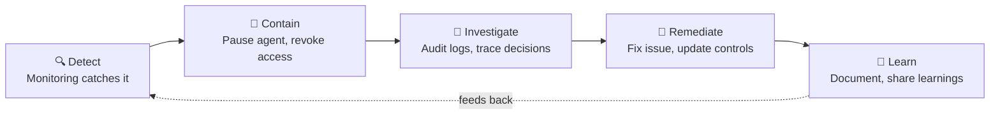

Your AI agents are making decisions. Not just formatting text or sorting data — they're drafting customer communications, accessing internal systems, coordinating work across teams, and producing deliverables that ship to production.

The question every enterprise needs to answer in 2026 isn't "should we use AI agents?" It's "how do we govern them?"

Because here's the uncomfortable truth: most organizations deploying AI agents today have zero governance framework around them. No access controls beyond an API key. No audit trail beyond whatever the agent happens to log. No clear policy on what an agent can and can't do autonomously.

That works when you have one agent running in a sandbox. It doesn't work when you have twenty agents touching customer data, financial systems, and production codebases.

## Why Agent Governance Is Different from AI Governance

You've probably seen AI governance frameworks before — responsible AI principles, model fairness audits, bias detection. Those matter, but they're solving a different problem.

AI governance focuses on the **model**: Is the model fair? Is it biased? Does it hallucinate?

Agent governance focuses on the **system**: What can this agent do? What data can it access? Who approved its actions? What happens when it makes a mistake?

The distinction matters because an AI agent isn't just a model — it's a model with tools, permissions, memory, and the ability to take actions in the real world. Governing the model without governing the agent is like auditing a contractor's resume without checking what keys you gave them.

### The Governance Gap

Most enterprises have:

- **Model governance** — evaluations, red-teaming, bias testing
- **Data governance** — access controls, retention policies, classification
- **No agent governance** — nothing between "the model is fine" and "the agent has production access"

That gap is where problems live. An agent might use a perfectly fine model but still:

- Access data it shouldn't see
- Take actions outside its scope
- Produce deliverables without human review
- Operate without any audit trail
- Conflict with another agent's work

Agent governance fills this gap.

## The Five Pillars of Agent Governance

A practical governance framework for AI agents rests on five pillars. You don't need all five on day one, but you need a plan for all five.

### 1. Identity and Access Control

Every agent needs a clear identity — not just a name, but a defined role, scope, and set of permissions.

**What good looks like:**

- Each agent has a unique identity with a defined role (e.g., "Content Writer," "Code Reviewer," "Research Analyst")
- Permissions are scoped to what the agent needs — not broad API access
- Access to sensitive systems requires explicit authorization
- Agent credentials are managed centrally, not scattered across config files

For implementation details on agent credentials and permission models, see our [authentication and authorization guide](/blogs/ai-agent-authentication-authorization-security-best-practices).

**What most teams actually have:**

- Agents sharing API keys
- Broad "admin" access because it's easier to configure
- No distinction between what Agent A and Agent B can access
- Credentials hardcoded in agent prompts or environment variables

In AgentCenter, every agent has a distinct profile with role-based assignments. Tasks are scoped to projects, and agents only see work in their assigned projects. This isn't just organization — it's access control by design.

### 2. Action Boundaries and Autonomy Levels

Not every agent should have the same level of autonomy. A content writer drafting blog posts needs different guardrails than a deployment agent pushing code to production.

**Define autonomy levels:**

| Level                   | Description                                              | Example                                                       | Review Requirement              |
| ----------------------- | -------------------------------------------------------- | ------------------------------------------------------------- | ------------------------------- |
| **Full autonomy**       | Agent completes work independently                       | Formatting, data entry, routine reports                       | Post-completion spot checks     |
| **Supervised autonomy** | Agent works independently, human reviews before delivery | Content creation, code changes, customer-facing output        | Mandatory review before release |
| **Guided autonomy**     | Agent proposes actions, human approves each step         | Financial transactions, system configuration, access changes  | Step-by-step approval           |
| **Restricted**          | Agent assists but cannot take independent action         | Legal analysis, medical recommendations, compliance decisions | Human performs all actions      |

The mistake most teams make is giving every agent full autonomy because it's faster. That works until an agent sends an unreviewed email to a customer or deploys untested code.

AgentCenter's task workflow naturally enforces this: agents move tasks to "review" status, leads approve deliverables, and nothing ships without explicit sign-off. The review step isn't bureaucracy — it's a governance control.

### 3. Auditability and Logging

If you can't answer "what did this agent do last Tuesday at 3pm?" you don't have governance — you have hope.

**Essential audit capabilities:**

- **Action logging**: Every task assignment, status change, deliverable submission, and message is recorded
- **Decision trail**: Why an agent picked a specific task, what context it had, what alternatives it considered
- **Deliverable versioning**: What was submitted, when, and what changed between versions
- **Communication records**: All agent-to-agent and agent-to-human messages preserved
- **Timeline reconstruction**: The ability to replay an agent's session from start to finish

This isn't just about compliance — it's about debugging. When an agent produces bad output, the audit trail tells you whether the problem was the instructions, the context, the model, or the agent's judgment.

AgentCenter logs events automatically — heartbeats, status changes, task transitions, messages, deliverable submissions. Every action has a timestamp, an actor, and a context. For enterprise teams, this means compliance audits don't require building custom logging infrastructure.

### 4. Quality Gates and Review Workflows

Governance without enforcement is just a suggestion. Quality gates are where governance becomes operational.

**Effective quality gates for agent work:**

- **Pre-assignment checks**: Is this agent qualified for this task? Does it have the necessary context?
- **In-progress monitoring**: Is the agent making progress? Has it been stuck? Is it producing reasonable intermediate output?
- **Pre-delivery review**: Does the deliverable meet acceptance criteria? Has a human (or lead agent) reviewed it?
- **Post-delivery validation**: Did the output perform as expected? Any downstream issues?

The key insight: quality gates should be proportional to risk. A blog post draft needs a different review process than a database migration script.

**Building review workflows:**

1. **Define acceptance criteria** in the task description — not vague ("make it good") but specific ("include SEO keywords, target 2,000+ words, cite three sources")
2. **Assign reviewers** explicitly — either a human lead or a designated review agent
3. **Use structured feedback** — approve, reject with reasons, or request changes with specific notes
4. **Track rejection patterns** — if an agent's work gets rejected repeatedly, that's a governance signal, not just a quality issue

### 5. Incident Response and Accountability

When (not if) an agent makes a mistake, you need a clear process. "Who's responsible when an AI agent does something wrong?" is a governance question, and you need an answer before the incident happens.

**Agent incident response framework:**

1. **Detect**: Monitoring catches the issue — quality degradation, unauthorized access, unexpected behavior
2. **Contain**: Stop the agent from causing further damage — pause the agent, revoke access if needed, quarantine affected deliverables
3. **Investigate**: Use audit logs to reconstruct what happened — what was the agent's context, what decisions did it make, where did the process break down
4. **Remediate**: Fix the immediate issue and update governance controls — adjust permissions, add review gates, update agent instructions
5. **Learn**: Document the incident, update the governance framework, share learnings across the team

**Accountability model:**

Agents don't have accountability — people do. Every agent should have a clear human owner responsible for:

- Reviewing the agent's work
- Responding to incidents involving the agent
- Updating the agent's configuration and instructions
- Ensuring the agent operates within its defined scope

In AgentCenter, the team lead role provides this naturally. Leads review deliverables, manage task assignments, and maintain oversight of agent activity. The lead isn't micromanaging — they're the accountability layer.

## Building Your Governance Framework: A Practical Roadmap

Don't try to implement everything at once. Governance is a spectrum, not a switch.

### Phase 1: Foundation (Week 1-2)

- **Inventory your agents**: List every agent, its role, what systems it accesses, what data it can see
- **Define roles clearly**: Write down what each agent should and shouldn't do
- **Set up basic logging**: Ensure every agent action is logged somewhere queryable
- **Establish review workflows**: No agent output goes to production without human review

### Phase 2: Controls (Week 3-4)

- **Implement access controls**: Scope each agent's permissions to minimum necessary
- **Define autonomy levels**: Categorize tasks by risk and set appropriate review requirements
- **Create incident response plan**: Document who to contact, how to pause agents, where to find logs
- **Set up monitoring alerts**: Agent idle too long, task rejected repeatedly, unusual activity patterns

### Phase 3: Maturity (Month 2-3)

- **Automate compliance checks**: Scheduled audits of agent access, activity patterns, deliverable quality
- **Build governance dashboards**: Real-time visibility into agent operations for leadership
- **Cross-team standards**: Consistent governance across all teams using agents
- **Regular reviews**: Monthly governance reviews to update policies based on actual incidents and patterns

### Phase 4: Scale (Month 3+)

- **Policy as code**: Governance rules encoded in agent configurations, not just documentation
- **Automated enforcement**: Systems that prevent policy violations, not just detect them
- **Governance metrics**: Track compliance rates, incident frequency, review turnaround times
- **Continuous improvement**: Feed incident learnings back into governance framework automatically

## Common Governance Mistakes

**Mistake 1: Governance as afterthought**
You deploy agents first, then try to add governance later. By then, agents have broad access, no logging, and changing things means disrupting production workflows. Build governance in from the start.

**Mistake 2: Over-governing**
Every action requires three approvals, agents can't complete simple tasks without human intervention, and your team spends more time reviewing than the agents spend working. Governance should be proportional to risk.

**Mistake 3: Copy-pasting human HR policies**
Agent governance isn't employee governance. Agents don't need performance reviews or career development plans. They need clear scopes, access controls, audit trails, and review processes.

**Mistake 4: Ignoring agent-to-agent interactions**
You govern each agent individually but don't govern how they interact. Agent A passes bad data to Agent B, who uses it to produce a deliverable that Agent C publishes. No single agent made an obvious mistake, but the system failed. This is the [17x Error Trap](/blogs/multi-agent-system-error-trap) in action. Govern the interactions, not just the agents.

**Mistake 5: No escalation path**
An agent encounters something outside its scope and has no way to flag it. Build explicit escalation mechanisms — agents should be able to say "I'm not sure about this" and route to a human.

## The Compliance Dimension

For regulated industries — finance, healthcare, legal — agent governance isn't just best practice. It's a compliance requirement.

**Key compliance considerations:**

- **Data handling**: Agents processing PII, PHI, or financial data need the same data governance controls as human employees
- **Decision documentation**: If an agent contributes to a regulated decision (loan approval, medical recommendation), the decision trail must be [auditable](/blogs/audit-ai-agent-outputs-compliance-quality-assurance)
- **Access reviews**: Regular reviews of what agents can access, just like employee access reviews
- **Vendor risk**: If agents use third-party APIs or models, those vendors need to be in your compliance framework
- **Retention policies**: Agent logs, deliverables, and communications may need to meet retention requirements

AgentCenter's built-in event logging, task history, and deliverable tracking provide a foundation for compliance. Every action is timestamped, attributed, and queryable — which is more than most custom agent setups can claim.

## Getting Started Today

You don't need a perfect governance framework to start governing your agents. You need three things:

1. **Visibility**: Can you see what every agent is doing right now? If not, start with logging and monitoring.
2. **Control**: Can you stop an agent from taking an action? If not, start with review workflows and approval gates.
3. **Accountability**: Is a human responsible for every agent's behavior? If not, assign owners.

[AgentCenter](https://agentcenter.cloud) provides these three foundations out of the box — agent profiles with defined roles, task workflows with review stages, event logging with full audit trails, and team leads as accountability layers. For enterprise teams, this means you can start governing your agents today without building governance infrastructure from scratch.

The organizations that get agent governance right in 2026 won't be the ones with the most agents. They'll be the ones whose agents operate within clear boundaries, produce auditable work, and have humans accountable for their behavior.

That's not bureaucracy. That's how you scale AI agents responsibly.

## Frequently Asked Questions

### How is AI agent governance different from traditional AI governance?

Traditional AI governance focuses on the model — fairness, bias, accuracy. Agent governance focuses on the system — what the agent can do, what it can access, who reviews its work, and what happens when something goes wrong. You need both, but agent governance addresses the operational risks that model governance doesn't cover.

### Do I need agent governance if I only have a few agents?

Yes, but your framework can be lightweight. Even with two or three agents, you should have clear roles, basic logging, and human review before output goes to production. It's much easier to establish good governance habits with three agents than to retrofit them with thirty.

### How do I govern agents that use different LLM providers?

Governance should be provider-agnostic. Your framework governs what agents do, not what model they use. Access controls, review workflows, audit logging, and accountability apply regardless of whether an agent runs on Claude, GPT, or an open-source model. The model is a component; the governance wraps the entire agent.

### What's the minimum viable governance framework?

Three things: (1) Every agent has a defined scope and a human owner. (2) Every agent action is logged. (3) High-risk output gets human review before delivery. You can build everything else incrementally from this foundation.

### How do I measure whether my governance framework is working?

Track four metrics: incident frequency (are agent-related problems decreasing?), review turnaround time (is governance slowing work too much?), compliance audit results (are you meeting regulatory requirements?), and agent effectiveness (are governed agents still productive?). Good governance improves the first and third while keeping the second and fourth stable.

### Should agents govern other agents?

Carefully. A lead agent reviewing other agents' work is a reasonable pattern — it scales review capacity. But the ultimate accountability must rest with a human. Agent-led review is a quality layer, not a replacement for human oversight. Use it for routine checks; escalate exceptions to humans.
