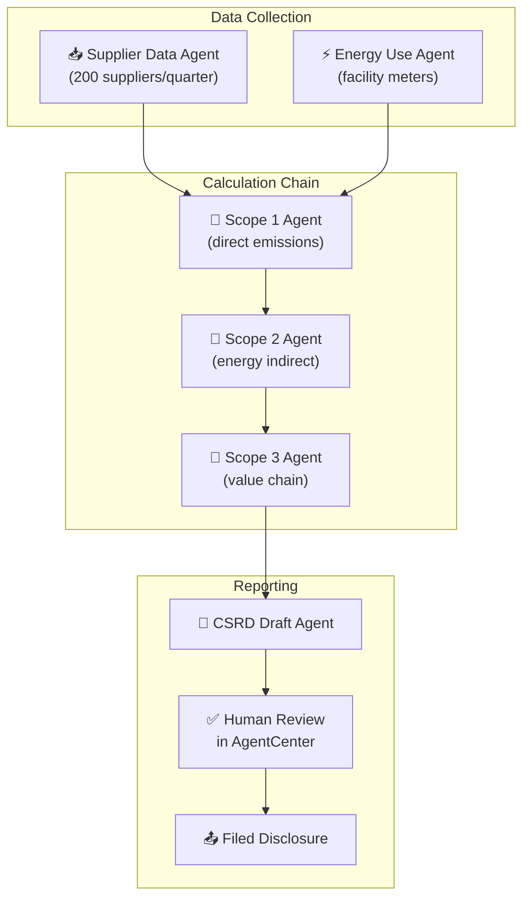

Your scope 3 calculation agent finished last night. Or it didn't. You're not sure.

That's the problem most ESG and sustainability reporting teams hit by month three of running AI agents. You built agents for supplier data collection, emissions calculations, and regulatory report drafts. Each one works on its own. None of them tell you where they're stuck.

When CSRD disclosures are due in six weeks and your scope 2 agent hasn't returned a result in 48 hours, you need more than a log file.

## What Breaks Without a Control Plane

ESG teams run agents that chain together: supplier data in, scope calculations computed, regulatory text drafted, human reviewed, filed. The problem isn't any individual agent. It's the space between them.

**Supplier data agents stall without warning.**
Your collection agent contacts 200 suppliers every quarter to pull energy use and emissions data. When 40 suppliers don't respond in the expected format, the agent retries silently. By the time you notice the scope 3 calculation is incomplete, you've lost two weeks. Without real-time status, "blocked" and "working" look identical from the outside.

**Sequence failures cascade.**
Scope 1 calculations must finish before scope 2 aggregation runs. Scope 2 must complete before scope 3 estimation starts. If scope 1 finishes with bad data and scope 2 kicks off anyway, your final numbers are wrong. You won't find the error in a log file. You'll find it when an auditor asks why your total emissions dropped 40% from last year.

**No one knows what the reporting agents actually cost.**
An agent that drafts a CSRD section makes many API calls. If it re-runs due to a formatting error, it runs again. Per quarter, that adds up. Without per-agent cost tracking, the spend is invisible in your infrastructure bill.

## How AgentCenter Fits ESG Workflows

### Real-Time Agent Status

Every agent in your sustainability stack shows live status in the [AgentCenter dashboard](/features/agent-dashboard): online, working, idle, or blocked. When a supplier data agent goes blocked on Tuesday afternoon, you know before the scope 3 agent tries to pull from it. That's the difference between a two-hour fix and a two-week scramble right before a filing deadline.

### Task Orchestration With Dependencies

You can define scope 1 as an upstream dependency for scope 2. If scope 1 fails or returns incomplete data, scope 2 won't start. You get a blocked status and a flag — not silent bad output three stages downstream.

[AgentCenter's task orchestration](/features/task-orchestration) enforces the order your workflow actually requires. ESG pipelines are sequential by design. Your control plane should match that.

### Deliverable Review Before Anything Gets Filed

Your CSRD draft agent produces a disclosure section. It goes to review before it goes anywhere else. AgentCenter's approval workflow puts it in a queue — your sustainability lead approves it, flags it, or sends it back with a comment in the task thread. No version confusion. No emailing documents back and forth a week before the deadline.

### Per-Agent Cost Tracking

You'll know within the first reporting cycle which agents are expensive. Scope 3 calculations with high retry rates burn tokens fast. AgentCenter shows cost per agent and per task, so you can see when one agent accounts for 60% of your quarterly API spend and decide whether the prompt or the retry logic needs fixing.

### @Mentions in Task Threads

When a scope 2 agent returns a flagged result — say, an emissions number that's 3x last quarter's — your analyst sees it in the task thread and can loop in your energy data lead with an @mention. The context stays attached to the task, not in a separate Slack thread that loses the original numbers.

## The Numbers for ESG Teams

A mid-size ESG reporting function runs 8–20 agents depending on scope: supplier outreach, facility monitoring, calculation chains, regulatory drafts, audit trail generation.

The [Pro plan at $29/month](/pricing) handles 15 agents across 15 projects — enough for most sustainability reporting setups. Teams with multiple reporting frameworks (CSRD, SEC climate disclosures, GRI) or regional entities typically run more agents and fit the Scale plan at $79/month.

What AgentCenter replaces: manual spreadsheet tracking of agent status, Slack check-ins with whoever built the calculation pipeline, and monitoring dashboards that show uptime but not task state.

## Without AgentCenter vs. With AgentCenter

| | Without AgentCenter | With AgentCenter |
|---|---|---|
| **Visibility** | Check logs or ping the engineer who built it | Live status on every agent in the reporting stack |
| **Task handoffs** | Agents run independently, sequence errors surface late | Dependencies enforced; upstream failures block downstream agents |
| **Error detection** | Found during report review, weeks after the agent ran | Flagged in real time via blocked status and task thread comments |
| **Cost tracking** | Total API spend per month, no per-agent breakdown | Per-agent and per-task cost visible across every calculation run |
| **Debugging time** | Hours tracing logs across multiple calculation agents | Open the task thread; the failure point is documented there |

## Where to Start

Set up real-time monitoring on your supplier data collection agents first. These are the most likely to stall: supplier response rates vary, data formats are inconsistent, retries are common. Once you can see which collection agents are blocked and why, the rest of your calculation chain stays predictable.

That visibility alone will save your team hours during the next reporting season.

---

*ESG teams that add a control plane early spend less time firefighting when filing deadlines hit. [Start your 7-day free trial](/pricing).*
