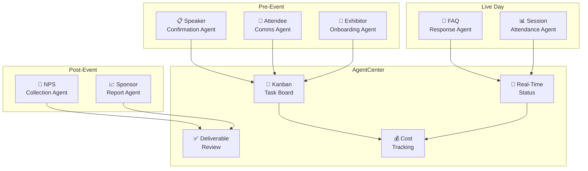

You're running a conference with 40 sessions, 200 exhibitors, and 8,000 registered attendees. You've got agents handling speaker confirmations, session reminders, exhibitor onboarding packets, live-day FAQ responses, and post-event NPS collection. That's 7 or 8 agents, maybe more.

And you have no way to know if any of them are working until an exhibitor emails you to say they never got their setup instructions.

That's the problem event technology teams hit about three weeks into production.

## Why Agent Visibility Breaks at Event Scale

Event tech is one of the more complex places to run AI agents. You're dealing with hard deadlines (the conference starts whether your speaker confirmation agent is working or not), a mix of internal and external stakeholders, and data coming in from multiple systems: registration platforms, CRM, survey tools, hotel blocks, AV vendors.

When an agent fails silently in most software contexts, you notice in hours. In event tech, you sometimes don't notice until the day before the event when you realize 14 speakers never received their session prep packets.

Three specific problems show up repeatedly when teams try to scale agent workflows without a control plane:

**Speaker coordination drops tasks silently.** You have an agent scanning for new session confirmations and triggering personalized speaker prep emails. It processes 30 speakers fine, then stalls on session 31 because the JSON payload from your registration platform had an unexpected null field. The agent doesn't error loudly. It just stops. You find out at the all-hands when the speaker mentions they never heard from anyone.

**Attendee communication agents run out of order.** You've scheduled a pre-event reminder, a day-of logistics email, and a post-event survey. All three agents are queued. One of them picks up a stale attendee list from cache instead of the updated one. Three hundred people who cancelled get a "See you tomorrow!" email. The agent completed its task. Nobody reviewed the output before it went out.

**Post-event analytics pile up with no handoff.** After the conference, three different agents are processing feedback, pulling attendance data, and drafting the sponsor impact report. Each one runs independently. There's no handoff between them and no one watching to see that the attendance agent finished before the sponsor report agent tried to pull from it. The sponsor report goes out with placeholder data still in place.

## How AgentCenter Fixes the Coordination Layer

The issue isn't that the agents are bad. It's that nothing is watching them, and nothing is connecting them.

Here's how specific AgentCenter features map to the problems above:

**Real-time agent status catches the stall.** The [agent monitoring dashboard](/features/agent-monitoring) shows every agent's current state: online, working, idle, or blocked. When your speaker confirmation agent stalls on session 31, you see it flip to blocked within minutes, not the day before the event. You can trace the task, see where it stopped, and fix the input before it becomes a crisis.

**The Kanban board makes sequencing visible.** The [task orchestration view](/features/task-orchestration) lets you see which agent tasks are queued, in progress, or done. For event workflows, this matters a lot. You can see that the sponsor report agent has a dependency on the attendance agent and confirm the right one ran first before approving the deliverable.

**Deliverable review stops the bad send.** Before your attendee comms agent fires 8,000 emails, someone on your team reviews the output in AgentCenter. You can @mention a colleague on the task thread to ask them to check the recipient list and the email content. One approval gate. That's the difference between sending to active attendees and sending to cancellations.

**Cost tracking shows you where your budget is going.** Event tech teams often have seasonal spikes: almost zero agent activity between events, then 10x usage in the two weeks before a conference. AgentCenter's cost tracking breaks down LLM spending per agent, per project. You'll know exactly what the speaker coordination agent cost you for the Q3 conference, which makes budgeting for Q4 a real number instead of a guess.

## The Numbers

A typical event technology team in production runs 8 to 15 agents, depending on conference size and how many workflows they've automated. That usually covers speaker management, attendee comms, exhibitor coordination, live-day support, and post-event reporting.

The [Pro plan](/pricing) at $29/month covers up to 15 agents and 15 projects. That fits most mid-sized event tech teams. Larger platforms running 30-plus agents across multiple concurrent events land on the [Scale plan](/pricing) at $79/month.

What AgentCenter replaces: the Notion page where someone manually tracked which agents ran, the Slack channel where engineers posted "I think the survey agent finished?", and the shared spreadsheet nobody updated after the last conference.

## Before vs After

| | Without AgentCenter | With AgentCenter |
|---|---|---|
| Visibility | You find out an agent failed when stakeholders complain | Agent status visible in real time; blocked agents surface immediately |
| Task handoffs | Each agent runs in isolation; sequencing is assumed, not tracked | Task dependencies visible on the Kanban; handoffs logged and reviewable |
| Error detection | Silent failures surface hours or days later | Blocked or errored agents flagged within minutes |
| Cost tracking | LLM spend is a single monthly bill with no per-agent breakdown | Cost tracked per agent and per project, with seasonal patterns visible |
| Debugging time | Requires digging through logs and running the agent manually to reproduce | Task history, inputs, and outputs stored per task for fast root cause analysis |

## Where to Start

Set up your attendee communications agent first. It's the one with the highest blast radius if something goes wrong. Connect it to AgentCenter, create a task for each send (pre-event, day-of, post-event), and add a deliverable review step before any email goes out.

Once you've seen what that workflow looks like with full visibility, the rest of your agents are easy to wire in.

---

*Event tech teams that add a control plane early spend less time firefighting later. [Start your 7-day free trial](/pricing).*
