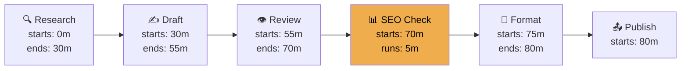

We had five agents running well. A research agent, a drafting agent, a reviewer, a formatter, and a publisher. End-to-end, a full content pipeline finished in about 40 minutes. Reliable, repeatable.

We added a sixth agent for SEO analysis. It made sense — SEO review was the only manual step left. Two weeks later, the same pipeline was taking 65 minutes. No errors. No failures. The SEO agent itself finished in under 5 minutes. But tasks were sitting in queue states between steps longer than before.

What changed? The new agent needed output from both the drafting agent and the reviewer before it could run. That meant the SEO agent and everything downstream of it now waited on both those agents to finish. We'd added 5 minutes of SEO processing and 20 minutes of upstream wait states we hadn't counted.

## Adding an agent adds coordination to every agent it touches

This is the thing teams miss. A new agent isn't just a new agent. It's a new set of dependencies in both directions. It waits on some agents before it can start. Other agents wait on it before they can continue.

When you have 3 agents in sequence, you have 2 handoffs. When you have 6, you have 5. Each handoff is a wait state. Each wait state adds to every run of that pipeline.

And it's not just latency. It's monitoring overhead. It's token cost. It's more rows in your task queue showing "waiting" without explaining why.

The SEO agent (highlighted) takes 5 minutes to run. But it doesn't start until minute 70, because it depends on review completing. Every agent after it shifts by the same amount. A fast agent in a slow position still adds slowdown.

## Where the overhead actually hides

There are three places coordination cost accumulates.

**Upstream blocking.** An agent can only run when its dependencies finish. If your new agent needs 3 existing agents to complete first, it won't start until the slowest of those 3 is done. Not the average. The slowest. So if agents take 30, 25, and 15 minutes, your new agent starts at minute 30 — and the 25-minute and 15-minute agents effectively added nothing to the start time.

**Context accumulation.** The more upstream agents feed into a single agent, the more context that agent receives per run. An agent that consolidates output from 4 agents processes more tokens per task than one that consolidates from 2. More tokens means slightly higher latency on every call and higher cost per run. Small per-task, but it compounds across hundreds of runs.

**Pipeline success rate.** If each agent in a 5-step sequential pipeline has a 95% task completion rate, the pipeline completes about 77% of the time. Add a 6th agent at the same 95% rate and that drops to 74%. Add a 7th: 70%. Each new agent in a sequential chain makes the whole pipeline more likely to fail — even when every individual agent performs well.

This math doesn't apply to parallel pipelines. If agents run independently and merge results at the end, you don't pay this compounding cost. The problem is specific to sequential dependencies.

## Map the dependency surface before adding

Before adding a new agent, spend 10 minutes on three questions:

1. Which existing agents does this new agent need to wait on before it can run?
2. Which existing agents will wait on this new agent before they can continue?
3. What context does this agent need, and how large will that context be?

Those three questions tell you what you're actually adding to your pipeline. Sometimes it's worth it. If the bottleneck is manual work and the agent removes it entirely, extra coordination overhead is a reasonable trade. But teams often add an agent to solve a 5-minute problem and add 20 minutes of hidden overhead.

The teams that regret agent additions almost always skipped the dependency map. The teams that do the map often restructure the pipeline before adding — making the new agent run in parallel rather than in sequence, or running it after publishing rather than before.

## The monitoring overhead that follows

Six agents producing "waiting" status is different from three.

With 3 agents in a pipeline, a "waiting" state is usually easy to trace. With 8, you have to follow which dependency is blocking each one. Is Agent 6 waiting because Agent 3 is slow, or because Agent 2 failed and Agent 3 never ran? That trace takes time every single time.

[AgentCenter's agent monitoring](/features/agent-monitoring) shows the real-time status of each agent and its upstream dependencies, so you're not tracing dependency trees manually when something stalls. But the underlying complexity — more agents, more states, more ways for "waiting" to mean different things — scales with how many sequential dependencies you've added.

## Who feels this first

Teams running sequential content, data, or research pipelines with 6 or more agents. If tasks flow through your agents in order — research feeds drafting, drafting feeds review, review feeds approval — you're in sequential territory.

The symptom is tasks taking longer than you'd expect from the sum of individual runtimes. You check each agent's performance and it looks fine. But the wall-clock time from task assignment to completion is 2x what you'd predict. That gap is wait states you haven't accounted for.

Teams with parallel pipelines notice this less. If your agents work independently and merge results at the end, each new agent adds its own runtime but doesn't extend the critical path. If you can make a new agent parallel rather than sequential, it's almost always worth doing.

## The honest part

More agents is often the right call. If the SEO step was genuinely slowing everything down when it was manual, automating it with an agent is correct — even if the pipeline takes a few extra minutes.

The issue isn't adding agents. It's adding agents without counting the coordination cost first. Ten minutes drawing the dependency graph before you add is almost always cheaper than two weeks of confusion after an unexplained slowdown.

You don't need to keep pipelines small. You need to know what you're paying when you make them bigger.

---

*The dashboard won't fix slow agents. But it will show you exactly where they're waiting. [Try AgentCenter free](/pricing).*
