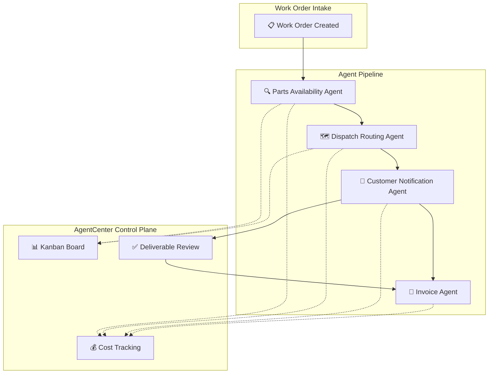

Your dispatch agent re-routed a technician at 9am. Your parts lookup agent returned stale inventory data at 9:03am. Your customer notification agent sent the ETA update at 9:05am, based on the original route, not the new one.

The customer is now waiting at a window that no longer applies. Nobody on your team knows yet. The agents all reported success.

That's the core problem for field service operations teams running AI agents. It's not that the agents don't work. It's that they work in isolation, and there's no shared view of what each one is doing or what it last produced.

## What a Field Service Agent Stack Actually Looks Like

A typical field service ops team running agents has somewhere between 8 and 20 of them. They're handling things like:

- Work order routing (assign the closest qualified technician)
- Parts availability checks before dispatch
- Customer ETA notifications and update messages
- SLA clock monitoring per job
- Invoice generation after job completion
- Compliance document creation (permit records, inspection reports)

Each agent has a clear job. The problem is coordination. The routing agent doesn't know the parts agent flagged a backorder. The notification agent doesn't know the route changed. And when something goes wrong at 11am, the coordinator has to dig through logs, Slack messages, and three separate dashboards to figure out what happened.

## Three Things That Break Without a Control Plane

**1. Agents produce outputs nobody reviews before they go out**

Customer-facing messages from your notification agent go straight out. If the template is wrong, the tone is off, or the ETA reflects stale data, the customer sees it. There's no checkpoint. The agent ran, the task completed, and the damage is done.

**2. Task handoffs fail silently**

Your dispatch agent depends on the parts lookup agent finishing first. But the parts agent timed out on an API call and returned an empty result instead of an error. The dispatch agent treated that as "parts available" and scheduled the job. The technician arrives on site with nothing to work with.

No one gets an alert. The job shows as scheduled. The failure only surfaces when the technician calls in.

**3. Cost attribution is impossible**

You're running five agents across 30 active work orders. Which agent is burning the most tokens? Which work order type costs three times more than the others? You can't answer either question from your agent logs. You just see the monthly API bill and guess.

## How AgentCenter Solves This for Field Service Teams

**Kanban board for work orders**

Every active work order becomes a task card on your [agent Kanban board](/features/task-orchestration). You can see at a glance which jobs are waiting on parts lookup, which are in dispatch routing, and which are blocked. When a coordinator needs to override the agent's routing decision, they update the task card and the relevant agent picks it up.

Before this, the coordinator had to check three systems to know where a job was. Now it's one board.

**Task dependencies that actually enforce sequencing**

Set the dispatch routing task as dependent on the parts lookup task. If the parts agent fails or returns empty, the dispatch task doesn't start. AgentCenter holds it in the queue and surfaces the blocker so a human can decide what to do.

This is what prevents the technician showing up with no parts. The pipeline stops at the right place instead of running ahead on bad data.

**Deliverable review gates on customer communications**

Route every customer notification through a review step before it sends. Your notification agent drafts the ETA message, it appears in AgentCenter as a pending deliverable, and a coordinator approves or edits it before it goes out.

For most work order types, you'll approve automatically after a week of clean outputs. For high-priority accounts or complex jobs, you keep the manual gate. Either way, you're in control. See more on [approval workflows](/features/agent-monitoring).

**@Mentions for escalation**

When the parts agent returns a backorder flag, the agent can mention the coordinator directly in the task thread. The coordinator sees the escalation, makes a sourcing decision, and the job continues. No Slack channel hunting. No missed messages.

**Per-agent cost tracking**

AgentCenter shows token spend broken down by agent and by project. You'll find out fast which agent is expensive. Usually it's the invoice generation agent running on GPT-4 for work orders that don't need it. Swap the model for that agent, cut costs by 60%, and nothing changes in the output.

## The Numbers for Field Service Teams

A mid-sized field service operation typically runs 8 to 15 agents covering dispatch, parts, notifications, compliance, and invoicing. That puts most teams on the [Pro plan at $29/month](/pricing), which covers 15 agents across 15 projects.

What it replaces: a coordinator spending 90 minutes per day cross-checking agent outputs across three tools, a spreadsheet tracking which jobs are blocked, and periodic customer complaints about wrong ETAs. The control plane pays for itself in the first week of reduced manual checks.

Larger teams handling 30+ concurrent technicians across regions might need the Scale plan (50 agents), particularly if they're running separate routing agents per territory.

## Before vs After

| | Without AgentCenter | With AgentCenter |
|---|---|---|
| Visibility | Check logs per agent manually | One board across all jobs and agents |
| Task handoffs | Silent failures when dependencies break | Enforced sequencing with blocked-task alerts |
| Error detection | Customer reports the wrong ETA | Coordinator sees the notification before it sends |
| Cost tracking | Monthly API bill with no breakdown | Per-agent, per-work-order cost visibility |
| Debugging time | 45-90 minutes per incident | Audit trail per task shows exactly what each agent produced |

## Where to Start

Set up the Kanban board first. Map your five highest-volume work order types to task templates in AgentCenter. Assign your dispatch routing agent to watch for new cards in the "ready for dispatch" column.

That single change gives you a unified view of every in-flight job. From there, add task dependencies between the parts agent and the dispatch agent. Within two weeks, you'll have a clear picture of where jobs get stuck and which agent is causing it.

---

*Field service operations teams that add a control plane early spend less time firefighting later. [Start your 7-day free trial](/pricing).*
