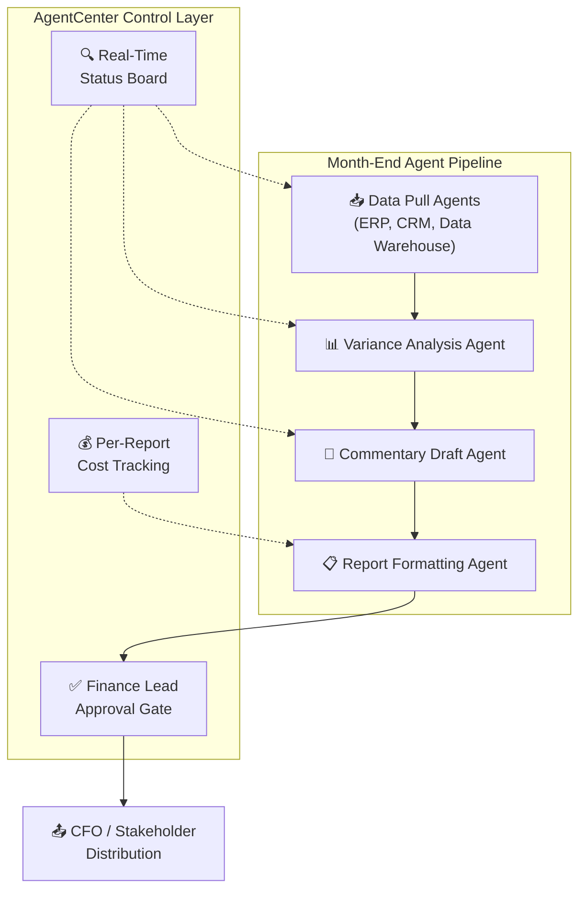

Financial reporting teams hit a specific wall when they start running AI agents. Month-end close is already a high-pressure cycle. Add eight agents running in parallel — pulling data from ERP systems, running variance analysis, generating commentary drafts — and the failure mode isn't "things break." It's "things break quietly."

Most FP&A teams start small. One agent to pull actuals from the data warehouse. Another to format the output for the monthly deck. It works fine until the agent count climbs and the first month-end close arrives with agents running overnight.

That's when the visibility problem shows up.

## What Breaks When FP&A Teams Scale Agents

**The silent failure at month-end.** A data aggregation agent that errors halfway through a run doesn't always crash loudly. It might log a timeout, return a partial result, and mark itself complete. The downstream analysis agent picks up incomplete data and runs with it. Nobody finds out until the controller asks why actuals are 12% lower than yesterday's pull.

**No review gate before numbers reach stakeholders.** In finance, a spreadsheet with wrong numbers that lands in the CFO's inbox is a serious problem. But most teams running report-generation agents don't have a formal approval step. The agent produces a draft, saves it to the shared drive, and it's immediately accessible. Human review happens after the fact, if it happens at all.

**No visibility into cost per report.** Running agents through a close cycle burns API tokens. Variance analysis, commentary generation, data formatting across 30 cost centers — it adds up fast. Most teams find out what this costs only when the monthly API bill arrives. By then, there's no data to tell you which reports are worth automating and which ones cost more than the time they save.

## How AgentCenter Fits Into This Workflow

**Real-time agent status.** The [agent monitoring dashboard](/features/agent-monitoring) shows every agent's current state: working, idle, blocked, or erroring. If the ERP pull agent stalls at 11pm during close, the finance manager sees a red status card right away, not after the analysis agent has already run on incomplete data. You catch the failure at the source, not three reports downstream.

**Approval workflows before anything goes out.** AgentCenter lets you wire a required human review step between "agent produces output" and "output reaches stakeholders." For financial reporting, this means: the report-generation agent drops a draft into an AgentCenter task, the controller gets a notification, reviews the numbers, and approves or flags it for revision before anything reaches the CFO. This is the review gate that most DIY agent setups skip entirely.

**Per-agent cost tracking.** Every agent run logs token usage and maps it to the task it completed. By the end of your close cycle, you can see exactly what each report cost: variance analysis agent ran 12 times this month at $4.20 per run, commentary generation at $2.80 per report. That's not just useful for the API budget. It's the data you need to make a real case for agent ROI to finance leadership.

**@Mentions for flagging anomalies mid-run.** When an agent spots an unusual variance, say a 40% year-over-year delta that looks like a data pull error rather than a real business move, it can tag the analyst directly in the task thread. No switching to Slack, no email chain, no "did you see what the agent flagged?" The context stays with the output, inside AgentCenter.

## The Numbers for FP&A Teams

A mid-size FP&A team running automated close reporting typically runs 8-15 agents: pull agents per system of record, one or two analysis agents, a commentary agent, a formatting agent, sometimes a distribution agent. That puts most teams squarely on the [Pro plan at $29/month](/pricing), which covers 15 agents across 15 projects.

What AgentCenter replaces: a shared Google Sheet tracking which agent ran when, a Slack channel dedicated to agent status updates, and the manual spot-checks that happen before anyone sends a report to leadership.

## Before vs After

| | Without AgentCenter | With AgentCenter |
|---|---|---|
| Visibility | Check logs manually when something seems off | Live status per agent, updated in real time |
| Task handoffs | Agent output saved to shared drive; humans find it later | Output queued for approval before it goes anywhere |
| Error detection | Found when downstream reports have wrong numbers | Red status at point of failure, while it's happening |
| Cost tracking | API bill arrives monthly with no breakdown by report | Per-agent, per-task cost logged automatically |
| Debugging time | 2-4 hours tracing logs to find the stalled agent | Filter by task, view run history, find it in minutes |

## Where to Start

Set up approval workflows first.

In financial reporting, human review before distribution is the single most important control you can add. Wire your report-generation agent's output into an AgentCenter task that requires approval before anything goes to stakeholders. It takes about 20 minutes to configure. Once it's live, no agent-generated number reaches the CFO without a controller seeing it first.

From there, add the [monitoring dashboard](/features/agent-monitoring) to catch pipeline failures early, then wire in cost tracking as your agent count grows. Each addition takes about an hour and doesn't require changes to how your existing agents work.

---

*Financial reporting teams that add a control plane early spend less time firefighting at month-end. [Start your 7-day free trial](/pricing).*
