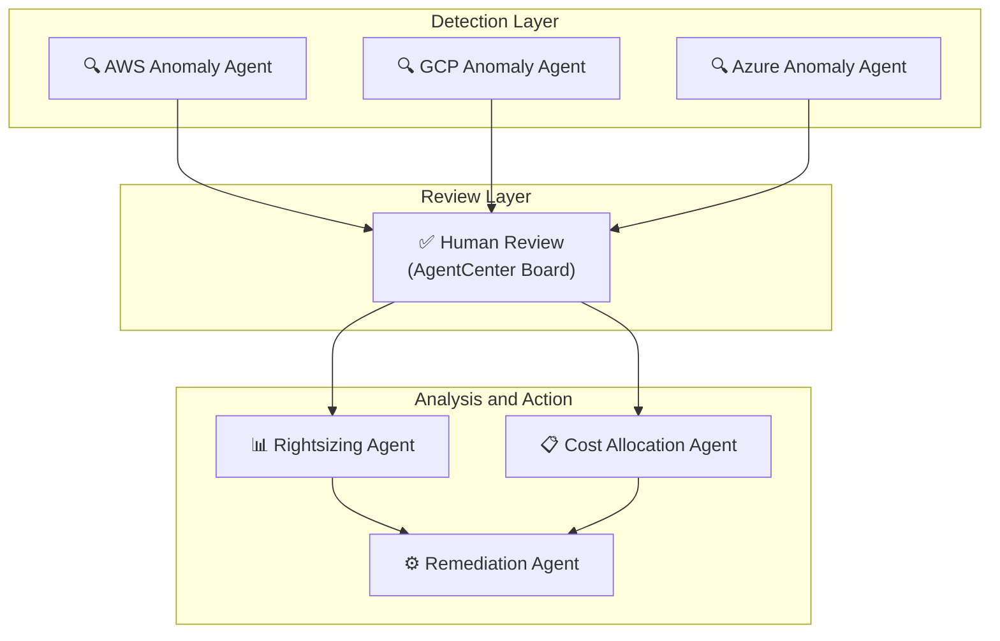

FinOps teams have a specific problem. They're responsible for controlling cloud spend, but the tools they use to automate that work (AI agents scanning bills, flagging anomalies, generating rightsizing reports) are themselves invisible.

You know you have an anomaly detection agent running against your AWS account. You know you have another one for GCP. But when a $14,000 spike shows up in the weekly report, can you tell which agent caught it first? Which one generated the recommendation that got ignored? Which one is currently stuck on a stalled API call?

Most FinOps teams can't. That's the problem.

## Where Agent Management Breaks for FinOps

### Handoff failures between detection and remediation

The typical FinOps agent pipeline goes: scan, detect anomaly, generate recommendation, get human approval, remediate. That last handoff, from recommendation to approval to action, almost always happens in Slack or email. The agent posts output. Someone reads it. Maybe someone acts on it.

When the recommendation gets buried in a thread, the resource keeps running. Nobody knows if the remediation agent ever picked up the task.

### No attribution on cost reports

If your anomaly agent and your rightsizing agent both flag the same EC2 instance on the same day, you get two overlapping reports. Which one is the source of truth? Which recommendation should drive the ticket?

Without a shared task board, these outputs pile up with no owner, no status, and no way to see if they conflict.

### Agents have costs too

FinOps teams track cloud spend to the dollar. But ask them what their anomaly detection agent costs per week in LLM tokens. Most don't know. The same rigor they apply to cloud costs rarely applies to the agents doing the analysis.

## How AgentCenter Fixes the FinOps Agent Pipeline

Here's how a typical FinOps team maps their workflow into AgentCenter:

### Kanban board: one card per cost event

Each flagged anomaly, rightsizing recommendation, or untagged resource becomes a card on the [task board](/features/task-orchestration). The card carries the agent that created it, the cloud account affected, and the estimated cost impact.

When your AWS anomaly agent flags a $14k spike, the card shows up in the "Needs Review" column with the agent's name and raw context. The FinOps engineer reviews it, approves or dismisses, and the card moves forward. Nothing gets lost in a Slack thread.

### Real-time agent status: know what's actually running

FinOps agents often run on daily or weekly schedules. With AgentCenter's [agent monitoring](/features/agent-monitoring), you can see whether the GCP scanner ran this morning or failed during authentication. You're not waiting until Thursday's report to find out Monday's agent crashed.

Status shows: online, working, idle, or blocked. If it's blocked, you can see the last task it was assigned and when it stalled.

### @Mentions for approval-required steps

When the rightsizing agent generates a recommendation that would delete a reserved instance, it can @mention the FinOps lead directly in the task thread. The thread includes the full context: original anomaly, recommendation, estimated savings. One click to approve or reject.

This replaces the version where the agent posts to Slack, the FinOps lead misses it, and the reservation auto-renews.

### Per-agent cost tracking

AgentCenter tracks token spend per agent. Your anomaly detection agents should be cheap: fast scans, short outputs. If one is burning $80/week in tokens because it re-reads the full billing CSV on every run, you'll see it. You can fix the prompt, change the data source, or retire the agent.

The irony of a FinOps team not knowing what their cost agents cost isn't lost on anyone. AgentCenter's [agent monitoring](/features/agent-monitoring) closes that gap.

## The Numbers for a Typical FinOps Team

A FinOps team at a company running 3 or more cloud providers typically operates:

- 3–5 anomaly detection agents (one per provider or account cluster)
- 2–3 rightsizing and optimization agents
- 1–2 cost allocation and tagging enforcement agents
- 1 reporting agent for weekly summaries

That's 8–12 agents. The [Pro plan](/pricing) at $29/month covers 15 agents across 15 projects. One project per cloud provider is a clean setup.

What it replaces: Slack threads for status updates, shared spreadsheets for tracking recommendations, and manual pings to check if a remediation ticket was actioned.

## Before vs After

| | Without AgentCenter | With AgentCenter |
|---|---|---|
| Visibility | Can't tell which agent ran which report | Each agent's active task is visible on the board |
| Task handoffs | Recommendations sit in logs, unenforced | Cards move from detection through approval to action |
| Error detection | Crashes discovered next morning | Blocked status visible within minutes |
| Cost tracking | No idea what agents spend per week | Per-agent token cost tracked against savings generated |
| Debugging time | Re-run full pipeline to find the break | Task thread shows exactly which step failed |

## Where to Start

Set up one project per cloud provider. Add your existing agents. Move any agent-generated output to a task card instead of a Slack message.

That first step, visibility into what's running and what it generated, is where most teams find the most immediate value. You don't need to change how your agents work. You just need to see them.

---

*FinOps teams that add a control plane early spend less time firefighting later. [Start your 7-day free trial](/pricing).*
