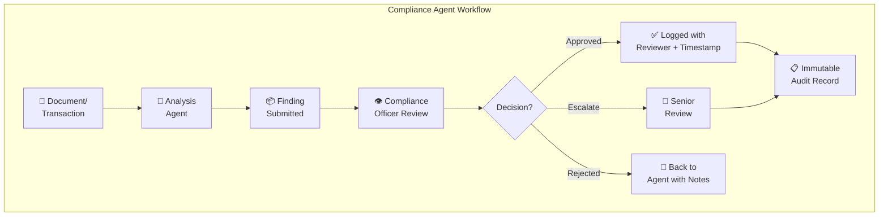

Compliance teams using AI agents face a problem that most agent management discussions skip: in regulated industries, "the agent did it" is not a valid answer. Someone has to be accountable. There has to be a record. A human has to have reviewed the output before it matters.

The features that make AI agents useful in compliance contexts — speed, scale, consistency — are only valuable if you can demonstrate that the work was done correctly and that a human approved it.

## The Specific Bottlenecks Compliance Teams Hit

**Audit trail gaps.** Traditional AI agent systems log inputs and outputs, but compliance-grade audit trails need more: who reviewed the output, when, what decision they made, and what the agent did next. Standard logging doesn't capture the review chain.

**Human approval workflow that actually works.** You can bolt on a "human review" step in most systems. But a real approval workflow needs routing (which human reviews this?), escalation (what if the reviewer doesn't respond in 4 hours?), version control on what was approved, and a signed audit record that the review happened.

**Explainability on agent decisions.** When a compliance agent flags a transaction or a document, you need to know why. "The AI flagged it" fails the "why" question in audits and in disputes. The agent's reasoning needs to be captured alongside its output.

## How AgentCenter Addresses Compliance Team Workflows

**Full task audit trail.** Every task in AgentCenter is logged with: what was assigned, to which agent, what the agent submitted, who reviewed it, what decision was made, and when each step happened. This is the foundation of a defensible audit record for compliance work.

**Structured deliverable review.** The [deliverable review workflow](/features/agent-monitoring) isn't just "approve or reject." It includes reviewer identity, timestamp, and optional notes that become part of the task record. You can pull the full review history for any deliverable — which reviewer, what they decided, what feedback they gave.

**Human-in-the-loop by design.** For compliance work, you want the human approval step to be mandatory, not optional. AgentCenter's review gate can be configured as a required step before downstream processing continues. The next agent in the pipeline doesn't start until the review is complete.

## Feature-to-Workflow Mapping

| Compliance Concern      | AgentCenter Feature         | How It Helps                      |
| ----------------------- | --------------------------- | --------------------------------- |
| Audit trail             | Full task + review history  | Every step logged with timestamps |
| Human approval          | Deliverable review workflow | Required gate before continuation |
| Reviewer accountability | Review record with identity | Who approved what and when        |
| Escalation routing      | @mentions + chat threads    | Notify specific reviewers         |
| Version control         | Task history snapshots      | See what agent config ran         |
| Cost tracking           | Per-task cost monitoring    | Budget for compliance workloads   |

## The Numbers

Compliance teams typically run 3-8 agents: document analysis, transaction flagging, regulatory report drafting, sanctions screening, and similar functions. The [Starter plan](/pricing) at $14/month handles up to 5 agents — a good starting point for piloting one compliance use case before expanding.

For teams running multiple compliance functions across multiple product lines, Pro at $29/month (15 agents, 15 projects) gives you enough room to segment by function or business unit.

## Before vs After AgentCenter

|                     | Without AgentCenter           | With AgentCenter           |
| ------------------- | ----------------------------- | -------------------------- |
| Visibility          | Manual log review             | Real-time status           |
| Task handoffs       | Ad-hoc email or Slack         | Structured review workflow |
| Error detection     | Audit findings after the fact | Review gate catches issues |
| Cost tracking       | Monthly billing total         | Per-analysis tracking      |
| Audit documentation | Manual assembly               | Built-in task history      |

## What You Still Need to Handle

AgentCenter provides the management and audit layer. It doesn't replace the domain expertise needed to design compliance workflows correctly. The human reviewer still needs to know what to look for. The agent still needs careful prompt engineering to produce findings that are accurate and explainable.

The platform handles the coordination and record-keeping. The compliance team handles the judgment.

## Where to Start

Start with your lowest-stakes compliance workflow — something where the cost of an error is bounded and recoverable. Run it through AgentCenter for 30 days. Pull the audit log at the end of the month and check if it would satisfy an audit request.

If it does, you have a template for expanding to higher-stakes workflows.

_Compliance teams that add a control plane early spend less time firefighting later. [Start your 7-day free trial](/pricing)._
