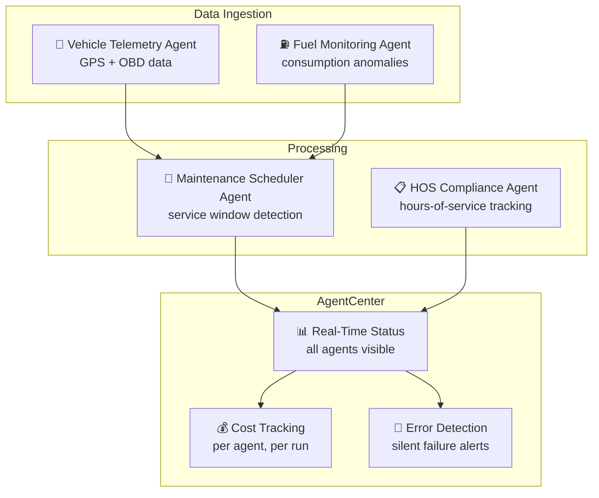

Fleet operations teams have a specific problem with AI agents: the agents run 24/7, but the humans who set them up only check in twice a day. Those agents are making decisions that affect real vehicles, real drivers, and real compliance records.

If a maintenance scheduling agent silently fails at midnight, you find out at 9am when a driver flags a missed service alert. By then, three vehicles are already past their maintenance window.

## The Daily Problem for Fleet Ops

Fleet ops teams typically run agents across four or five distinct workflows at once. A routing optimization agent that re-routes based on traffic. A preventive maintenance agent that monitors odometer readings and schedules service. A driver hours-of-service agent that tracks compliance windows. A fuel anomaly agent that flags unusually high consumption by vehicle.

Each agent runs on its own schedule. Each writes to a different system. And when one breaks, the failure usually looks like silence — the agent just stops producing results, and nothing alerts.

## What Breaks Without a Control Plane

### You Can't Tell What's Running vs. Broken

Fleet agents are time-sensitive. A route optimization agent that stopped running two hours ago means dispatchers are working off stale data. But unless you're actively checking agent logs, you won't know.

With 8-10 agents running at different intervals, you need a dedicated monitoring script just to know which ones are live and which have stopped responding. Most teams don't build that script until after the first incident.

### Task Handoffs Between Agents Fall Apart

A fleet maintenance workflow might look like this: sensor data ingestion agent feeds anomaly detection agent, which triggers work order creation agent. If the anomaly detection agent fails, the work order agent has nothing to process. It completes successfully — no errors, no alerts — and you have vehicles with outstanding issues that never generated a work order.

This is the handoff failure problem. Without visibility into each step, you're looking at completion counts, not whether the right work actually happened.

### Cost Tracking Is Invisible

Fleet ops teams run agents against GPS data, maintenance APIs, and compliance databases. Each external call has a cost. When your fuel anomaly agent runs on 800 vehicles per night, those API calls add up fast. Without per-agent cost tracking, you won't know your anomaly detection agent is costing three times more than expected until the monthly bill arrives.

## How AgentCenter Fits Fleet Operations

### Real-Time Agent Status

The [agent monitoring dashboard](/features/agent-monitoring) shows every agent's current state: online, working, idle, or blocked. For fleet ops, this means a dispatcher can see at a glance whether the route optimization agent has finished its morning run before drivers go out.

If the maintenance scheduler gets stuck on a bad vehicle record, it shows up as blocked — not as a successful no-op with empty output.

### Task Orchestration Across Agents

Fleet maintenance workflows span multiple agents. AgentCenter's [task orchestration](/features/task-orchestration) lets you define which tasks depend on each other. If your anomaly detection agent produces zero results for a 30-minute window — unusual for a fleet of 200 vehicles — downstream agents wait rather than proceeding on empty data.

That one guardrail prevents entire classes of handoff failures.

### Per-Agent Cost Tracking

With [agent monitoring](/features/agent-monitoring), you get cost data broken down by agent and by run. Your fuel anomaly agent running nightly on 800 vehicles — you can see exactly what that costs per night, per vehicle, per anomaly flagged. When the bill goes up 40%, you can point to which agent changed behavior and when.

### @Mentions for Compliance Review

When your HOS compliance agent flags a potential hours-of-service violation, that shouldn't push automatically to a driver's record without review. AgentCenter's @mention system lets agents flag tasks for a coordinator to review before proceeding. The reviewer sees the agent's output, approves or rejects, and the workflow continues — all without leaving the dashboard.

## The Numbers

A mid-size fleet ops team managing 200 to 500 vehicles typically runs 8 to 12 agents covering routing, maintenance, compliance, fuel, and shift reporting. That fits the **Pro plan at $29/month** (15 agents, 15 projects).

Larger fleets running specialized agents per vehicle class, region, or compliance regime will hit the **Scale plan at $79/month** (50 agents, 50 projects).

What it replaces: custom monitoring scripts, manual log-checking routines, and spreadsheet-based cost tracking that no one updates after the first month.

## Before vs. After

| | Without AgentCenter | With AgentCenter |
|---|---|---|
| **Visibility** | Log files, manual scripts | Live status per agent in one dashboard |
| **Task handoffs** | Silent failures when upstream agents stop | Blocked state is visible; downstream agents wait |
| **Error detection** | Discovered when results stop arriving | Flagged within minutes of the agent stopping |
| **Cost tracking** | Monthly API bill with no breakdown | Per-agent, per-run cost data |
| **Debugging time** | 2-4 hours tracing logs across systems | Under 30 minutes with full task history |

## Where to Start

Set up **agent monitoring** first. Connect your highest-frequency agent — probably the vehicle telemetry or route optimization agent — and watch one full day's run through AgentCenter.

You'll see which runs take longer than expected, which ones complete with zero outputs, and what each run actually costs. That single week of visibility usually surfaces at least one silent failure that wasn't on anyone's radar before.

---

*Fleet operations teams that add a control plane early spend less time firefighting later. [Start your 7-day free trial](/pricing).*
