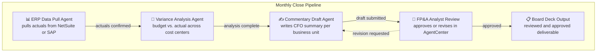

FP&A teams have always run against hard deadlines. Monthly close, quarterly reforecast, board deck. Now they're also running AI agents to hit those deadlines faster.

Agents that pull actuals from NetSuite. Agents that run variance analysis across 40 cost centers. Agents that draft the commentary your CFO reads before the board meeting. It sounds like a good setup — until one of them fails silently at 11pm the night before close and nobody notices until a number doesn't tie.

That's the problem. Not the agents. The lack of a control plane watching them.

## What Happens When FP&A Agents Have No Visibility

FP&A cycles have real consequences when they go wrong. A wrong number in the board deck isn't a minor bug. Here are the three failure modes that hit this team the hardest.

**Data pull agents stall and nobody knows.** Your actuals-from-ERP agent hits a session timeout at 2am and dies quietly. The variance analysis agent runs on yesterday's data because it doesn't know the pull failed. You find out three hours later when a variance figure looks off by a full percentage point.

**Agent outputs go straight to stakeholders without review.** The commentary draft agent writes a plausible but incorrect explanation for a margin miss. It gets copied into the board slide before an analyst checks it. The CFO asks a question about it in the meeting.

**No audit trail when numbers are questioned.** During review, someone asks why Q2 operating expenses are higher than last year. You have no record of which agent ran, what data it used, or what logic it applied. You spend an hour reconstructing the run manually.

None of this is unusual. It's what happens when you run 8 to 12 agents across a monthly close cycle with zero visibility into any of them.

## How AgentCenter Fits Into the FP&A Workflow

### Real-Time Agent Status

Every agent in your close pipeline shows live status in [AgentCenter's agent dashboard](/features/agent-dashboard): online, working, idle, or blocked. When your ERP pull agent stalls overnight, you see it in minutes — not the next morning when variance numbers don't reconcile.

You can also wire up task dependencies so the variance analysis agent won't start until the data pull agent confirms it finished cleanly. No manual trigger. No "did it run?" check in Slack.

### Deliverable Review Workflows

Before agent-generated commentary goes to a CFO, it routes through an approval gate in AgentCenter. An FP&A analyst reviews the draft, checks the reasoning, and either approves it or kicks it back with a comment. The agent revises and resubmits.

This one workflow change eliminates the "wrong number in the board deck" failure mode. It also creates a review record — so if the output is questioned later, you can show exactly who approved it and when.

### Cost Tracking Per Task

FP&A teams track every expense. Agent costs should be no different. AgentCenter shows token spend per agent, per task. You can see what your monthly close pipeline costs to run, and catch it early if an agent starts running longer or more expensive than the baseline.

### Full Task History

Every task an agent runs is logged: what it did, when it ran, what it returned, who reviewed the output. If a number gets questioned two weeks after close, you can trace it back to the exact agent run and the data it used. That's the audit trail your finance team actually needs.

## The Numbers

A typical mid-market FP&A team running agents across a full monthly close has somewhere between 8 and 18 agents: data pull agents per source system (ERP, CRM, payroll, billing), analysis agents by business unit or cost center, and one or two commentary agents for summarization.

The [Pro plan at $29/month](/pricing) covers up to 15 agents and 15 projects — enough for most teams at this scale. Scale ($79/month) fits larger teams running separate agent pools per region, entity, or reporting line.

What it replaces: manual status checks, a spreadsheet tracking which agents ran when, and the "go check the logs" debugging session that takes 45 minutes every time something breaks.

## Before vs After

| | Without AgentCenter | With AgentCenter |
|---|---|---|
| **Visibility** | No idea which agents ran or when | Real-time status across every agent in the close pipeline |
| **Task handoffs** | Manually trigger next agent after checking output | Task dependencies enforce correct sequence automatically |
| **Error detection** | Found out when a number doesn't tie | Blocked task alert within minutes of the failure |
| **Cost tracking** | Unknown per analysis run | Per-agent token cost tracked per task |
| **Debugging time** | 45+ minutes reconstructing what happened | Task history shows exactly where it stopped and why |

## Where to Start

Set up a deliverable review gate before anything else. Pick the agent output that causes the most pain when it's wrong — usually the commentary draft agent — and route its output through an [approval workflow](/features/agent-monitoring).

Once you've done it once, the pattern is clear. You add it to the next agent, then the next. Within a close cycle, the whole pipeline has human review at the right checkpoints — without adding much overhead.

---

*FP&A teams that add a control plane early spend less time firefighting later. [Start your 7-day free trial](/pricing).*
