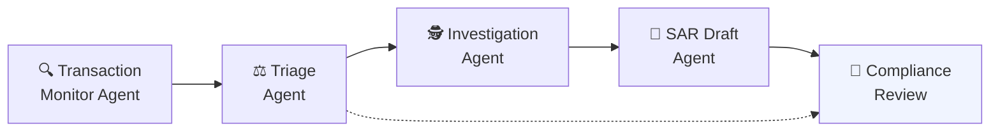

Fraud detection teams have a coordination problem. You run agents around the clock: transaction monitors, triage classifiers, investigation runners, SAR drafters. When a suspicious transaction triggers your monitor agent, the case has to move through multiple agents before a human ever touches it. When that pipeline works, it moves fast. When it breaks, cases stall silently and nobody notices until compliance asks why a SAR filing deadline was missed.

AI agents for fraud detection are only as useful as the control you have over them.

## What Breaks When Fraud Detection Teams Scale AI Agents

**Alert stacking without visibility.** A transaction gets flagged. The triage agent classifies it as high-priority and passes it to the investigation agent. But the investigation agent is mid-run on another case, or it timed out, or it's waiting on an external data API. The case sits in limbo. No one knows. The SAR filing window starts ticking.

**Silent false negative drift.** Your transaction monitor starts flagging 30% fewer transactions than last week. That could mean fraud patterns changed. Or it could mean the agent's context window drifted and it's under-classifying risk. You can't tell without per-output tracking, and most teams don't have that until a problem surfaces during a compliance review.

**Cost spikes with no attribution.** Investigation agents are expensive. They call the LLM several times per case, pull account history, and sometimes run for three to four minutes per transaction cluster. When your monthly API bill comes in 40% over forecast, you have no per-case cost data to point to. You know spend went up. You don't know which agents drove it.

## How AgentCenter Fits Fraud Detection Workflows

Here's how a typical fraud detection pipeline flows through AgentCenter:

**Kanban board for live case status.** Every flagged transaction becomes a task card on the [Kanban board](/features/task-orchestration). You define your pipeline stages: Flagged, Triaged, Under Investigation, SAR Review, Filed. Cards move as agents hand off work. When a card stops moving, you see exactly where it stalled — before the deadline passes.

**Real-time agent status.** If an investigation agent hits a rate limit or gets stuck in a loop, its status in AgentCenter changes from Working to Blocked. That's a live signal, not something you find two hours later buried in a log file. The blocked agent shows up in the [agent monitoring](/features/agent-monitoring) view immediately.

**@Mentions for edge cases.** Triage agents hit ambiguous cases regularly. A transaction that doesn't clearly cross a threshold but still looks off. The agent drops a note in the task thread and mentions the analyst. They see it, make a call, and the case moves forward. The conversation stays attached to the case for the audit trail.

**Cost tracking per task.** AgentCenter breaks down token usage and cost per agent, per task. If a fraud event on Tuesday caused investigation agents to process 200 cases in six hours, that cost shows up by agent type and time window. When compliance or finance asks what drove last month's spend, you have the answer.

**Approval gates for SAR drafts.** SAR drafts should never file without a human check. AgentCenter holds the draft in Pending Review status until a compliance officer approves it. The agent produced the output. A human makes the decision. That review record stays attached to the task.

## The Numbers

A mid-size fraud detection team typically runs 8 to 15 agents: two or three transaction monitors covering different product lines or channels, one or two triage classifiers, three or four investigation agents, and one or two SAR drafters. Some teams add a calibration agent to track model confidence over time.

The Pro plan ($29/month) covers 15 agents across 15 projects — most teams fit there. Larger operations with 20-plus agents and multiple business lines fit the Scale plan ($79/month). See [full pricing](/pricing) to pick the right fit.

What AgentCenter replaces in practice: Slack threads for case handoffs, spreadsheets tracking which cases are in which state, and end-of-month log reviews to understand spend. None of those scale past a few dozen cases per day.

## Before vs After

| Area | Without AgentCenter | With AgentCenter |
|---|---|---|
| Visibility | Unknown case status unless you query the agent directly | Live card position shows every case stage in real time |
| Task handoffs | Implicit — agents pull when ready, no tracking record | Explicit transitions with timestamps and thread context |
| Error detection | Stalled agents noticed only when a case goes overdue | Status changes to Blocked immediately |
| Cost tracking | Monthly API bill with no per-case breakdown | Per-task cost by agent type and time window |
| Debugging time | Reconstruct from LLM provider trace logs, hours of work | Activity feed shows every agent action per task |

## Where to Start

Set up your Kanban board first. Define your pipeline stages as columns and create task cards for your current active cases. Once agents are moving cards through the board, two things become clear fast: where cases actually pile up, and exactly when each handoff happened.

From there, add agent monitoring for your investigation agents specifically. They're the most expensive to run, the most likely to stall on external API calls, and the ones that create the biggest compliance risk when they stop without notice.

---

*Fraud detection teams that add a control plane early spend less time firefighting later. [Start your 7-day free trial](/pricing).*
