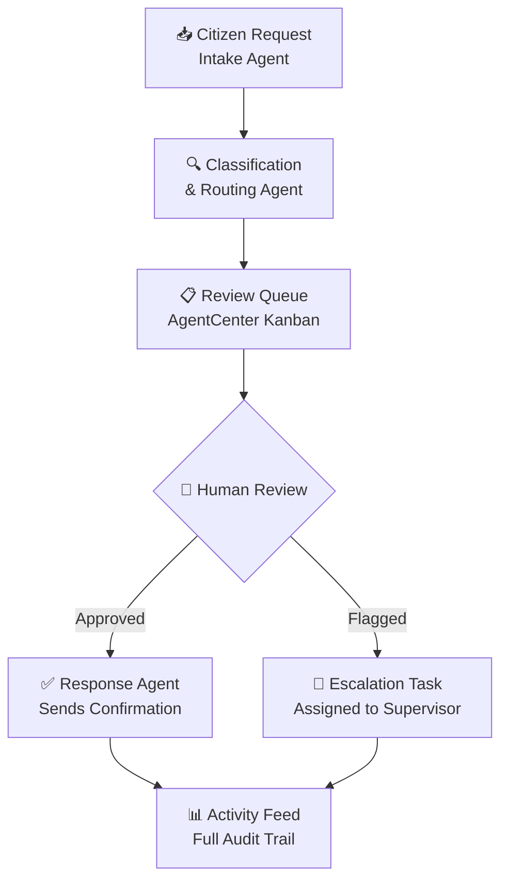

Government tech teams live under a constraint most developer teams never think about: every agent output has to be auditable. Not "we'll add logging later" auditable. Auditable right now, by someone who doesn't know what an LLM is, when they ask why a permit application was auto-approved at 3am.

That's a different operating environment than shipping a SaaS feature. And it breaks most assumptions about how AI agents are supposed to work.

## The Real Problem Government Tech Teams Hit

The agents themselves aren't the hard part. Processing permit applications, classifying FOIA requests, screening eligibility for benefits programs, routing complaints to the right department — these are tasks OpenClaw agents handle well.

The problem is what happens around the agents. Who signed off on this output? Which agent ran last night's batch? Why did 43 applications get flagged when yesterday only 12 were? Which program does this API cost belong to?

Without a control plane, none of those questions have fast answers.

### What breaks without it

**Handoffs fall through.** A document intake agent classifies an incoming request. A routing agent sends it to the right team. Then a human reviewer needs to verify the classification before the applicant gets a response. In most govtech stacks, this chain lives across email, a shared drive, and someone's Slack DMs. Things disappear. Deadlines get missed. The auditor asks for documentation and nobody has it.

**Cost reporting is a nightmare.** You're running 12 agents across three separate programs — a permit pilot, a records digitization project, and a compliance monitoring initiative. At the end of the quarter, the budget office wants a cost breakdown by program. You have one API invoice that doesn't say any of that. You spend a week reconstructing estimates from log timestamps.

**Errors surface too late.** An agent that processes overnight batches silently fails at 1:47am. Nobody notices until a supervisor shows up and the morning queue is empty. Now you're scrambling to rerun jobs, check what was partially processed, and figure out whether any citizen-facing records are in a bad state.

## How AgentCenter Changes the Operating Model

### Deliverable review and approval workflows

Every agent output lands in a structured review queue before it does anything. The human supervisor sees the classification, the reasoning, and the source document — all in one place. They approve or flag it. The record of that decision is stored automatically.

That's not a custom integration you build. It's how AgentCenter handles task deliverables by default. For govtech teams, this is the feature that makes agents actually deployable in high-stakes workflows.

### Task tracking across the full pipeline

An intake agent processes a FOIA request. A routing agent assigns it to the right department. A drafting agent prepares a response template. A reviewer approves it. A dispatch agent sends it.

Each of those steps is a tracked task on an [AgentCenter Kanban board](/features/task-orchestration). Every handoff has a timestamp. Nothing exists only in someone's inbox. When a legal team asks "what happened with request #4821," the answer is a two-minute board lookup, not a two-hour log reconstruction.

### Real-time agent monitoring with full activity feed

The [agent monitoring dashboard](/features/agent-monitoring) shows you which agents are running, which are idle, and which have errored. The activity feed records every task action with timestamps. When your overnight permit batch fails, you know in minutes, not at 9am when the backlog is visible.

This matters for compliance: many government programs have SLA requirements. If a complaint has to be routed within 24 hours, you need to know when an agent fails to route it, not the next day.

### Per-agent cost tracking

AgentCenter tracks costs per agent and per task. That means at the end of the quarter, you can pull cost data by agent, filter by the project it belongs to, and hand your budget office actual numbers — not reconstructed estimates.

For govtech teams running agents across multiple funded programs, this changes budget reporting from a guessing game to a straightforward export.

### Recurring task automation

Night-time batches, weekly compliance summaries, monthly records digests — these run automatically as [recurring tasks](/features/task-orchestration) on Pro and Scale plans. No cron job management. No "did it run?" Slack messages in the morning.

## The Numbers

A mid-sized govtech team typically runs 10-20 agents: document intake, classification, routing, drafting, eligibility screening, compliance checking, translation for multilingual services. That's a Pro plan ($29/mo, 15 agents) for smaller deployments, or Scale ($79/mo, 50 agents) for departments running multiple services in parallel.

What it replaces: shared spreadsheets tracking which batches ran, Slack threads for handoffs, manual API invoice parsing, and ad-hoc log queries when something goes wrong.

See [pricing details](/pricing) — there's a 7-day free trial on monthly plans.

## Before vs. After

| | Without AgentCenter | With AgentCenter |
|---|---|---|
| Visibility | Log files per agent; no cross-workflow view | Single dashboard: all agents, real-time status |
| Task handoffs | Email, shared drives, Slack DMs | Kanban board; every handoff tracked with timestamp |
| Error detection | Discovered next morning when queue is empty | Alert within minutes; shows exactly which run failed |
| Cost tracking | One API invoice with no program breakdown | Per-agent cost data, filterable by project |
| Debugging time | 2-4 hours reconstructing from logs | Under 10 minutes via activity feed |

## Where to Start

Set up **deliverable review queues** first, even before you automate the full pipeline.

Getting agent outputs into a structured queue instead of email attachments or a shared folder changes your team's workflow immediately. Reviewers know where to look. Every decision has a record. You can add more automation steps later, but the review structure is the foundation everything else depends on.

---

*Government tech teams that add a control plane early spend less time firefighting later. [Start your 7-day free trial](/pricing).*
