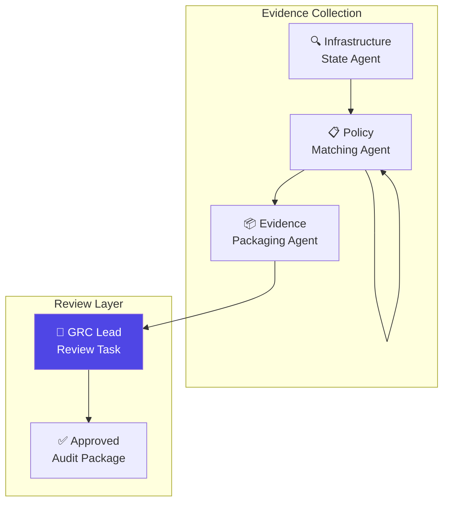

Running AI agents for compliance work sounds like a straightforward win. Set up a SOC 2 evidence collection agent, a GDPR data inventory agent, a vendor risk scoring agent. Let them run. Save your team 20 hours a week.

The problem shows up three months in, when your auditor asks: "Which system generated this evidence, and who reviewed it before it went into the audit package?" You say "an agent did it" and then scramble to explain why there's no task-level record, no approval workflow, no way to tell if the agent ran correctly last Tuesday.

That's the GRC control plane problem.

## What Breaks Without a Control Plane

GRC teams manage compliance across multiple frameworks simultaneously — SOC 2, ISO 27001, GDPR, vendor risk, internal audit. Running agents for each without a central control plane creates three specific failure modes.

**Silent pipeline failures.** A compliance pipeline typically looks like: infrastructure state agent → policy matching agent → evidence packaging agent → reviewer. If step one fails, step two runs on stale data, and step three packages evidence that reflects last month's infrastructure state. You don't catch it until the auditor does.

**No audit trail for agent decisions.** Agent-generated compliance evidence needs to be traceable. Who ran the check? When? What did the agent return? If an inconclusive result was flagged for human review, who made the exception decision? Without a task management layer, these answers live in someone's head or a Slack thread that got deleted after 90 days.

**Uncontrolled agent sprawl.** A team that started with 3 agents has 12 within a year — one for each framework, subframework, or quarterly requirement. Without visibility into all of them, you lose track of what's running, what's costing money, and which ones haven't been updated to reflect a policy change from six months ago.

## How AgentCenter Solves This for GRC Teams

**Kanban board for compliance pipelines.** Each control check becomes a task — visible, trackable, assignable. GRC teams can see which evidence collection runs are in progress, which are waiting for review, and which failed. A quarterly SOC 2 evidence run doesn't disappear into a black box. See how [task orchestration](/features/task-orchestration) works for multi-step agent workflows.

*Example:* Your GDPR data inventory agent finishes its run and deposits results in AgentCenter as a completed task. The privacy lead reviews the output directly in the task thread, leaves notes on any gaps, and marks it approved. That review is timestamped and attached to the task — it's your audit evidence that a human reviewed the agent's output before it went anywhere.

**Task threads as audit trails.** When an agent returns an inconclusive control result, the GRC lead can add a note explaining the exception decision. That thread becomes the documented justification an auditor would ask for.

*Example:* A vendor risk agent flags a third-party SaaS vendor with an outdated SOC 2 report. The GRC lead @mentions the vendor management contact in the task, requests an updated report, and documents the compensating control decision — all in the same place, all tied to the original agent output.

**Real-time agent status.** If your ISO 27001 mapping agent goes offline during a quarterly review cycle, you see it in the [agent monitoring dashboard](/features/agent-monitoring) immediately. Not when you go looking for results, and not when the auditor asks why a control is missing evidence.

**Per-agent cost tracking.** Evidence collection agents that parse lengthy vendor contracts or process large policy documents consume meaningful LLM tokens. AgentCenter shows cost per task so you know which agents are expensive before costs compound over a quarter.

**Recurring task automation.** Schedule SOC 2 continuous monitoring agents to run weekly, vendor risk scoring agents monthly, and GDPR data inventory agents quarterly. The schedule lives in AgentCenter, not in someone's calendar reminder or a cron job no one remembers setting up.

## The Numbers for GRC Teams

A typical GRC team with 2-4 compliance professionals and one framework to manage starts with 5-8 agents. Teams handling multiple frameworks simultaneously — SOC 2, ISO 27001, GDPR, vendor risk — typically run 10-15 agents.

The [Pro plan](/pricing) at $29/month fits most GRC teams: 15 agents, 15 projects, enough headroom to segment agents by framework. Teams managing compliance across multiple legal entities or business units benefit from Scale at $79/month.

What AgentCenter replaces: shared compliance tracking spreadsheets, Jira tickets used as makeshift audit evidence records, Slack threads where exception decisions get made and then lost 90 days later.

## Before vs After

| Area | Without AgentCenter | With AgentCenter |
|---|---|---|
| Visibility | Agents run, you check results manually | Real-time status for every compliance agent |
| Task handoffs | Email or Slack, no formal record | Task threads with timestamped approvals |
| Error detection | Silent failures caught at audit time | Blocked or failed agents surface immediately |
| Cost tracking | Monthly LLM bill, no per-agent breakdown | Cost tracked per task, per framework, per agent |
| Debugging time | Hours retracing what an agent did and when | Task history and logs available directly in AgentCenter |

## Where to Start

Set up recurring tasks for your SOC 2 evidence collection agent first. Schedule it weekly in AgentCenter, tag each task with the relevant control category — access control, encryption, incident response — and route completed tasks to the GRC lead's review queue before evidence goes into your audit package.

This single workflow gives you an audit-ready process in the first week, and a template for every other compliance agent you add after that.

---

*GRC teams that add a control plane early spend less time firefighting later. [Start your 7-day free trial](/pricing).*
