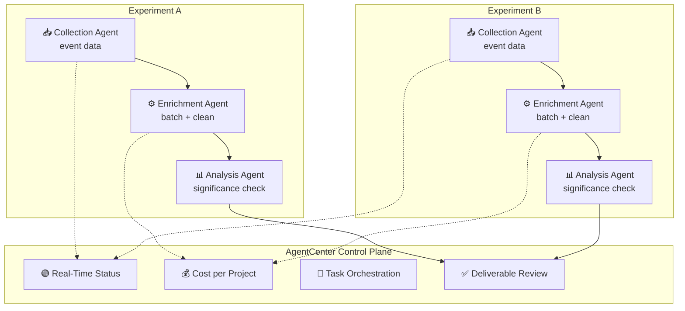

You have 3 experiments running at the same time. Each one has an agent collecting event data, another batching it into your warehouse, and an analysis agent that fires once the sample size hits your threshold. That's 9 agents for 3 experiments.

Now one data collection agent starts failing halfway through your test. Not crashing — just silently skipping rows. The analysis agent still runs when the sample count triggers. Your results look clean. You ship the variant. Three weeks later you realize the significance was built on corrupted data.

That's the real problem growth engineering teams hit when they scale AI agents across experiments. It's not complexity. It's invisibility.

## What Breaks When Growth Engineering Teams Scale AI Agents

Growth teams face a specific version of the multi-agent management problem. Your agents aren't running long tasks in isolation — they're running in coordinated pipelines tied to live experiments where bad data has real consequences.

Three things break first:

**Silent mid-pipeline failures.** A data collection agent can drop events without raising an error. If nothing is watching its output quality and status in real time, the downstream analysis agent runs on incomplete data. You don't find out until you're trying to explain why your 95% confidence lift evaporated post-ship.

**No cost attribution by experiment.** Most teams end up with a single model bill at the end of the month. The bill says $340 in API calls. But which experiment used what? Was the personalization pipeline for Campaign A three times more expensive than Campaign B? Without per-project cost tracking, you're making budget decisions blind.

**Handoff gaps between pipeline stages.** Collection completes. Enrichment starts. Analysis fires. When those stages pass data between agents without a coordination layer, there's no record of what was handed off or whether the receiving agent confirmed receipt. If enrichment takes longer than expected or stalls on a large batch, analysis may fire anyway — on stale or partial input.

## How AgentCenter Solves These Problems

**Real-time agent status.** AgentCenter shows you which agents are online, working, idle, or blocked — right now, not after the fact. When your collection agent for Experiment A goes idle mid-test, you see it on the [agent monitoring dashboard](/features/agent-monitoring) before the analysis agent fires. You catch the failure while there's still time to act, not after you've shipped.

**Task orchestration with explicit handoffs.** The [task orchestration layer](/features/task-orchestration) treats each pipeline stage as a linked task. Collection must complete and submit a deliverable before enrichment picks up. Enrichment submits its output before analysis runs. If any stage stalls, the chain stops and surfaces the block. You're no longer relying on timing assumptions between independent agents.

**Per-project cost tracking.** Each experiment lives in its own project in AgentCenter. Every agent run, every token consumed, every API call is attributed to that project. When you run your monthly review, you can see that Experiment C's personalization pipeline cost 4x what Experiment A's did — and trace why.

**@Mentions and activity threads.** When an analysis agent completes a significance check, it posts results directly to the experiment task thread. Your team sees it in the activity feed. No digging through logs or Slack messages to find out where the test landed.

## The Numbers

A mid-sized growth engineering team typically runs between 10 and 25 agents at any point across 4–8 active experiments. That fits cleanly in the [Pro plan at $29/mo](/pricing), which covers 15 agents and 15 projects. Teams running larger experiment portfolios or seasonal traffic spikes move to Scale ($79/mo) for 50 agents.

What AgentCenter replaces: a combination of cron jobs, Slack pings, manual log review, and spreadsheet cost tracking that doesn't scale past 3 simultaneous experiments.

## Before vs After

| | Without AgentCenter | With AgentCenter |
|---|---|---|
| **Visibility** | Logs after the fact | Real-time status per agent per experiment |
| **Task handoffs** | Timing-based assumptions | Explicit orchestrated chains |
| **Error detection** | After bad data surfaces | Within minutes of agent failure |
| **Cost tracking** | Total model bill only | Per-experiment attribution |
| **Debugging time** | 2–4 hours tracing logs | 15–20 minutes with audit trail |

## Where to Start

Set up one project per active experiment in the AgentCenter Kanban board before you connect any agents. Drop your collection, enrichment, and analysis agents into a task chain inside that project. Once you see all three stages on a single board with live status, you'll understand immediately which experiments are healthy and which have a stalled agent.

That first board view — three experiments, nine agents, real-time status — is what makes the investment obvious.

---

*Growth engineering teams that add a control plane early spend less time firefighting later. [Start your 7-day free trial](/pricing).*
