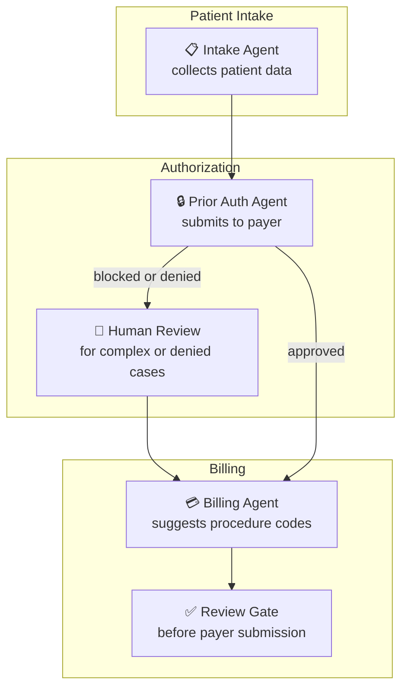

Healthcare admin teams were among the first to discover what happens when you run ten AI agents and have no idea which one is holding up a prior authorization.

You built the intake agent. Then the prior auth agent. Then a billing code suggestion agent. Each one works fine on its own. But when a patient record moves from intake to auth to billing, you don't see the handoffs. You see the end result — approved or rejected — and hope nothing fell through the gap.

That's the problem. Not the agents. The space between them.

## What Breaks for Healthcare Admin Teams Without a Control Plane

Healthcare admin agents don't just process data. They touch real workflows with real consequences: delayed authorizations, incorrect billing codes, missed follow-ups. When those agents run without visibility, three things go wrong fast.

**1. You can't tell when a prior auth agent is blocked.**
Auth agents depend on upstream data: insurance payer IDs, diagnosis codes, supporting documentation. If the intake agent passes an incomplete record, the auth agent stalls. Without real-time status monitoring, you find out three days later when a patient calls asking why their procedure hasn't been approved.

**2. Task handoffs between agents leave no record.**
If the records summarization agent feeds context to the billing agent, and that summary has the wrong procedure code, you have a billing error. Without a shared task thread connecting both agents, tracing the error means reading logs manually across two systems — often with no clear timestamp matching them up.

**3. You have no idea what prior auth processing is costing.**
Each failed auth attempt still burns API calls. If your agent retries a denial five times before escalating to a human, you're paying for five API calls on a task that needed human judgment from the start. Without per-agent cost tracking, that waste accumulates invisibly.

## How AgentCenter Fits the Healthcare Admin Workflow

### Real-time agent status

AgentCenter shows every agent's current state: online, working, idle, or blocked. For a healthcare admin team, this means you see immediately when the prior auth agent hits a blocked state. You don't wait for the agent to timeout or a staff member to notice the queue isn't moving. You catch it early and send the case to a human before a deadline passes.

### Kanban board for case tracking

Every patient intake, prior auth request, and billing submission becomes a task on a shared [Kanban board](/features/task-orchestration). You can see exactly which stage each case is in and which agent is handling it. When a task stalls, it's visible to everyone on the team.

### @Mentions for human escalation

When a prior auth case needs a human, the agent can flag it directly in the task thread. A reviewer gets notified, sees all previous agent outputs in context, and approves or redirects the case. No separate Slack channel. No copy-pasting records between systems.

### Deliverable review workflows

Before a billing code suggestion reaches the payer system, it can sit in a review gate. A coder sees the suggested codes, the supporting documentation, and the agent's reasoning. They approve or flag it. This is where you catch errors before they become denials or audits.

### Per-agent cost tracking

AgentCenter tracks API spend by agent. If the prior auth agent makes 40 API calls per case while the billing agent averages 6, you see that immediately. You can investigate whether the auth agent retries too aggressively, and fix the logic before costs compound. See the full picture in [agent monitoring](/features/agent-monitoring).

## The Numbers for Healthcare Admin Teams

A typical healthcare admin automation setup runs 8 to 18 agents: intake processing, prior auth (often split by payer type), billing code suggestion, records summarization, appointment reminders, compliance documentation, and denial management.

The [Pro plan](/pricing) fits most teams at that size — 15 agents at $29/month. For larger practices running 20 or more agents across multiple departments or locations, the Scale plan ($79/month) covers up to 50 agents.

What it replaces: manual monitoring scripts checking agent logs, shared spreadsheets tracking auth status, Slack channels used as makeshift task queues, and the person whose unofficial job was "check on the agents every morning."

## Without AgentCenter vs With AgentCenter

| | Without AgentCenter | With AgentCenter |
|---|---|---|
| **Visibility** | No live status — you find out when something fails | Real-time status per agent, visible to the whole team |
| **Task handoffs** | No shared record between agents | Full task thread with every agent output linked |
| **Error detection** | Caught after submission or denial | Caught at review gate before submission |
| **Cost tracking** | Total bill at end of month | Per-agent spend updated in real time |
| **Debugging time** | 30 to 60 minutes reading cross-system logs | 5 minutes tracing the task thread |

## Where to Start

Set up the Kanban board first. Map your existing agent pipeline to task stages: Intake, Auth Pending, Auth Approved, Coding, Ready to Submit, Submitted. Assign each agent to a stage. That one step gives your whole team a live view of where every case stands, without changing any of your existing agent code.

Once the board is running, add a deliverable review gate on the billing agent output. That's where the highest-cost errors happen, and it's the safest place to add a human check without disrupting the rest of the pipeline.

---

*Healthcare admin teams that add a control plane early spend less time firefighting later. [Start your 7-day free trial](/pricing).*
